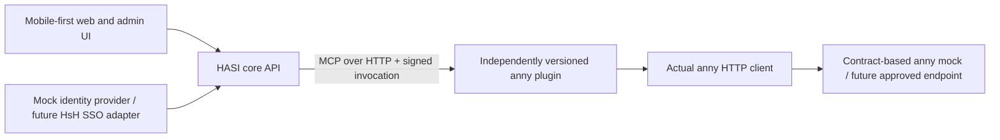

# Independent plugins and the server-backed demo

Date: 2026-10-16. Updated: 2026-10-18. This design replaces the earlier suggestion to start with
in-process integration packages. Independently deployed and updated plugins
are now an explicit requirement. All first-party application code is TypeScript.

## Boundaries

The local prototype has separate processes for the core, anny plugin, anny
mock and Next.js UI. It does not load third-party executable packages into the
core process. The core API depends on the SDK and wire contract, not the anny
plugin implementation. The development launcher wires the included example
deployment; it is not a plugin marketplace or production installer.

The Vercel demo co-locates Node.js API and MCP entry points in one deployment
while preserving the same HTTP path: core API, signed MCP, anny plugin,
AnnyClient and synthetic anny service. It stores demo sessions, proposals,
plugin registry state, replay claims and synthetic bookings in Neon Postgres.
Sessions, proposals, registry state and bookings are workspace-scoped; the
browser's chat history remains in local storage.

`pnpm dev` remains the separate-process, in-memory reference mode.
Workspace cookies expire after seven days; a later visit receives a new
workspace with synthetic defaults.

## Mock identity

Three synthetic personas model student, employee and administrator access.
In local mode, the server resolves an opaque HttpOnly session cookie to an
internal actor, resource grants and anny customer mapping. In the Vercel demo,
`DurableDemoIdentity` stores sessions by token hash and resolves them within a
server-issued, HMAC-signed workspace cookie. Each visitor has isolated
synthetic state, and all fixture personas are intentionally selectable there.
Administrator access affects only that visitor's demo workspace. These fixtures
make no claim about real HsH roles, institutional identity or SSO attributes.
Institutional deployments must use verified identity and permission mappings,
not the demo identity provider.

The local `MockIdentityProvider` is available only in explicit development or
test mode, bound to loopback, with same-origin checks on mutations. The public
demo has a separate server-backed fixture identity with a public persona
selector. Neither mode simulates SAML/OIDC redirects or proves that a future
real SSO deployment is correct.

## Plugin contract

The SDK uses the official MCP TypeScript v2 SDK and MCP revision 2026-07-28 over
Streamable HTTP. A HASI manifest supplements MCP with identity, plugin SemVer,
HASI API version, tool JSON Schemas, effect classification and required grants.
MCP annotations and plugin declarations are not a security sandbox.

Every invocation carries a short-lived EdDSA-signed actor capability bound to
plugin ID/version, tool name and canonical arguments. The service authenticates
the core separately. The plugin verifies the signature, subject, audience,
expiry, arguments and permissions. An execution token is single-use. Provider
credentials live only in the integration process, not in model arguments.

Model-facing tool routing supports reads and proposal preparation. Executing a
write requires a separately authenticated confirmation endpoint, a server-held
proposal bound to the actor, exact arguments, expiry and plugin version, and
fresh permission/availability checks. Confirmation cannot replace arguments.
Tool results and preview strings remain untrusted content. The generic tool
route also supports additional installed plugins without adding anny code to
the dispatcher; domain-specific UI routes are conveniences over that route.

Installation requires an operator-configured endpoint and an explicitly
approved manifest digest. The core validates inputs and outputs against that
approved contract. Runtime update checks compare the fetched release with the
approved contract. Compatible updates can be activated without a core rebuild;
changed schemas, effect classifications or permissions require renewed
approval. Pending proposals bound to a different plugin version expire for
execution. A version mismatch during connection denies the call.

Plugin endpoints currently come exclusively from trusted operator startup
configuration. Before adding dynamic installation, enforce an explicit network
destination policy, including resolved addresses and DNS rebinding protection.
Campus-internal destinations may be legitimate but must be explicitly allowed;
HTTPS alone does not establish an authorized destination.

Production distribution should use independently versioned packages/container
artifacts with publisher provenance, pinned digests, preflight compatibility
checks, staged activation and an available previous artifact for rollback.
The Vercel demo persists approved registry state and proposals in workspace-
scoped Postgres; local `pnpm dev` keeps registry and proposal state in memory.
Artifact delivery/signature verification, multi-instance rollout and database
migrations remain production work.

Third-party code still needs a publisher/review policy and OS/container,
filesystem, credential, network and resource isolation. A process boundary
alone does not prevent malicious code from reading local files or abusing
credentials assigned to that process. A plugin with a powerful downstream
token can exceed its declared effects; use least-privilege credentials and
enforced egress policies. Only the included reviewed plugin runs locally.
The prototype actor includes one fixture customer mapping and room grants.
Before enabling another integration, resolve and minimize those account/resource
claims per plugin; an anny customer ID is not a universal institutional account
identifier. Namespace real upstream subjects by verified issuer.

## External installation and administrator configuration

The agreed target includes plugins from external repositories, independent
updates and configuration through the HASI administrator interface. A plugin
is an installed integration that may expose several MCP tools. Package/version
management and instance configuration belong to the plugin; permission and
model-exposure decisions also apply to each individual tool and user context.

The measured baseline at main `526241a` provides a generic registry/invoker,
signed MCP contracts and per-plugin enable/update controls for endpoints
registered by the operator at startup. An update activates a compatible version
already served by that endpoint; it does not download or install a release
artifact. Vercel co-locates the included plugins; only the local launcher starts
separate processes. Neither mode supplies third-party sandboxing.

The current manifest has no general configuration schema or secret-field
declarations, and the admin has no install/configuration form or per-tool
enablement control. The model-facing tool schemas, name allowlist and chat
wire protocol still enumerate anny and knowledge tools. The generic registry's
`/api/tools` and `/api/tools/call` alone do not expose an arbitrary installed
plugin to the LLM. `ActorContext` still requires an anny customer/resource shape.
These are explicit production gaps, not a claim of complete plugin installability.

The production contract must provide:

- **Reviewed installation sources and artifacts.** Admit operator-approved
  external repository/release sources and immutable reviewed artifacts, with
  publisher provenance, compatibility checks and explicit initial trust. Connecting
  a remote MCP endpoint and deploying executable plugin code are separate modes.
  A repository URL is not permission to execute its build/install scripts in the
  HASI host. Plain MCP servers need a reviewed HASI adapter/manifest where they
  do not implement the host's authorization and effect contract.
- **Versioned declarative configuration.** Plugins declare a bounded schema,
  logical secret requirements and configuration/migration compatibility. The
  server binds approved secret-store references; neither a manifest nor a model
  chooses arbitrary secret references. Separate package identity/version from
  installation/instance configuration and upstream tenant/account bindings.
- **Generic administrator lifecycle.** Authorized institutional administrators
  install/connect, inspect capabilities and permissions, configure schema-derived
  forms, validate/save settings, check readiness, activate updates, roll back and
  disable/remove installations. Validate every change server-side and record its
  operator/configuration revision. Stored secret values are never read back to
  the browser, logs or model. Demo personas retain workspace-only authority.
- **Registry-driven chat integration.** Derive eligible model tools from reviewed
  installed manifests under server-owned user/turn policy, with collision-safe
  names, validated inputs/outputs and a generic proposal/confirmation contract.
  New approved tools must not require anny-specific host enums or customer claims.
  Untrusted schemas/results cannot widen permissions, origins or execution rights.
  Plugin settings and per-tool policy are distinct from a plugin's own downstream
  authorization checks.
- **Safe update and execution boundaries.** Qualify artifact delivery, signatures,
  configuration/state migrations, staged activation, rollback and multi-instance
  consistency. Reapprove expanded schemas/effects/permissions and invalidate
  incompatible pending actions. Enforce per-plugin credential, filesystem,
  network/DNS/redirect and resource boundaries; a process or MCP connection alone
  is insufficient. Keep a validated previous artifact/configuration available.

Tracking: [external plugin installation/admin configuration #65](https://github.com/metaneutrons/HASI/issues/65),
under [M2 #49](https://github.com/metaneutrons/HASI/issues/49).

These requirements extend the existing production boundary without replacing
the working registry/SDK. They require an implementation and qualification plan
before enabling external executable code. Current execution state belongs in
the linked M2 implementation issue, not in a parallel acceptance checklist here.

## anny contract fidelity

The mock replaces the remote HTTP service, not the plugin or HTTP client.
The client uses pinned official anny paths, organization query context,
authentication, JSON:API relationships, availability and order creation.
Synthetic resource presentation data is configured separately: anny's
`quantity` describes parallel slots and is not interpreted as room seating.

Live writes remain opt-in. The local launcher enables writes only against its
loopback mock. It cannot send bookings or notifications to the real anny
service. Admin customer context is not treated as a customer access token;
the plugin uses backend-derived customer and resource grants. The real source
of those rights remains an integration prerequisite.

The public schemas do not settle all semantics. Customer-booking responses
and order creation must be checked against the actual tenant before live use.
Owned future-booking cancellation is exposed through prepare/confirm tools. The
current Admin guide documents its request but no response schema; HASI verifies
the result through a subsequent customer-scoped booking read. The mock is
contract-tested; tenant-specific rules and live cancellation remain unqualified.
`DELETE` is not substituted. See [cancellation](anny-cancellation.md). No automatic write
retry occurs after a timeout or unknown outcome.

## Interface requirements

The user and admin UI share one design system: system typography, restrained
translucency, clear focus/contrast, and light/dark palettes. Theme selection is
Light, Dark or System and persists locally. Both surfaces are designed from
phone width upward, with touch-sized controls, wrapping cards, safe-area
spacing and reduced-motion support. Administrative operations remain protected
by backend permissions regardless of navigation visibility.

## Qualification criteria

- **P1:** Local mock sessions and public-demo fixture sessions resolve
  server-owned identities; forged/missing sessions, foreign workspaces,
  wrong-origin mutations and institutional production use of demo identity are
  rejected.
- **P2:** A valid signed invocation succeeds; forged, expired, mismatched or
  replayed execution capabilities fail before the handler.
- **P3:** The same anny client performs real HTTP against the contract mock;
  schema-invalid/auth-invalid requests fail and writes are never blindly retried.
- **P4:** Cross-user confirmation and changed arguments fail; repeated exact
  confirmations cannot create duplicate mock bookings.
- **P5:** A compatible plugin update changes the active plugin independently of
  the host and persists across server instances, while expanded
  permissions/incompatible contracts are blocked.
- **P6:** User/admin views work at 375 px and desktop width in light and dark
  modes without horizontal page overflow. Native phone/keyboard testing remains
  required before mobile production acceptance.

## Official references

- [MCP TypeScript SDK v2](https://ts.sdk.modelcontextprotocol.io/v2/)
- [MCP Fastify integration](https://ts.sdk.modelcontextprotocol.io/v2/serving/fastify.html)
- [MCP Streamable HTTP revision](https://modelcontextprotocol.io/specification/2026-07-28/basic/transports/streamable-http)
- [Pinned anny API research and sources](../research/anny-api.md)
