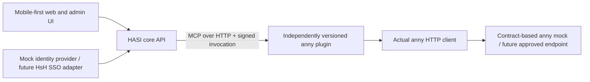

# Independent plugins and the local prototype

Date: 2026-10-16. This design replaces the earlier suggestion to start with
in-process integration packages. Independently deployed and updated plugins
are now an explicit requirement. All first-party application code is TypeScript.

## Boundaries

The local prototype has separate processes for the core, anny plugin, anny
mock and Next.js UI. It does not load third-party executable packages into the
core process. The core API depends on the SDK and wire contract, not the anny
plugin implementation. The development launcher wires the included example
deployment; it is not a plugin marketplace or production installer.

## Mock identity

Three synthetic personas model student, employee and administrator access.
The server resolves an opaque HttpOnly session cookie to an internal actor,
resource grants and anny customer mapping. Browser requests cannot supply a
customer ID or actor grants. These fixtures make no claim about real HsH roles
or released SSO attributes. The identity adapter may later consume verified
institutional claims while preserving the internal actor contract.

Mock login is available only in explicit development/test mode, bound to
loopback, with same-origin checks on mutations. Production startup must fail
with mock identity enabled. This does not simulate SAML/OIDC redirects or prove
that a future real SSO deployment is correct.

## Plugin contract

The SDK uses the official MCP TypeScript v2 SDK and MCP revision 2026-07-28 over
Streamable HTTP. A HASI manifest supplements MCP with identity, plugin SemVer,
HASI API version, tool JSON Schemas, effect classification and required grants.
MCP annotations and plugin declarations are not a security sandbox.

Every invocation carries a short-lived EdDSA-signed actor capability bound to
plugin ID/version, tool name and canonical arguments. The service authenticates
the core separately. The plugin verifies the signature, subject, audience,
expiry, arguments and permissions. An execution token is single-use. Provider
credentials live only in the integration process, not in model arguments.

Model-facing tool routing supports reads and proposal preparation. Executing a
write requires a separately authenticated confirmation endpoint, a server-held
proposal bound to the actor, exact arguments, expiry and plugin version, and
fresh permission/availability checks. Confirmation cannot replace arguments.
Tool results and preview strings remain untrusted content. The generic tool
route also supports additional installed plugins without adding anny code to
the dispatcher; domain-specific UI routes are conveniences over that route.

Installation requires an operator-configured endpoint and an explicitly
approved manifest digest. The core validates inputs and outputs against that
approved contract. Runtime update checks compare the fetched release with the
approved contract. Compatible updates can be activated without a core rebuild;
changed schemas, effect classifications or permissions require renewed
approval. Pending proposals bound to a different plugin version expire for
execution. A version mismatch during connection denies the call.

Plugin endpoints currently come exclusively from trusted operator startup
configuration. Before adding dynamic installation, enforce an explicit network
destination policy, including resolved addresses and DNS rebinding protection.
Campus-internal destinations may be legitimate but must be explicitly allowed;
HTTPS alone does not establish an authorized destination.

Production distribution should use independently versioned packages/container
artifacts with publisher provenance, pinned digests, preflight compatibility
checks, staged activation and an available previous artifact for rollback.
Persistent installation state, artifact delivery/signature verification,
multi-instance rollout and database migrations are separate implementation
work; the local registry and proposals currently live in memory.

Third-party code still needs a publisher/review policy and OS/container,
filesystem, credential, network and resource isolation. A process boundary
alone does not prevent malicious code from reading local files or abusing
credentials assigned to that process. A plugin with a powerful downstream
token can exceed its declared effects; use least-privilege credentials and
enforced egress policies. Only the included reviewed plugin runs locally.
The prototype actor includes one fixture customer mapping and room grants.
Before enabling another integration, resolve and minimize those account/resource
claims per plugin; an anny customer ID is not a universal institutional account
identifier. Namespace real upstream subjects by verified issuer.

## anny contract fidelity

The mock replaces the remote HTTP service, not the plugin or HTTP client.
The client uses pinned official anny paths, organization query context,
authentication, JSON:API relationships, availability and order creation.
Synthetic resource presentation data is configured separately: anny's
`quantity` describes parallel slots and is not interpreted as room seating.

Live writes remain opt-in. The local launcher enables writes only against its
loopback mock. It cannot send bookings or notifications to the real anny
service. Admin customer context is not treated as a customer access token;
the plugin uses backend-derived customer and resource grants. The real source
of those rights remains an integration prerequisite.

The public schemas do not settle all semantics. Customer-booking responses
and order creation must be checked against the actual tenant before live use.
Cancellation is not exposed until the documented Admin cancellation route's
contract has been verified; `DELETE` is not substituted. No automatic write
retry occurs after a timeout or unknown outcome.

## Interface requirements

The user and admin UI share one design system: system typography, restrained
translucency, clear focus/contrast, and light/dark palettes. Theme selection is
Light, Dark or System and persists locally. Both surfaces are designed from
phone width upward, with touch-sized controls, wrapping cards, safe-area
spacing and reduced-motion support. Administrative operations remain protected
by backend permissions regardless of navigation visibility.

## Qualification criteria

- **P1:** Mock sessions resolve server-owned identities; forged/missing sessions,
  wrong-origin mutations and production mock startup are rejected.
- **P2:** A valid signed invocation succeeds; forged, expired, mismatched or
  replayed execution capabilities fail before the handler.
- **P3:** The same anny client performs real HTTP against the contract mock;
  schema-invalid/auth-invalid requests fail and writes are never blindly retried.
- **P4:** Cross-user confirmation and changed arguments fail; repeated exact
  confirmations cannot create duplicate mock bookings.
- **P5:** A compatible plugin update changes the active plugin independently of
  the host, while expanded permissions/incompatible contracts are blocked.
- **P6:** User/admin views work at 375 px and desktop width in light and dark
  modes without horizontal page overflow. Native phone/keyboard testing remains
  required before mobile production acceptance.

## Official references

- [MCP TypeScript SDK v2](https://ts.sdk.modelcontextprotocol.io/v2/)
- [MCP Fastify integration](https://ts.sdk.modelcontextprotocol.io/v2/serving/fastify.html)
- [MCP Streamable HTTP revision](https://modelcontextprotocol.io/specification/2026-07-28/basic/transports/streamable-http)
- [Pinned anny API research and sources](../research/anny-api.md)
