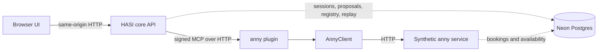

# Server-backed public demo on Vercel

Date: 2026-10-16. Repository: `metaneutrons/HASI`, public, GPL-3.0-only.
Configured demonstration domain: `hasi.metaneutrons.cc`.

The server-backed demo runtime is implemented in this branch, but no completed
Preview or Production deployment qualification is recorded yet. The domain and
configuration below describe the intended deployment contract; they do not
confirm live behavior.

## Runtime and data boundaries

`pnpm dev` remains the local reference stack: Next.js UI, core API, signed MCP
plugin and synthetic anny HTTP service run as separate processes. Their state is
in memory and resets when they restart.

The Vercel demo uses the same core API, signed MCP invocation, anny plugin,
AnnyClient and synthetic HTTP service. Vercel co-locates the Node.js entry
points in one deployment. Same-origin HTTP requests cross the core API,
Streamable HTTP MCP endpoint and synthetic anny API in both modes.

The demo runtime stores sessions, proposals, registry settings, invocation
replay claims and synthetic anny state in Neon Postgres. Sessions, proposals,
registry settings and synthetic service state are scoped to a server-issued
browser workspace; replay claims use single-use invocation IDs. The workspace
cookie contains a random ID, expiry and server HMAC; it is `HttpOnly`,
`SameSite=Strict`, and `Secure` on HTTPS. Visitors cannot select or submit
another workspace ID through the UI.

Records survive server restarts within their retention period. The store uses a
seven-day default lifetime; sessions, proposals and replay claims have shorter
explicit expiry where configured. The workspace cookie lasts seven days from
issuance. After it expires, the next request receives a new workspace with
synthetic defaults; old workspace data remains isolated and expires according
to its record lifetime.

The student, employee and administrator personas are public selectable test
fixtures inside each visitor's workspace. All three share that workspace's
synthetic calendar. Selecting the administrator persona permits administration
of that workspace's demo integration. Fixture roles and permissions establish
no institutional identity or authority.

Chat transcripts, drafts and profile preferences remain in the browser's
versioned local storage. Each test persona has up to 20 saved chats, separate
model context and tool state; a chat can display earlier synthetic results.
Server APIs remain authoritative for sessions, proposals, plugin state and
bookings. Browser chat history is not authenticated institutional evidence and
is not copied to Postgres.

The UI is built with `NEXT_PUBLIC_HASI_PUBLIC_DEMO=1`. Server handlers require
`HASI_DEMO_MODE=1`, `DATABASE_URL` and a dedicated `HASI_DEMO_SECRET`. Groq,
GWDG SAIA or an explicitly configured custom profile may run through the
server-side `/api/chat` route with its own credential; no credential is sent to
the browser or plugin. An explicit offline profile retains the bounded German
dialogue parser. Provider failures do not trigger a silent fallback.
IT/intranet retrieval and institutional citations remain unavailable.

Real SSO, institutional permissions, anny tenant and customer linking, full
anny API coverage, third-party artifact isolation, cancellation and booking
reconciliation remain open work. The synthetic demo provides no connection to
HsH identity, anny tenant data or institutional knowledge services.

## Chat and request limits

The chat server validates the complete wire message/tool sequence and executes
one inference step. The browser performs at most four steps per user turn and
stops when host-rendered availability, proposal or booking cards supply the
next action. Only typed anny read and proposal-preparation tools are model
facing. A host-owned confirmation card performs the separately authorized
booking execution. Prepared intervals must match a previously observed
available interval.

The default profile is Groq GPT-OSS 120B. GPT-OSS 20B and Qwen3.8 27B are also
available; Qwen is labelled Preview and uses non-thinking mode, while GPT-OSS
uses low reasoning effort. Each assistant response records the resolved
profile. Messages and bounded tool results are sent to the selected model
provider, as stated in the UI.

The chat handler allows a maximum 30-second invocation, a shared 20-second
generation deadline, 1,536 output tokens per generation, a 60,000-byte request
body, 30,000 message-content characters and four validated tool calls per
inference step. Native HTTP 400 `tool_use_failed` permits one regeneration with
the same selected profile, lower temperature and a fixed schema reminder.
Failed generated content is discarded. Other errors, including
transport/auth/quota failures, have no automatic retry, and business actions
are never retried. One admitted HTTP request can make at most two provider
calls within the same deadline. Failed generations may count toward provider
usage; this is not monetary accounting.

The chat route uses Vercel Firewall rule `hasi-chat`, configured for 60
inference requests per 600-second fixed window. It uses a server-owned shared
rate-limit key and pins the WAF callback host to `hasi.metaneutrons.cc`.
Preview's WAF check uses that public project callback. It does not use the
Vercel automation bypass credential. Missing or failed limiter checks fail
closed before inference. Local execution has no distributed WAF. The counter
is regional, not an atomic worldwide token or currency budget. Input, output
and request caps bound prototype throughput; provider quotas remain separate.
Durable per-user/day accounting and a hard monetary ceiling remain necessary
before an institutional pilot.

Diagnostics log only host-owned failure categories, HTTP status, allowlisted
provider codes, known tool names and schema issue codes or field names. They do
not log provider error payloads, argument values, messages, headers, prompts or
credentials. Interrupted generations receive a neutral history entry before
the next user message. Completed tool results remain visible; no action resumes
automatically.

## Vercel configuration

- Vercel project `hasi`, team `metaneutrons`, root directory `apps/web`.
- Node.js 24.x, `fra1`, and version-pinned pnpm 12.11.2 install/build commands
  are declared in `apps/web/vercel.json`. The project function default must
  also be `fra1`; CLI deployments from the repository root use that setting
  unless passed `--regions fra1`. Check deployment metadata after publication.
- Set `NEXT_PUBLIC_HASI_PUBLIC_DEMO=1` for both Preview and Production builds.
  Changing this public flag requires a rebuild.
- Set `HASI_DEMO_MODE=1`, `DATABASE_URL` and a separately provisioned
  `HASI_DEMO_SECRET` for both Preview and Production. The secret must encode 32
  random bytes as 43 base64url characters. Keep it server-side.
- Set each enabled provider credential as a server-side Vercel Secret in the
  required environments. GWDG uses `GWDG_API_KEY`. A custom provider also needs
  server-only `CUSTOM_ENDPOINT` and `CUSTOM_MODEL_ID`. `GET /api/chat` reports
  configuration presence and approved profiles; a successful inference is a
  separate runtime check.
- Production self-requests use the pinned origin `https://hasi.metaneutrons.cc`
  and the `production:v1` database namespace. Preview uses its Vercel deployment
  URL as origin and a `preview:<commit SHA>` namespace, with the deployment URL
  as a fallback when a commit SHA is unavailable.
- When Preview deployment protection requires a server self-request bypass,
  `VERCEL_AUTOMATION_BYPASS_SECRET` is added by the internal, origin-pinned
  core-to-MCP-to-mock HTTP transport only. It cannot be set by a caller, and it
  is not used for the WAF callback. Production does not use this Preview bypass.
- App API and MCP routes use Node.js runtime functions with a 60-second maximum;
  `/api/chat` uses a 30-second maximum.
- Local Vercel metadata, environment files and private research are ignored by
  Git. `.vercelignore` excludes research/documents and test/build artifacts from
  CLI deployment uploads.
- The DNS record is a DNS-only CNAME to the Vercel project target. Preserve
  other zone records. Vercel manages TLS.
- The site advertises `noindex` and disallows crawlers because its campus
  information and bookings are synthetic.

For local server-backed demo mode, configure `NEXT_PUBLIC_HASI_PUBLIC_DEMO=1`,
`HASI_DEMO_MODE=1`, `HASI_DEMO_ORIGIN=http://127.0.0.1:3001`, `DATABASE_URL` and
`HASI_DEMO_SECRET` in `apps/web/.env.local`, then run
`pnpm --filter @hasi/web dev`. This runs the co-located server runtime against a
local PostgreSQL database. It is separate from `pnpm dev`, which continues to
start the multi-process in-memory reference stack.

The [server-demo parity criteria](../plans/server-demo-parity.md) are supported
by the dated verification report. Institutional rollout remains separate work.

Rollback promotes a previously verified deployment. Keep the synthetic store
and namespace intact; never import browser-supplied booking state. A rollback
to the former browser simulator cannot display the new server-held bookings.
No real institutional data or external business action needs migration.

The knowledge MCP and imported room catalog add an intentional anny 0.1.0 → 0.2.0 contract migration. See [knowledge MCP](knowledge-mcp.md) for the verified old-pin migration and the rollback requirement; an alias-only rollback to a deployment using the old pin cannot read migrated workspace registry state.
