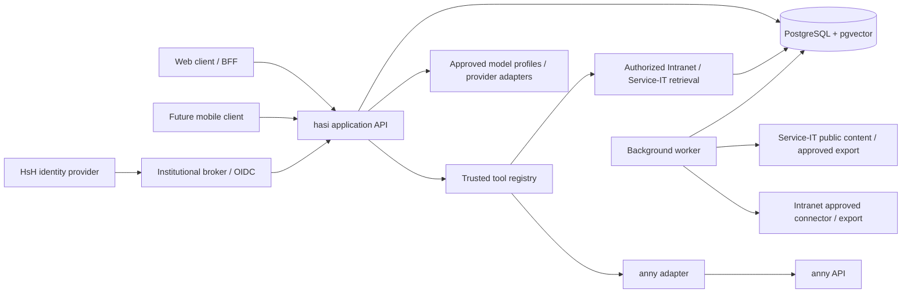

# Proposed technical basis for hasi

Created: 2026-10-09. Updated: 2026-10-16. Status: architecture with an initial
local prototype under development; no institutional production provisioning has been
performed. The agreed MVP covers permission-aware
knowledge search with citations across intranet.hs-hannover.de and
service.it.hs-hannover.de, plus anny room booking. Microsoft 365 Bookings is
deferred.

## Recommendation

Use a modular TypeScript core API, a separate web frontend and independently
versioned integration plugin services. A later background worker can use shared
contracts. Separate processes are deliberate at the plugin trust and release
boundary; other core capabilities can remain modules of the same application.

TypeScript is the agreed language for all production application components:
frontend, API, plugins and background workers. The pilot primarily coordinates
HTTP integrations, database operations and model calls. Shared runtime schemas
and generated API contracts reduce interface drift across web, API and plugins;
TypeScript types alone do not validate untrusted inputs. Production ingestion
and model-client code follow the same TypeScript stack. Existing Python scripts
are local research utilities and introduce no production runtime dependency.

| Concern | Proposed choice | Reason |
| --- | --- | --- |
| Language and runtime | TypeScript, supported Node.js LTS, pnpm workspace | Shared contracts between UI, API, integrations and worker |
| Web client | React with Next.js; Tailwind CSS and accessible UI primitives; mobile-first responsive design | Conversational UI, routing, structured result cards and browser session integration |
| Application API | Fastify, JSON Schema contracts and OpenAPI | Explicit, validated interfaces shared by web and future mobile clients |
| Data | PostgreSQL | Identities, mappings, conversations, action proposals, audit events and ingestion state |
| Retrieval | PostgreSQL full-text search plus pgvector | Exact IT terminology and semantic matching in one permission-aware data store |
| Background jobs | PostgreSQL-backed queue, initially pg-boss | Content refresh, embeddings and reconciliation without another mandatory data service |
| Model integration | AI SDK Core behind a hasi-owned provider interface and approved model-profile registry | Switchable providers/models for reproducible tests; capability and data-policy checks independent of the selected model |
| Authentication | OIDC-facing application interface; existing institutional broker preferred; Keycloak if an additional SAML-to-OIDC broker is required | Keep app-specific auth code small and support later native clients |
| Deployment | Container images on the institution's supported platform | Reproducible operation with clear ownership of database, backups and credentials |
| Verification | Focused backend/integration tests and browser flow tests, e.g. Vitest and Playwright | Verify identities, permissions, action integrity, retrieval and actual UI behavior |

Initial prototype package versions and compatibility are pinned in the workspace
manifests and lockfile. The public prototype is hosted on Vercel; GroqCloud is
the first integrated model provider for the synthetic-data prototype. The
institutional production platform, exact model, embedding model and retention
policy remain open. See [LLM router credentials](llm-router-credentials.md) for
the agreed separation of provider configuration and server-side secrets.

Next.js is a frontend/BFF choice, not the location of the business authorization
rules. Those rules belong to the application API. A React/Vite SPA is a viable
simpler alternative if the team does not need Next.js routing and server-side
frontend features; Next.js is not required for the core architecture.

## Mobile experience and acceptance

Mobile usability remains a release criterion for every pilot capability.
Sequencing decision, 2026-10-19: M1–M7 qualify automated/browser/simulator
behavior; all actual-device and participant acceptance below belongs to final
[M8-A7](../plans/hasi-mvp.md#institutional-acceptance-m8). These requirements
are preserved, not passed by emulation. Required CI and technical operational
checks remain in their original milestones. Design the
phone interaction first and adapt it to tablet and desktop. All search,
booking, cancellation and source-reading functions must be available on a
phone without switching to a desktop flow.

- Use a single-column conversation with accessible navigation and compact,
  structured room/booking cards. Long results, URLs and source references wrap;
  wide tables use an explicit alternative mobile presentation.
- Keep the composer and confirmation actions visible when the software
  keyboard opens. Handle changing viewport height, device safe areas, browser
  chrome, orientation changes and scrolling without obscuring focused fields.
  Avoid forced auto-scroll while the user reads earlier messages.
- Provide touch targets of at least 44 by 44 CSS pixels, clear focus states,
  semantic controls, labelled inputs, sufficient contrast and usable text
  enlargement. Test with VoiceOver and TalkBack. Streamed answers should not
  cause a screen reader to announce every token.
- Preserve drafts and server-recorded conversation/action state across
  navigation, backgrounding and connection loss. Support stopping generation
  and recovering interrupted responses. Booking execution is tracked on the
  server; a lost stream or repeated tap cannot establish failure or authorize
  a duplicate booking.
- Show explicit pending, confirmed, rejected and outcome-unknown action states.
  After reconnection, query authoritative action status. Booking and
  cancellation require an online server response.
- Keep initial JavaScript and large assets limited and load secondary screens
  on demand. Set measurable performance budgets during the first UI prototype
  and verify on a representative mid-range phone with constrained connectivity.
- Verify layouts at 320, 375, 390, 768 and 1280 CSS pixels and text enlargement
  up to 200%. Key flows must have no page-wide horizontal overflow or hidden
  primary actions. Final M8-A7 supplements technical browser emulation with
  real iPhone/Safari and Android/Chrome testing, including SSO redirects, keyboard behavior and
  reconnecting during a booking.

Next.js can support an installable PWA. Installation is an optional convenience;
the complete pilot remains usable in a normal mobile browser. Push notifications
and offline content are separate scope decisions. A future HsH app can embed
the web experience or provide its own UI against the same API; choose that
integration after verifying the app's authentication and navigation constraints.

## Demo performance targets

Fabian approved these technical M2/M7 targets on 2026-10-19 (Plan V6):

- Non-generative API queries: **p95 at most 1,000 ms with five concurrent
  synthetic test users**.
- Local UI reactions: **at most 200 ms** for the named, measured interactions.
- Model generation latency, provider rate limits and retry delays are measured
  and reported separately; they are not silently included or hidden in these
  two results.

Measure API time at the caller from dispatch to receipt and validation of the
complete response, including authentication/policy, application and storage
work. Identify each tested room, knowledge and status route, source/artifact
revision, deployment topology, dataset, environment and omitted routes. Keep
five distinct authenticated synthetic users active concurrently, preserving
per-user isolation. For qualification, collect at least 20 completed queries
per user per tested route, and repeat the batch. Calculate each route's p95
with the nearest-rank method (`ceil(0.95 * n)` in the sorted observations).
Errors and timeouts fail that batch rather than disappearing from latency
statistics. Record cold-start behavior separately from the warmed query batch;
a fast session endpoint alone does not qualify the whole application.

For local UI changes, measure from the triggering input to the corresponding
committed visible feedback in the actual rendered component. Name the
interaction and browser/viewport, repeat it and retain the maximum observed
duration against 200 ms. Test immediate pending/error feedback independently
of a network operation's total time. Tool-call and model-call counters remain
separate; opening or paging existing results must not silently generate a model
request. Browser-control tool round-trip time is not a UI latency measurement.

Each measurement instrument needs a passing control and an intentionally delayed
countercase that exceeds its relevant target and fails the same gate. Use only
synthetic read data and local test delays; do not slow the public demo, call a
paid model, execute real business actions or reset the shared budget. These are
bounded technical acceptance targets for a small demo, not a production
availability SLA or actual-device/institutional M8-A7 acceptance. The result
reports and milestone issues own measured execution state.

## Application boundaries



Longer-term source layout (the current executable packages are listed in the
[README](../../README.md)):

```text
apps/web
apps/api
apps/worker
packages/contracts
packages/identity
packages/assistant
packages/models
packages/knowledge
packages/plugin-sdk
packages/anny-client
apps/anny-plugin
apps/service-it-plugin
apps/intranet-plugin
```

The web client uses a same-origin browser session with HttpOnly cookies and
appropriate CSRF protection. A future native client uses the institutional OIDC
authorization-code flow with PKCE. The backend derives identity from a verified
session/token; caller-supplied identity fields are not authorization inputs.

## Plugins and tools

An integration plugin is a reviewed package or deployed service that exposes
typed capabilities through a registry. A registry entry includes version,
owner, input/output schema, read/write classification, required authorization,
confirmation policy and limits. Executable plugin code is trusted application
code; schema validation alone is not a sandbox.

Integration plugins use MCP over HTTP as independently versioned services.
The anny plugin wraps a TypeScript client for its documented REST API. The
local prototype uses a separate contract mock for that external API and mock
SSO identities. MCP is an integration protocol, not the authority for identities,
permissions, updates or booking confirmation. See
[plugins and prototype](plugins-and-prototype.md) for the SDK/manifest contract,
independent update lifecycle and explicit trust boundaries.

The model selects capabilities and proposes arguments. Backend policy checks
scope, identity and inputs. Booking proposals are stored server-side and bound
to the authenticated user, operation, resource, interval and expiry. The
confirmation endpoint cannot silently accept changed arguments. The server
records results and reconciles uncertain outcomes; it does not infer success
from a fluent model response.

A job queue's delivery guarantee does not establish exactly-once behavior at
the external booking API. Do not blindly retry a write after a timeout unless
the API's idempotency or a reliable reconciliation mechanism has been verified.

## Retrieval

Intranet and Service-IT are separate mandatory MVP knowledge sources. Each
requires an approved connector/export and its own authoritative access contract.
The Intranet platform and connector have not yet been researched; no Wagtail or
API assumption is made for it. Ingestion records source URL, language, source
modification time where available, fetch time, content revision, extraction
version, access class and owner. Search uses both full-text and embedding
matches, with permission filtering before snippets are exposed to the model,
rerankers or answer generation. The same controls apply to titles, source
previews, caches and conversation context. Missing or stale authorization
metadata fails closed until source rights can be established. Source citations
use backend-issued references to authorized source records.
Translations, URL aliases and repeated responsive-layout content must be
deduplicated; language variants remain separately attributable.

Public HTML can be ingested anonymously. Authenticated content needs an
approved export/API or a controlled ingestion identity plus authoritative
document access metadata. Availability to the ingestion identity does not
mean availability to all hasi users.

Prefer an agreed CMS export or API containing stable page/block IDs, revisions,
links, images and access rules. A CMS offering an API framework does not prove
that this deployment exposes the required endpoint or authorization metadata.
Visible audience labels are useful source metadata, not an authorization
contract. Apply filtering at the smallest unit governed by the source policy;
do not assume every page has one uniform access class.

The public snapshot includes FAQ pages with instructional images. Index image
references and associated captions and evaluate OCR or multimodal extraction
for those instructions; text-only retrieval can omit necessary steps. Validate
extracted instructions against the rendered source before including them in
the production knowledge corpus. Current HTML captures are research artifacts,
not a permission-complete production index.

Incident notifications are refreshed independently of relatively stable
manuals. The public RSS feed is a notification trigger, not a complete incident
history. Follow the incident page and its updates to distinguish active,
resolved and historic events. Retrieved content is evidence, never an authority
to enable new tools, change identities or issue actions.

## Identity and anny authorization

Public evidence establishes SAML for the current Service-IT login, not the
registration or attribute release for hasi. The published HsH IdP metadata
advertises a transient NameID. That value must not be used for persistent user
mapping. A broker cannot invent a stable upstream identity from a transient
identifier. See [identity research](../research/hsh-identity.md).

Use an internal UUID with a confirmed stable external identity namespace and
subject. Map that UUID to the appropriate anny customer/user ID within the HsH
organization. A SAML pairwise identifier or OIDC subject from one client cannot
be assumed equal to the identifier delivered to a different client.

Verify the initial linking using an authoritative shared identifier or a
controlled proof of ownership. Email, if used to find candidates, is not a
durable authorization key. Duplicate matches, missing users, offboarding and
reassignment need explicit handling. Role/affiliation data and anny community
membership are separate from identity linking.

The existing anny API access must be examined for scope, tenant boundary and
principal semantics. Admin API operations and customer API operations may have
different eligibility behavior. Listing restrictions does not by itself prove
that booking enforces them. Customer rights must be preserved for every lookup,
create and cancel operation. See [anny research](../research/anny-api.md).

## Prompt injection defenses and model switching

The MVP includes approved model selection for testers and reproducible
cross-model evaluation. A model switch never changes user permissions, enabled
action scopes or confirmation requirements. Retrieved content and tool outputs
are untrusted data, including content hosted on HsH systems. Prompt wording and
injection detectors are supporting controls; enforcement belongs in backend
authorization, constrained tools, rendering and network policy.

See [security and model evaluation](security-and-models.md) for the proposed
trust boundaries, model-profile contract and mandatory acceptance scenarios.

## Choices deliberately left open

- Model provider and hosting depend on institutional data-processing and
  operating decisions. Benchmark candidate models on German/English support
  questions and correct tool arguments, including adversarial content.
- Prefer an existing institutional OIDC/brokering service over operating a
  second identity system. Confirm the actual integration offered to hasi.
- The protected Intranet and Service-IT connectors and access contracts require
  their source owners; the public inventory cannot supply them.
- Production capacity, availability targets and costs need measured pilot
  load and institutional operating requirements. No estimate is asserted.

## Official technical references

- [Next.js backend-for-frontend guide](https://nextjs.org/docs/app/guides/backend-for-frontend)
- [Next.js PWA guide](https://nextjs.org/docs/app/guides/progressive-web-apps)
- [Fastify TypeScript support](https://fastify.dev/docs/latest/Reference/TypeScript/)
- [Fastify plugins](https://fastify.dev/docs/latest/Reference/Plugins/)
- [Fastify validation and serialization](https://fastify.dev/docs/latest/Reference/Validation-and-Serialization/)
- [pgvector, including hybrid search](https://github.com/pgvector/pgvector)
- [pg-boss](https://github.com/timgit/pg-boss)
- [AI SDK provider interface](https://ai-sdk.dev/docs/foundations/providers-and-models)
- [AI SDK tool calling](https://ai-sdk.dev/docs/ai-sdk-core/tools-and-tool-calling)
- [Keycloak identity brokering](https://www.keycloak.org/docs/latest/server_admin/index.html#_identity_broker)
- [Wagtail API configuration](https://docs.wagtail.org/en/stable/advanced_topics/api/v2/configuration.html)
- [MCP security practices](https://modelcontextprotocol.io/docs/2026-07-28/tutorials/security/security_best_practices)
