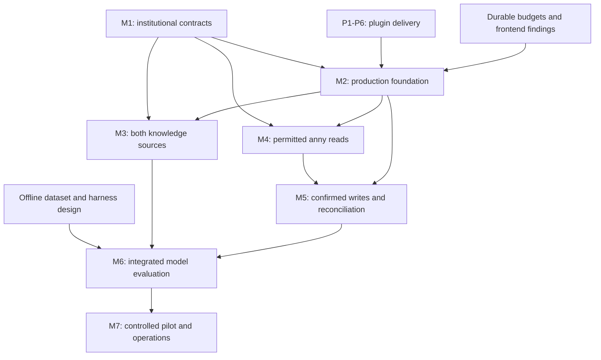

# HASI consolidated delivery plan

Plan version: 1. Proposed on 2026-10-18, against main
`a03fdf2049c99a287397705e1e34b9761c2b2430`.

Decision state: **proposed for review**. The institutional MVP and independent
plugin requirements are already agreed. The delivery slices, MCP Apps adoption
gate and additional qualification criteria below are proposals, not implemented
capabilities or accepted production evidence. Planning does not authorize live
writes, new paid resources, a container release or execution of third-party code.

## Purpose and authority

Turn the existing issues into an executable dependency order without creating
another backlog. HASI remains a chat-first, mobile-first university assistant.
Intranet, Service-IT and anny remain mandatory for the institutional MVP.

This document owns the proposed cross-track sequence and the detailed plugin
delivery slices. It complements these existing requirements authorities:

- [MVP plan](hasi-mvp.md): product scope, M1–M7 acceptance and later integrations.
- [Plugin architecture](../architecture/plugins-and-prototype.md#external-installation-and-administrator-configuration): installation, configuration and trust boundaries.
- [Delivery plan](releases-and-demo.md): D1–D3, automatic Vercel delivery and Release Please containers.
- [Model benchmark](../evaluation/benchmark-v1.md), [credential and budget boundary](../architecture/llm-router-credentials.md) and [repository findings](../architecture/repository-standard.md#known-doctor-findings-2026-10-16): evaluation, spending controls and engineering gaps.

Those requirements are not weakened or duplicated here. Issues own current stage,
next action, blockers and evidence. The tables below map work and dependencies;
they are not live completion tables. A reviewed change must settle conflicts
before implementation; an issue edit cannot waive an existing requirement.

## Measured baseline

The audited revision contains signed MCP invocation, a generic registry,
manifest approval, input/output validation, exact booking/cancellation proposals,
durable synthetic demo state and limited plugin enable/update controls. Model
registry and routing were accepted separately in #32–#34 and are reused.

The model-facing tool list, chat results and actor shape still contain anny and
knowledge-specific assumptions. There is no general plugin configuration form,
artifact installer, third-party sandbox or MCP Apps host. Local development runs
separate processes; Vercel imports the included plugins into one deployment.
Activating a version already served at an endpoint is not installing an artifact.

The public demo uses mock identity and synthetic availability/bookings. Its
knowledge corpus has 60 fictional documents. A read-only anny catalog snapshot
does not establish current user rights. Real SSO, source ACLs, delegated anny
rights, live writes and institutional model approval remain unqualified.

## One issue graph

Reuse the three existing epics. Keep #65 as the plugin implementation issue under
M2; P1–P6 below are ordered work slices within that issue, not new
epics or a second set of institutional milestones. Split a slice into an issue
only if it develops independent execution ownership or a material blocker.
Each slice may need several independently reviewable PRs; its acceptance is
broader than a single merge.

| Record | Responsibility and acceptance authority | Prerequisite or qualification boundary |
| --- | --- | --- |
| [#47](https://github.com/metaneutrons/HASI/issues/47) | Institutional MVP epic; MVP plan | Indexes M1–M7; all three mandatory integrations |
| [#48](https://github.com/metaneutrons/HASI/issues/48) | M1 identity, source and anny contracts | External owners supply verified contracts; discovery starts immediately |
| [#49](https://github.com/metaneutrons/HASI/issues/49) | M2 production foundation | Production identity needs relevant M1 contracts; includes #65, #66 and resolution of #67 |
| [#50](https://github.com/metaneutrons/HASI/issues/50) | M3 Intranet and Service-IT | Relevant M1 source contracts and M2 identity/policy; both sources and current incidents |
| [#51](https://github.com/metaneutrons/HASI/issues/51) | M4 permitted anny reads | M1 account/rights contract and M2 identity/policy |
| [#52](https://github.com/metaneutrons/HASI/issues/52) | M5 confirmed anny writes | Qualified M4 rights, M2 action state, authorized test tenant and reconciliation |
| [#53](https://github.com/metaneutrons/HASI/issues/53) | M6 formal model/security evaluation | Offline design now; integrated production boundaries for qualification; #66 before paid benchmark runs |
| [#54](https://github.com/metaneutrons/HASI/issues/54) | M7 controlled pilot and operations | All applicable M1–M6 gates, real devices, restore and operating approval |
| [#65](https://github.com/metaneutrons/HASI/issues/65) | Independent plugin installation/admin; plugin architecture and P1–P6 | Synthetic work starts now; institutional authority and executable-code trust remain separate gates |
| [#66](https://github.com/metaneutrons/HASI/issues/66) | Durable model budgets; credential/public-demo architecture | Define reservations and unknown usage; required for production foundation and paid comparisons |
| [#67](https://github.com/metaneutrons/HASI/issues/67) | Frontend standard gaps; repository findings | Bounded migration or reviewed explicit exception before M2 acceptance |
| [#64](https://github.com/metaneutrons/HASI/issues/64) | Groq cache investigation; existing measurement contract | Provider evidence required only for cache-hit/savings claims; not a general MVP gate |
| [#14](https://github.com/metaneutrons/HASI/issues/14) | Demo/container delivery epic; delivery plan | Separate from institutional acceptance; accepted D1/D2 remain accepted |
| [#17](https://github.com/metaneutrons/HASI/issues/17) | D3 first actual container publication | Separately requested Release Please release; exact-tag amd64/arm64 and real publication evidence |
| [#55](https://github.com/metaneutrons/HASI/issues/55) | Post-MVP integration index; future-roadmap authority | Per-service discovery may start early; no implied implementation order |
| [#56](https://github.com/metaneutrons/HASI/issues/56) | Zammad topic-routed tickets | Shared platform plus instance, configurable domains/queues, requester rights and classification approval |
| [#57](https://github.com/metaneutrons/HASI/issues/57) | Restricted public web MCP | Approved URL/network scope and query-processing policy; never substitutes for protected sources |
| [#58](https://github.com/metaneutrons/HASI/issues/58) | All-programme examination-regulations corpus | Authoritative inventory/owners, reviewed PDF/OCR, versions/cohorts and page citations; no dependency on HISinOne for corpus work |
| [#59](https://github.com/metaneutrons/HASI/issues/59) | Moodle | Shared platform plus installed version, enabled functions, personal rights and approved operations |
| [#60](https://github.com/metaneutrons/HASI/issues/60) | Stud.IP | Shared platform plus installed API/version, account linkage and source permissions |
| [#61](https://github.com/metaneutrons/HASI/issues/61) | HISinOne discovery and integration | HsH-authorized business API and authoritative eligibility; corpus answers cannot authorize exam writes |
| [#62](https://github.com/metaneutrons/HASI/issues/62) | SAP leave and time discovery | Identify actual business application/workflow/API; no direct HANA writes |
| [#63](https://github.com/metaneutrons/HASI/issues/63) | Deferred M365 Bookings | Explicit later go/no-go and approved tenant/API; remains outside mandatory MVP |

## Delivery order and parallel work

Edges indicate acceptance dependencies, not a prohibition on fixtures, interface
design or implementation against agreed draft contracts. Avoid a cycle: P1–P6
are qualified against synthetic identities and an independent test plugin; they
do not require completed live M3–M5. Institutional use of the same platform does.

1. **Next delivery:** P1 contract/journey specification, then P2 Anny MCP Apps
   feasibility proof. In parallel, collect M1 contracts and prepare the offline
   M6 corpus/harness. Inventory #67 and design #66 without widening model access.
2. **Complete the shared foundation:** P3–P6, durable budgets and the bounded
   frontend findings. Qualify real SSO/API operation once M1 permits it. Keep the
   public demo on mock identity and synthetic data throughout.
3. **Institutional read pilot:** M3 and M4 may proceed in parallel once their
   respective contracts and M2 boundary are qualified. Neither optional Apps UI
   nor cache telemetry makes source permissions optional.
4. **Controlled actions and evaluation:** M5 after M4; run the integrated M6
   comparison after the required read/write flows and spending controls exist.
5. **Pilot and operations:** M7 after all applicable gates, with source owners,
   actual phones, recovery and operating approval.

Container publication is an independent, separately requested delivery. If the
chosen institutional deployment consumes containers, its exact candidate must
pass D3 before use; a published demo container alone does not qualify M2 or M7.
Later integrations stay outside MVP acceptance. Select their implementation
order by owner readiness, user value, API evidence and operational capacity,
rather than issue number. Public corpus inventory and API discovery can proceed
before the shared platform is complete.

## Plugin delivery slices

Execution record for every slice: [#65](https://github.com/metaneutrons/HASI/issues/65),
under [M2 #49](https://github.com/metaneutrons/HASI/issues/49). Acceptance is recorded
against stable P*-A* identifiers and an exact reviewed plan revision. Completion
of one slice does not close #65 or M2. HASI application components remain TypeScript.

### P1 — Contracts and complete journeys

Dependencies: existing plugin architecture; no live HsH credentials required.

- **P1-A1:** Specify separately plugin/package identity, immutable version,
  installation instance, configuration revision, upstream tenant and personal
  account binding. Replace universal anny-shaped actor claims with minimized
  plugin-specific projections. Define configuration schema plus UI metadata,
  logical secret requirements, protocol compatibility and migration rules.
- **P1-A2:** Specify generic tool/result, provenance, pagination and proposal
  envelopes, eligible tool discovery and collision-safe names. Document model,
  app-only and host-confirmation paths. Untrusted declarations cannot grant
  authority or select credentials/origins; tool visibility is not authorization.
- **P1-A3:** Review an end-user room/knowledge journey and administrator
  connect/configure/test/activate/update journey. Separate central service setup
  from personal consent/renewal/revocation. Name every loading, denied, expired,
  unavailable, stale and uncertain-outcome state and its user action. Preserve
  the original task/draft when authentication resumes. Make source/instance
  selection understandable, clarify genuinely ambiguous targets and communicate
  permitted capabilities without requiring a technical plugin/tool catalogue.
- **P1-A4:** Record the compatibility strategy for current manifests, old chat
  results and pending proposals, with contract examples and valid/invalid
  fixtures. Inventory current SDK compatibility before choosing an Apps package.
  Resolve operator trust and isolation ownership before P5/P6 activation.

### P2 — Bounded MCP Apps feasibility proof

Dependencies: P1 contracts relevant to reads, presentation and identity.

Proposed approach: HASI becomes an MCP Apps host; a reviewed Anny view is the
first optional interactive UI. Existing text/structured responses remain usable.
The official extension supplies UI resources, iframe communication and app-only
tool visibility; HASI must implement and qualify the host enforcement. See the
[official overview](https://apps.extensions.modelcontextprotocol.io/api/documents/overview.html).

- **P2-A1:** Deliver one read-only Anny result view over the existing mock/client,
  with compact results, office/workplace distinctions, filter changes and paging.
  Preserve the requested date/time. Instrument a fixed user journey: filtering
  and paging make typed tool calls and zero additional model generations; measure
  initial/interactive latency, calls and input/output tokens without assuming
  cache hits or claiming provider billing savings.
- **P2-A2:** Enforce a sandbox/CSP, reviewed immutable UI resource identity,
  message source/instance binding, allowed methods, bounded payloads and resource
  fetch/redirect/network policy. Reject forged messages, cross-chat/instance
  calls and undeclared tool/resource access. Expose no provider/service tokens,
  SSO credentials or host cookies to the view. Deny arbitrary view-originated
  messages/context updates, navigation and network access unless explicitly
  approved by host policy; they must not initiate an unreviewed model call.
- **P2-A3:** Feed HASI theme tokens, locale, time zone and dimensions into the
  view; test theme changes, keyboard/focus, touch, text enlargement and loss of
  the UI resource. A useful fallback remains available. State the protocol and
  library versions qualified; do not assume future native-app host support.
  The [host-context contract](https://apps.extensions.modelcontextprotocol.io/api/interfaces/app.McpUiHostContext.html)
  supports environment delivery but does not enforce design consistency.
- **P2-A4:** Record a go/no-go with security, mobile, accessibility, performance
  and compatibility findings. If Apps fails the gate, retain the standard/native
  presentation path and review the revised implementation approach before
  extending it. A successful iframe render alone is not acceptance.

### P3 — Registry-driven chat and migration of existing tools

Dependencies: P1 and P2 go/no-go; retain the existing signed invocation boundary.

- **P3-A1:** Derive model tools from approved installed contracts and server-owned
  user/turn/data policy. Remove fixed anny/knowledge enums as an installation
  prerequisite. Test duplicate names, forbidden tools, oversized/malicious schemas,
  injection in descriptions/results and model switches. Bound discovery/context
  size and tool-result projection; Apps data is not automatically safe or hidden
  from the model merely because it is structured.
- **P3-A2:** Migrate anny and knowledge through the same contracts as an external
  test plugin. Preserve room search, own bookings, source access/citations,
  prepare/confirm booking and cancellation, interval checks and per-persona
  isolation. Anny customer IDs remain private to its identity adapter. The model
  provider registry and existing accepted routing policy are reused.
- **P3-A3:** Generic host-owned confirmation displays the exact instance/account,
  target, effect, time and consequences. Bind proposal, actor, arguments, plugin
  and configuration revision; recheck authority/current state at execution.
  Neither a view nor a model can confirm. Reject stale/tampered/foreign actions;
  reload/repeated confirmation cannot duplicate writes. Unknown outcomes use
  authoritative status/reconciliation rather than blind replay.
- **P3-A4:** With Apps disabled, legacy results or a removed view resource, retain
  a readable transcript and source references subject to current access checks.
  Historical cards do not run tools or execute old actions merely by rendering.
  Explicitly test both Apps-enabled and fallback modes.

### P4 — Administrator configuration and account lifecycle

Dependencies: P3 and durable instance/configuration state; real administrative
authorization before institutional use. Demo administration stays workspace-only.

- **P4-A1:** Provide schema-driven setup with labels/help/conditional fields,
  draft validation, connection testing and explicit activation. Distinguish
  configured, reachable, authenticated, authorized and user-ready states. Show
  instance/tenant and concrete field-level remedies without exposing secrets.
- **P4-A2:** Server-side validation and versioned configuration support multiple
  instances, optimistic concurrency and an auditable operator change record.
  Bind approved logical secret requirements through the HASI secret abstraction;
  support replacement/rotation without secret readback. Client/model/plugin input
  cannot choose arbitrary secret references or credential origins.
- **P4-A3:** Keep per-tool policy separate from plugin enablement. Distinguish
  disable, personal disconnect and uninstall, showing effects on pending actions,
  retained history and data. Personal login/renewal returns to the original task;
  revocation invalidates dependent rights/context. No credentials enter chat forms.
- **P4-A4:** Qualify complete setup, errors, update review and reconnect on phone
  width, keyboard and assistive technology. Form generation is not evidence of
  good UX. Treat Apps as an optional result UI, not a replacement for trusted
  host installation/configuration and confirmation controls.

### P5 — External connection and independently updated artifacts

Dependencies: P3/P4, P1 trust policy and a qualified isolation/runtime design.

- **P5-A1:** Connect an operator-approved remote MCP endpoint with approved
  manifest/capabilities, destination policy and minimized per-instance authority.
  Apply resolved-address, DNS-rebinding and redirect checks. Support a reviewed
  adapter for plain MCP servers that lack HASI's effect/authorization contract;
  an unmodified MCP server is not automatically HASI-compatible.
- **P5-A2:** Separately support deploying a reviewed, digest-pinned plugin release
  from an approved external source. Verify publisher provenance, compatibility
  and license/dependency inventory. Do not run arbitrary repository install/build
  scripts in the core. Enforce filesystem, credential, network, CPU/memory and
  execution-time boundaries; prove denial cases as well as allowed behavior.
- **P5-A3:** Stage health/configuration/migration checks before activation. Show
  changed schemas, effects, permissions, network destinations and UI resources
  for renewed approval. Coordinate active revision across instances, invalidate
  incompatible pending actions and record immutable audit events.
- **P5-A4:** Demonstrate update and recovery using retained previous artifact and
  compatible configuration/state. Irreversible migrations need a restore/forward
  recovery plan; an old image alone is not rollback. Failed preflight leaves the
  active version usable; an unknown activation state is reconciled before retry.
  Revalidate current secret references and rights on recovery; rollback must not
  reinstate revoked credentials, grants or superseded trust approvals.
- **P5-A5:** Document the runtime matrix. Production executable plugins run outside
  the core's trust boundary; Vercel cannot install arbitrary persistent processes
  into a function. Its demo uses reviewed bundled fixtures or an approved remote
  test service. Demonstrate truly independent updates outside the co-located
  deployment; do not present a rebuilt Vercel bundle as that evidence.

### P6 — Independent plugin and end-to-end qualification

Dependencies: P1–P5; production SSO remains part of M1/M2 qualification.

- **P6-A1:** A small independently versioned test plugin outside the host workspace
  is connected, configured, used in chat, updated and rolled back without a host
  rebuild or domain-specific core edit. Include multiple tools, an optional Apps
  view/fallback and a synthetic confirmed action. A fixture package alone is not
  proof of external distribution; identify the exact external artifact/source.
- **P6-A2:** Qualify reauthentication without task loss; an update/disable during
  a pending booking; configuration races across runtimes; malicious UI/schema/
  results; lost connection during execution; authoritative unknown-outcome
  recovery; denied cross-workspace/account/resource calls. Preserve anny and
  knowledge regression evidence and test the actual deployment topology.
- **P6-A3:** Exercise chat and admin on actual iPhone/Safari and Android/Chrome,
  including keyboard, safe areas, focus, VoiceOver/TalkBack, 200% text and reload.
  Apply the existing [mobile acceptance](../architecture/technical-basis.md#mobile-experience-and-acceptance),
  including 320/375/390/768/1280 px viewport checks. Record platform versions,
  measured latency and omissions; emulation alone cannot satisfy native gates.
  This slice qualifies plugin chat/admin flows with synthetic data. M7 separately
  qualifies all key institutional flows, including real SSO and source rights.
- **P6-A4:** Publish developer contracts/examples and administrator runbooks for
  setup, account renewal, rotation, disable, update and recovery. Update README
  with demonstrated capabilities and limits. Map each P criterion to exact
  artifact/code revisions and durable evidence before accepting #65. M2 still
  requires its separate production identity, budget and deployment gates.

## Supporting gates and external decisions

The following proposed qualifications make the existing supporting issues
actionable without reopening accepted provider routing or inventing a new
coverage percentage:

- **BUD-A1 (#66):** Define server-owned budget scopes and atomic cross-instance
  reservations across concurrent requests, fallback attempts and output limits.
  Tests cover exhausted and unavailable budget state, timeouts, cancellation,
  failed/unknown usage and reconciliation. Unknown counters are never zero spend.
  Separate conservative admission bounds from verified provider billing; record
  currency/rate configuration and any hard-cap limitations explicitly. No fallback
  may bypass exhaustion. Qualify before production acceptance or paid benchmarks;
  offline mocks need no provider spend.
- **WEB-A1 (#67):** Inventory each shared strictness/lint/coverage gap, implement a
  bounded Next-compatible migration or review an explicit, justified exception
  in the versioned repository findings. Verify Node 24/26 and meaningful affected
  user workflows; preserve existing gates. Green current checks alone do not
  resolve the inventory, and an exception is not automatically authorized here.
- **CACHE-A1 (#64):** Preserve the existing measurement contract. Only a documented
  positive provider cache-read counter establishes a hit. Missing counters remain
  unknown; no unlimited retries, support messages or unsupported savings claims.
  If unavailable, record the blocker and seek a scope decision. Other work can
  proceed using measured tokens/calls/latency without claiming cache savings.

M1 must identify institutional owners for IdP/account lifecycle, both knowledge
sources, anny rights and downstream operations. Hosting, security/secret custody,
model/data classification and pilot operations require named accountable owners.
These roles are not assigned to assumed individuals. Implementation owners are
recorded in issues before their respective work begins; source-owner approvals
and unresolved API semantics cannot be replaced by synthetic tests.

## Migration, verification and delivery discipline

Introduce versioned contracts alongside a bounded compatibility adapter, migrate
anny and knowledge, then remove obsolete paths only after parity evidence. Keep
host identity, rights and write confirmation authoritative throughout. Bind view
state to actor, chat, installation, invocation and revision; persist only approved
minimal state and recheck rights after reconnect. A UI teardown is not a durable
business-state transaction.

During development, run focused contract, policy and workflow tests. At each
integration point, qualify the exact candidate with required CI, supported Node
versions and relevant PostgreSQL/concurrency paths. Use isolated malicious
fixtures to prove new gates reject bad inputs as well as accept valid ones.
Reserve native phones, deployment checks and multi-platform container work for
their stated gates. Refresh/qualify only the next PR in merge order; unrelated
documentation edits do not justify repeating expensive runtime qualification.

Use reviewed PRs per slice; reference #65/#49 without automatic closing words for
partial work. A main merge updates the synthetic Vercel demo under D2. Verify its
exact revision, readiness and public alias when delivering runtime changes.
Release Please remains the sole container version/tag authority; no release is
performed merely to close a planning issue. No dates or cost estimates are
committed without team capacity, runtime design and approved spending limits.

The main risks are expanding #65 into an unbounded marketplace, trusting schemas
as authorization, mistaking iframe isolation for complete security, presenting
synthetic rights as institutional acceptance, and promising rollback across an
irreversible migration. P1/P2 bound the design; P3/P4 prove existing workflows;
P5/P6 qualify external execution. If a required boundary fails, record the blocker
and revise the plan through review rather than silently narrowing acceptance.

## Plan review and completion

Review P1 contracts and journeys before P2 implementation, record the P2 Apps
go/no-go, and review P5 isolation/distribution before admitting external executable
code. Retain the smallest existing issue structure; create no duplicate epics.
Once the plan is reviewed and published, link its exact revision from #47, #49,
#65 and the supporting issues. Do not publish links to an unpushed local draft.

This plan is complete as a delivery initiative only when the relevant existing
milestones and all adopted P/BUD/WEB criteria have evidence. Institutional MVP,
plugin-platform qualification, container publication and later integrations
remain distinct acceptance decisions. Future changes record date, decision/PR,
affected criterion IDs and evidence that must be requalified.
