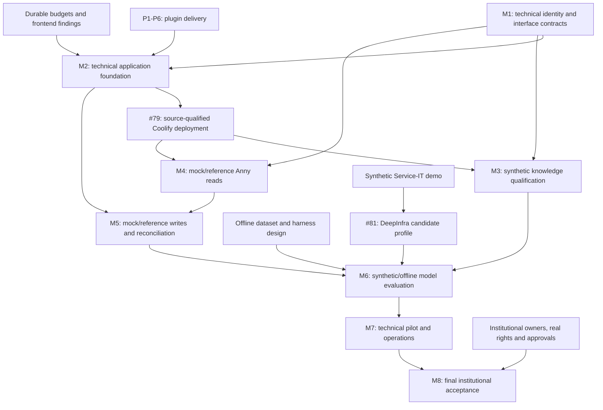

# HASI consolidated delivery plan

Plan version: 2. Unified execution order updated on 2026-10-18. The issue graph
and acceptance requirements originate from the baseline adopted against main
`a03fdf2049c99a287397705e1e34b9761c2b2430`.

Decision state: **v2 unifies the current execution order and self-hosted delivery
boundary; it does not change acceptance authority or mark work accepted.** The
original planning baseline was adopted by the user on 2026-10-18. Third-party
MCP Apps remain off by default after the P2 no-go decision; contracts and
executable-code admission retain their review gates. This plan does not
authorize live writes, new paid resources, a container release or execution of
third-party code.

## Purpose and authority

Turn the existing issues into an executable dependency order without creating
another backlog. HASI remains a chat-first, mobile-first university assistant.
Intranet, Service-IT and anny remain mandatory for the institutional MVP.

This document owns the cross-track sequence and the detailed plugin
delivery slices. It complements these existing requirements authorities:

- [MVP plan](hasi-mvp.md): product scope, technical M1–M7 acceptance, final M8 institutional acceptance and later integrations.
- [Plugin architecture](../architecture/plugins-and-prototype.md#external-installation-and-administrator-configuration): installation, configuration and trust boundaries.
- [Delivery plan](releases-and-demo.md): D1/D2 historical Vercel acceptance,
  current Coolify delivery follow-up #79, and separate Release Please D3.
- [Model benchmark](../evaluation/benchmark-v1.md), [credential and budget boundary](../architecture/llm-router-credentials.md) and [repository findings](../architecture/repository-standard.md#known-doctor-findings-2026-10-16): evaluation, spending controls and engineering gaps.
- [Issue roadmap audit](../verification/2026-10-18/issue-roadmap-audit.md):
  all-issue status map and transfer record; GitHub issues remain the current
  execution-state authority.

Those requirements are not weakened or duplicated here. Issues own current stage,
next action, blockers and evidence. The tables below map work and dependencies;
they are not live completion tables. A reviewed change must settle conflicts
before implementation; an issue edit cannot waive an existing requirement.

## Current baseline — 2026-10-18

The current public demo runs on the Hetzner host under Coolify. HASI, the demo
wiki and private PostgreSQL 18.6 are managed there; the Vercel project and Neon
database have been retired. The Coolify service still uses a preloaded image.
CI-qualified source builds and deployment to this host are open in [#79](https://github.com/metaneutrons/HASI/issues/79). The cutover and database
records are in [self-host verification](../verification/2026-10-18/selfhost-cutover.md)
and [PostgreSQL cutover verification](../verification/2026-10-18/local-postgres-cutover.md).

M2 and P1–P6 implementation is merged, but final technical acceptance is
deliberately deferred. [PR #78](https://github.com/metaneutrons/HASI/pull/78) is
unmerged; its candidate at `1ffd651b1c561b8dba6182435c233093f47a99e2` has
green CI. M1–M7 now qualify technical behavior against TestIdP, mock/reference
authorities and synthetic fixtures. Real institutional identity, source rights,
Anny tenant behavior, protected-data approval and final go/no-go are reserved for
M8 [#80](https://github.com/metaneutrons/HASI/issues/80); mock evidence does not
qualify that milestone.

The Service-IT portal/catalog is in progress as synthetic demo content. The
reviewed fixture inventory has 301 documents: 271 Service-IT and 30 Intranet.
The 241 new Service-IT entries comprise 183 authenticated FAQ fixtures, one
additional valid public RSS FAQ, 22 services, 11 news items, 19 links and five
forms; category landing pages are excluded. These are inventory counts, not a
deployed corpus count. The older 60-document seed and 104-page public crawl are
separate historical evidence. Synthetic fixtures and mock identity support
technical M3/M4 qualification only; they do not establish HsH rights.

The accepted model registry/routing work in #32–#34 is reused. DeepInfra with
DeepSeek-V4.1-Flash is the requested next provider after the synthetic
Service-IT demo; provider contract, model compatibility and credential
readiness remain unverified. Track this bounded additive work in [#81](https://github.com/metaneutrons/HASI/issues/81) against
[DI-A1–DI-A4](model-provider-routing.md#deepinfra-follow-up), before final M6
comparison, without reopening accepted #32–#34. Real SSO, source ACLs, delegated
anny rights, live writes and institutional model approval remain M8 criteria.

## One issue graph

Reuse the existing epics and keep one final institutional-acceptance milestone.
P1–P6 are independently tracked plugin milestones under M2, using #69–#74.
Each may need several reviewable PRs. The former standalone issues #64–#67 are
superseded through the explicit mapping below; their work is transferred, not
accepted or discarded. Technical M1–M7, institutional M8, later roadmap
milestones and D3 remain open until their own qualification gates pass.

| Record | Responsibility and acceptance authority | Prerequisite or qualification boundary |
| --- | --- | --- |
| [#47](https://github.com/metaneutrons/HASI/issues/47) | Institutional MVP epic; MVP plan | Indexes technical M1–M7 and final institutional M8; all three mandatory integrations |
| [#48](https://github.com/metaneutrons/HASI/issues/48) | M1 technical identity/integration contracts | TestIdP, mock authorities and stable interface contracts; real institutional proof transfers to M8 |
| [#49](https://github.com/metaneutrons/HASI/issues/49) | M2 technical application foundation | TestIdP/mock contracts; includes P1–P6, BUD-A1 and WEB-A1; final tests remain deferred |
| [#50](https://github.com/metaneutrons/HASI/issues/50) | M3 synthetic permission-aware knowledge qualification | M1/M2 technical boundaries and signed fixtures for Intranet and HTML/web acquisition; source rights remain M8 |
| [#51](https://github.com/metaneutrons/HASI/issues/51) | M4 anny read contracts and behavior | M1/M2 technical boundaries; mock identities and reference contracts, not a real tenant |
| [#52](https://github.com/metaneutrons/HASI/issues/52) | M5 confirmed anny write/cancel/reconcile behavior | Follows M4 against mocks/reference contracts; actual tenant and vendor conformance remain M8 |
| [#53](https://github.com/metaneutrons/HASI/issues/53) | M6 synthetic/offline model and adversarial evaluation | Formal evaluation before M7; BUD-A1 before paid runs; DI-A1–DI-A4 via #81 before final provider comparison; CACHE-A1 remains separate |
| [#54](https://github.com/metaneutrons/HASI/issues/54) | M7 synthetic technical pilot and operations | M1–M6 technical gates, real-device UX, restore and off-host monitoring; no institutional data prerequisite |
| [#80](https://github.com/metaneutrons/HASI/issues/80) | M8 final institutional acceptance | After M1–M7; real identity, source rights, Anny tenant, protected-data approval and recorded go/no-go |
| [#81](https://github.com/metaneutrons/HASI/issues/81) | Bounded DeepInfra/DeepSeek-V4.1-Flash follow-up | After synthetic Service-IT; DI-A1–DI-A4; additive to #32–#34 and before final M6 comparison |
| [P1 #69](https://github.com/metaneutrons/HASI/issues/69) | Define plugin contracts and complete user journeys; detailed criteria below | Existing contracts; no live credentials |
| [P2 #70](https://github.com/metaneutrons/HASI/issues/70) | Qualify the Anny MCP Apps feasibility prototype; detailed criteria below | P1 read/identity/presentation contracts |
| [P3 #71](https://github.com/metaneutrons/HASI/issues/71) | Integrate registry-driven chat and migrate existing tools; detailed criteria below | P1 and P2 go/no-go |
| [P4 #72](https://github.com/metaneutrons/HASI/issues/72) | Deliver plugin administration and account lifecycle; detailed criteria below | P3 and durable instance/configuration state |
| [P5 #73](https://github.com/metaneutrons/HASI/issues/73) | Qualify external plugin connection, distribution and updates; detailed criteria below | P3/P4, trust policy and qualified isolation |
| [P6 #74](https://github.com/metaneutrons/HASI/issues/74) | Qualify an independent plugin and complete mobile workflows; detailed criteria below | P1–P5; synthetic qualification does not accept real SSO |
| [#14](https://github.com/metaneutrons/HASI/issues/14) | Demo/container delivery epic; delivery plan | Separate from institutional acceptance; accepted D1/D2 remain accepted |
| [#17](https://github.com/metaneutrons/HASI/issues/17) | D3 first actual container publication | Separately requested Release Please release; exact-tag amd64/arm64 and real publication evidence |
| [#55](https://github.com/metaneutrons/HASI/issues/55) | Post-MVP integration index; future-roadmap authority | Per-service discovery may start early; no implied implementation order |
| [#56](https://github.com/metaneutrons/HASI/issues/56) | Zammad topic-routed tickets | Shared platform plus instance, configurable domains/queues, requester rights and classification approval |
| [#57](https://github.com/metaneutrons/HASI/issues/57) | Restricted public web MCP | Approved URL/network scope and query-processing policy; never substitutes for protected sources |
| [#58](https://github.com/metaneutrons/HASI/issues/58) | All-programme examination-regulations corpus | Authoritative inventory/owners, reviewed PDF/OCR, versions/cohorts and page citations; no dependency on HISinOne for corpus work |
| [#59](https://github.com/metaneutrons/HASI/issues/59) | Moodle | Shared platform plus installed version, enabled functions, personal rights and approved operations |
| [#60](https://github.com/metaneutrons/HASI/issues/60) | Stud.IP | Shared platform plus installed API/version, account linkage and source permissions |
| [#61](https://github.com/metaneutrons/HASI/issues/61) | HISinOne discovery and integration | HsH-authorized business API and authoritative eligibility; corpus answers cannot authorize exam writes |
| [#62](https://github.com/metaneutrons/HASI/issues/62) | SAP leave and time discovery | Identify actual business application/workflow/API; no direct HANA writes |
| [#63](https://github.com/metaneutrons/HASI/issues/63) | Deferred M365 Bookings | Explicit later go/no-go and approved tenant/API; remains outside mandatory MVP |

### Superseded standalone issues

| Former issue | Authoritative successor | Closure meaning |
| --- | --- | --- |
| [#65](https://github.com/metaneutrons/HASI/issues/65) | P1–P6 (#69–#74), coordinated by M2 #49 | Split into bounded milestones; installation, UX, isolation and independent updates remain unaccepted |
| [#66](https://github.com/metaneutrons/HASI/issues/66) | M2 #49, BUD-A1 | Budget reservations/accounting remain open |
| [#67](https://github.com/metaneutrons/HASI/issues/67) | M2 #49, WEB-A1 | Engineering gaps remain open unless resolved or explicitly excepted |
| [#64](https://github.com/metaneutrons/HASI/issues/64) | M6 #53, CACHE-A1 and existing measurement contract | Cache hit remains unproven; provider blocker and evidence obligations remain open |

Close these records as superseded, with GitHub's `not_planned` state reason and
explicit successor links, never as completed work. Their previous bodies and
historical evidence remain available. No outstanding obligation disappears from
the successor's execution state.

## Unified delivery order and parallel work

M1–M7 are technical milestones that may qualify against TestIdP, mock/reference
authorities and synthetic data. Institutional identity, source grants, real
Anny tenant behavior and protected-data approvals are intentionally deferred to
M8. This is a transfer of the original institutional criteria, not a waiver.
Synthetic acceptance evidence must be labeled as such and cannot authorize real
writes, protected context or institutional rollout. P1–P6 also use synthetic
identities and an independent test plugin; they do not require live M3–M5.

1. **Finish the synthetic Service-IT demo slice.** The current reviewed fixture
   inventory is 301 documents (271 Service-IT and 30 Intranet), including 241
   newly inventoried Service-IT entries: 183 authenticated FAQ fixtures, one
   additional valid public RSS FAQ, 22 services, 11 news items, 19 links and five
   forms. Category landing pages are excluded. These counts describe inventory,
   not deployed content. Keep bounded HTML acquisition separate from real-source
   qualification and verify the exact artifact before reporting deployment.
2. **Review PR #78 at its exact candidate revision.** The candidate is `1ffd651`
   with green CI and remains unmerged. Review and merge the adapter work at a
   qualified head; that code review does not accept M3 or authorize source access.
3. **Complete technical M1 and M2 qualification, then the current deployment
   path.** Specify and test identity/integration contracts with TestIdP and mock
   authorities. Complete the deferred M2/P1–P6 matrix and BUD-A1/WEB-A1. Implement
   #79 with an exact source SHA, required CI, state/budget preservation, private
   Coolify administration, an authenticated replay-bounded trigger, health
   checks and a working rollback. Do not replace a newer candidate with an older
   main build.
4. **Qualify M3 and M4 in parallel against synthetic/reference contracts.** M3
   covers signed fixtures, HTML/web extraction, permissions, two-user allow/deny,
   rights-change behavior, reviewed German/English cases and incident freshness
   as represented in test data. M4 covers mock account linking and permitted
   resource/booking views. Actual owner grants and source/tenant semantics remain
   M8; they are not blockers to closing these technical milestones.
5. **Qualify M5 after M4** using reference contracts and mocks for exact
   confirmation, stale/foreign proposal rejection, cancellation, idempotency
   and reconciliation after unknown outcomes. Do not issue live writes in this
   milestone.
6. **Prepare M6 offline now and finish it before M7.** Use synthetic datasets
   and adversarial cases, compare quality, citations, tool arguments, latency,
   measured costs and security per profile. DeepInfra/DeepSeek-V4.1-Flash is the
   requested next provider after the Service-IT slice; follow [#81](https://github.com/metaneutrons/HASI/issues/81) and
   [DI-A1–DI-A4](model-provider-routing.md#deepinfra-follow-up) without reopening
   #32–#34. Provider contract/model compatibility and credential readiness are
   unverified. Complete BUD-A1 before paid evaluation. CACHE-A1 remains separate;
   missing counters do not establish cache hits or savings.
7. **Accept M7 as the synthetic technical pilot.** Complete real iPhone/Safari
   and Android/Chrome UX and accessibility flows, encrypted-backup restore,
   off-host monitoring, incident handling and rollback using synthetic data.
   This milestone does not need institutional source approval and does not
   qualify real SSO or writes.
8. **Complete M8 last** as the institutional go/no-go. Real identity, both
   sources' access and rights, Anny customer delegation/eligibility and vendor
   conformance, protected-data processing approvals, named owners, reviewed real
   acceptance cases and recorded institutional go/no-go must be present before
   rollout. Scope-specific authorization precedes any M8 real-write or protected-
   context test. See [M8 in the MVP plan](hasi-mvp.md#institutional-acceptance-m8).

Container publication is independent and remains a separately requested
Release Please delivery under #17. If an institutional deployment consumes a
published image, its exact candidate must pass D3; demo publication does not
qualify M2 or M7. Later integrations stay outside MVP acceptance. Select their
implementation order by owner readiness, user value, API evidence and operational
capacity, rather than issue number. Public corpus inventory and API discovery can
proceed before the shared platform is complete.

## Plugin delivery slices

Execution: one issue per P milestone, under [M2 #49](https://github.com/metaneutrons/HASI/issues/49).
Acceptance is recorded against stable P*-A* identifiers and an exact reviewed
plan revision. Completing one milestone does not complete M2. HASI application
components remain TypeScript.

### P1 — Contracts and complete journeys

Execution: [P1 #69](https://github.com/metaneutrons/HASI/issues/69).

Dependencies: existing plugin architecture; no live HsH credentials required.

- **P1-A1:** Specify separately plugin/package identity, immutable version,
  installation instance, configuration revision, upstream tenant and personal
  account binding. Replace universal anny-shaped actor claims with minimized
  plugin-specific projections. Define configuration schema plus UI metadata,
  logical secret requirements, protocol compatibility and migration rules.
- **P1-A2:** Specify generic tool/result, provenance, pagination and proposal
  envelopes, eligible tool discovery and collision-safe names. Document model,
  app-only and host-confirmation paths. Untrusted declarations cannot grant
  authority or select credentials/origins; tool visibility is not authorization.
- **P1-A3:** Review an end-user room/knowledge journey and administrator
  connect/configure/test/activate/update journey. Separate central service setup
  from personal consent/renewal/revocation. Name every loading, denied, expired,
  unavailable, stale and uncertain-outcome state and its user action. Preserve
  the original task/draft when authentication resumes. Make source/instance
  selection understandable, clarify genuinely ambiguous targets and communicate
  permitted capabilities without requiring a technical plugin/tool catalogue.
- **P1-A4:** Record the compatibility strategy for current manifests, old chat
  results and pending proposals, with contract examples and valid/invalid
  fixtures. Inventory current SDK compatibility before choosing an Apps package.
  Resolve operator trust and isolation ownership before P5/P6 activation.

### P2 — Bounded MCP Apps feasibility proof

Execution: [P2 #70](https://github.com/metaneutrons/HASI/issues/70).

Dependencies: P1 contracts relevant to reads, presentation and identity.

Current decision from [#70](https://github.com/metaneutrons/HASI/issues/70):
retain the read-only feasibility implementation, use native results by default,
keep the public Apps flag off, and do not admit unreviewed third-party Apps. The
original feasibility approach below records what P2 must assess before any
reconsideration; it does not authorize production adoption. The official
extension supplies UI resources, iframe communication and app-only tool
visibility; HASI must implement and qualify host enforcement. See the
[official overview](https://apps.extensions.modelcontextprotocol.io/api/documents/overview.html).

- **P2-A1:** Deliver one read-only Anny result view over the existing mock/client,
  with compact results, office/workplace distinctions, filter changes and paging.
  Preserve the requested date/time. Instrument a fixed user journey: filtering
  and paging make typed tool calls and zero additional model generations; measure
  initial/interactive latency, calls and input/output tokens without assuming
  cache hits or claiming provider billing savings.
- **P2-A2:** Enforce a sandbox/CSP, reviewed immutable UI resource identity,
  message source/instance binding, allowed methods, bounded payloads and resource
  fetch/redirect/network policy. Reject forged messages, cross-chat/instance
  calls and undeclared tool/resource access. Expose no provider/service tokens,
  SSO credentials or host cookies to the view. Deny arbitrary view-originated
  messages/context updates, navigation and network access unless explicitly
  approved by host policy; they must not initiate an unreviewed model call.
- **P2-A3:** Feed HASI theme tokens, locale, time zone and dimensions into the
  view; test theme changes, keyboard/focus, touch, text enlargement and loss of
  the UI resource. A useful fallback remains available. State the protocol and
  library versions qualified; do not assume future native-app host support.
  The [host-context contract](https://apps.extensions.modelcontextprotocol.io/api/interfaces/app.McpUiHostContext.html)
  supports environment delivery but does not enforce design consistency.
- **P2-A4:** Record a go/no-go with security, mobile, accessibility, performance
  and compatibility findings. If Apps fails the gate, retain the standard/native
  presentation path and review the revised implementation approach before
  extending it. A successful iframe render alone is not acceptance.

### P3 — Registry-driven chat and migration of existing tools

Execution: [P3 #71](https://github.com/metaneutrons/HASI/issues/71).

Dependencies: P1 and P2 go/no-go; retain the existing signed invocation boundary.

- **P3-A1:** Derive model tools from approved installed contracts and server-owned
  user/turn/data policy. Remove fixed anny/knowledge enums as an installation
  prerequisite. Test duplicate names, forbidden tools, oversized/malicious schemas,
  injection in descriptions/results and model switches. Bound discovery/context
  size and tool-result projection; Apps data is not automatically safe or hidden
  from the model merely because it is structured.
- **P3-A2:** Migrate anny and knowledge through the same contracts as an external
  test plugin. Preserve room search, own bookings, source access/citations,
  prepare/confirm booking and cancellation, interval checks, source-reader
  quality and per-persona isolation. Anny customer IDs remain private to its identity adapter. The model
  provider registry and existing accepted routing policy are reused.
- **P3-A3:** Generic host-owned confirmation displays the exact instance/account,
  target, effect, time and consequences. Bind proposal, actor, arguments, plugin
  and configuration revision; recheck authority/current state at execution.
  Neither a view nor a model can confirm. Reject stale/tampered/foreign actions;
  reload/repeated confirmation cannot duplicate writes. Unknown outcomes use
  authoritative status/reconciliation rather than blind replay.
- **P3-A4:** With Apps disabled, legacy results or a removed view resource, retain
  a readable transcript and source references subject to current access checks.
  Historical cards do not run tools or execute old actions merely by rendering.
  Explicitly test both Apps-enabled and fallback modes.

### P4 — Administrator configuration and account lifecycle

Execution: [P4 #72](https://github.com/metaneutrons/HASI/issues/72).

Dependencies: P3 and durable instance/configuration state; real administrative
authorization before institutional use. Demo administration stays workspace-only.

- **P4-A1:** Provide schema-driven setup with labels/help/conditional fields,
  draft validation, connection testing and explicit activation. Distinguish
  configured, reachable, authenticated, authorized and user-ready states. Show
  instance/tenant and concrete field-level remedies without exposing secrets.
- **P4-A2:** Server-side validation and versioned configuration support multiple
  instances, optimistic concurrency and an auditable operator change record.
  Bind approved logical secret requirements through the HASI secret abstraction;
  support replacement/rotation without secret readback. Client/model/plugin input
  cannot choose arbitrary secret references or credential origins.
- **P4-A3:** Keep per-tool policy separate from plugin enablement. Distinguish
  disable, personal disconnect and uninstall, showing effects on pending actions,
  retained history and data. Personal login/renewal returns to the original task;
  revocation invalidates dependent rights/context. No credentials enter chat forms.
- **P4-A4:** Qualify complete setup, errors, update review and reconnect on phone
  width, keyboard and assistive technology. Form generation is not evidence of
  good UX. Treat Apps as an optional result UI, not a replacement for trusted
  host installation/configuration and confirmation controls.

### P5 — External connection and independently updated artifacts

Execution: [P5 #73](https://github.com/metaneutrons/HASI/issues/73).

Dependencies: P3/P4, P1 trust policy and a qualified isolation/runtime design.

- **P5-A1:** Connect an operator-approved remote MCP endpoint with approved
  manifest/capabilities, destination policy and minimized per-instance authority.
  Apply resolved-address, DNS-rebinding and redirect checks. Support a reviewed
  adapter for plain MCP servers that lack HASI's effect/authorization contract;
  an unmodified MCP server is not automatically HASI-compatible.
- **P5-A2:** Separately support deploying a reviewed, digest-pinned plugin release
  from an approved external source. Verify publisher provenance, compatibility
  and license/dependency inventory. Do not run arbitrary repository install/build
  scripts in the core. Enforce filesystem, credential, network, CPU/memory and
  execution-time boundaries; prove denial cases as well as allowed behavior.
- **P5-A3:** Stage health/configuration/migration checks before activation. Show
  changed schemas, effects, permissions, network destinations and UI resources
  for renewed approval. Coordinate active revision across instances, invalidate
  incompatible pending actions and record immutable audit events.
- **P5-A4:** Demonstrate update and recovery using retained previous artifact and
  compatible configuration/state. Irreversible migrations need a restore/forward
  recovery plan; an old image alone is not rollback. Failed preflight leaves the
  active version usable; an unknown activation state is reconciled before retry.
  Revalidate current secret references and rights on recovery; rollback must not
  reinstate revoked credentials, grants or superseded trust approvals.
- **P5-A5:** Document the runtime matrix. Production executable plugins run outside
  the core's trust boundary. The current public demo runs on Coolify and uses only
  reviewed demo composition; Vercel is retired and is not an execution target.
  Demonstrate truly independent updates outside the co-located deployment; do not
  present a rebuilt application bundle as independent plugin distribution.

### P6 — Independent plugin and end-to-end qualification

Execution: [P6 #74](https://github.com/metaneutrons/HASI/issues/74).

Dependencies: P1–P5; synthetic TestIdP and mock authorities support technical qualification. Real institutional SSO is M8.

- **P6-A1:** A small independently versioned test plugin outside the host workspace
  is connected, configured, used in chat, updated and rolled back without a host
  rebuild or domain-specific core edit. Include multiple tools, an optional Apps
  view/fallback and a synthetic confirmed action. A fixture package alone is not
  proof of external distribution; identify the exact external artifact/source.
- **P6-A2:** Qualify reauthentication without task loss; an update/disable during
  a pending booking; configuration races across runtimes; malicious UI/schema/
  results; lost connection during execution; authoritative unknown-outcome
  recovery after mobile reauthentication; denied cross-workspace/account/resource
  calls. Preserve anny and
  knowledge regression evidence and test the actual deployment topology.
- **P6-A3:** Exercise chat and admin on actual iPhone/Safari and Android/Chrome,
  including keyboard, safe areas, focus, VoiceOver/TalkBack, 200% text and reload.
  Apply the existing [mobile acceptance](../architecture/technical-basis.md#mobile-experience-and-acceptance),
  including 320/375/390/768/1280 px viewport checks. Record platform versions,
  measured latency and omissions; emulation alone cannot satisfy native gates.
  This slice qualifies plugin chat/admin flows with synthetic data. M7 qualifies technical
  pilot operations with synthetic data; M8 owns real SSO and source rights.
- **P6-A4:** Publish developer contracts/examples and administrator runbooks for
  setup, account renewal, rotation, disable, update and recovery. Update README
  with demonstrated capabilities and limits. Map each P criterion to exact
  artifact/code revisions and durable evidence before accepting P1–P6. M2 still
  requires its separate technical identity, budget and deployment gates. M8 owns
  institutional identity and authorization.

## Supporting gates and external decisions

The following qualifications carry the former supporting issues into M2/M6
without reopening accepted provider routing or inventing a coverage percentage:

- **BUD-A1 (M2 #49; transferred from #66):** Define server-owned budget scopes and atomic cross-instance
  reservations across concurrent requests, fallback attempts and output limits.
  Tests cover exhausted and unavailable budget state, timeouts, cancellation,
  failed/unknown usage and reconciliation. Unknown counters are never zero spend.
  Separate conservative admission bounds from verified provider billing; record
  currency/rate configuration, operator quotas, safe exhaustion behavior and any
  hard-cap limitations explicitly. Preserve content-free telemetry and secret
  boundaries; no new paid resource, quota increase or evaluation run is authorized
  by this tracking migration. No fallback may bypass exhaustion. Qualify before production acceptance or paid benchmarks;
  offline mocks need no provider spend.
- **WEB-A1 (M2 #49; transferred from #67):** Inventory each shared strictness/lint/coverage gap, implement a
  bounded Next-compatible migration or review an explicit, justified exception
  in the versioned repository findings. Verify Node 24/26 and meaningful affected
  user workflows; preserve existing gates and distinguish configuration failures
  from application regressions. No blanket coverage target or mechanical tests
  are implied. Green current checks alone do not resolve the inventory, and an exception is not automatically authorized here.
- **CACHE-A1 (M6 #53; transferred from #64):** Preserve the existing measurement contract. Only a documented
  positive provider cache-read counter, exact model/environment/request-prefix
  conditions and preserved raw-to-SDK evidence establish a hit. Honor quotas and
  Retry-After. Missing counters remain unknown; no unlimited retries, support messages or unsupported savings claims.
  If unavailable, record the blocker and seek a scope decision. Other work can
  proceed using measured tokens/calls/latency without claiming cache savings.

M1 defines technical identity and integration contracts and exercises them with
TestIdP and mock authorities. M8 must identify institutional owners for real
IdP/account lifecycle, both knowledge sources, Anny rights, data/model approvals
and downstream operations. Hosting, security/secret custody and pilot operations
require named accountable owners. Synthetic tests qualify technical controls;
they do not replace source-owner approvals, real API semantics or final
institutional acceptance.

## Migration, verification and delivery discipline

Introduce versioned contracts alongside a bounded compatibility adapter, migrate
anny and knowledge, then remove obsolete paths only after parity evidence. Keep
host identity, rights and write confirmation authoritative throughout. Bind view
state to actor, chat, installation, invocation and revision; persist only approved
minimal state and recheck rights after reconnect. A UI teardown is not a durable
business-state transaction.

During development, run focused contract, policy and workflow tests. At each
integration point, qualify the exact candidate with required CI, supported Node
versions and relevant PostgreSQL/concurrency paths. Use isolated malicious
fixtures to prove new gates reject bad inputs as well as accept valid ones.
Reserve native phones, deployment checks and multi-platform container work for
their stated gates. Refresh/qualify only the next PR in merge order; unrelated
documentation edits do not justify repeating expensive runtime qualification.

Use reviewed PRs per milestone; reference its P issue and #49 without automatic
closing words for partial work. D2 (#16) records the completed historical Vercel
delivery and remains closed. Current qualified main builds must use the Coolify
path in #79: deploy the exact intended main SHA after required CI, preserve
database and budget state, and verify readiness and rollback. Never deploy an
older main commit over a newer running candidate. Release Please remains the sole
container version/tag authority; no release is performed merely to close a
planning issue. No dates or cost estimates are committed without team capacity,
runtime design and approved spending limits.

The main risks are expanding the plugin initiative into an unbounded marketplace,
trusting schemas as authorization, mistaking iframe isolation for complete security, presenting
synthetic rights as institutional acceptance, and promising rollback across an
irreversible migration. P1/P2 bound the design; P3/P4 prove existing workflows;
P5/P6 qualify external execution. If a required boundary fails, record the blocker
and revise the plan through review rather than silently narrowing acceptance.

## Plan review and completion

Unified sequencing update, 2026-10-18: v2 reconciles the issue graph with the
Coolify cutover, current source-deployment follow-up #79 and the user decision
to put institutional acceptance in M8 #80. It preserves all original M1–M7,
D1–D3, P1–P6 and BUD/WEB/CACHE acceptance criteria through explicit transfer
to technical mock qualification or M8; nothing is waived. GitHub issues remain
the status authority. The complete issue map is in
[the issue-roadmap audit](../verification/2026-10-18/issue-roadmap-audit.md).

Execution decision, 2026-10-18: Fabian requested completion of M2 implementation
while deferring tests. Deliver the remaining contracts, account/configuration UX,
action reconciliation and independent deployment/runtime implementation now;
retain focused development regression checks and required CI gates. Final target-
device, assistive-technology, adversarial/isolation/recovery tests remain
pending; institutional qualification is reserved for M8. This sequences
implementation before acceptance;
it does not waive those criteria. M2 technical acceptance may use TestIdP and
mock authorities; institution-specific identity approval is explicitly M8. Record
M2 as awaiting qualification rather than closing unverified acceptance criteria.

Review P1 contracts and journeys before P2 implementation, record the P2 Apps
go/no-go, and review P5 isolation/distribution before admitting external executable
code. The three epics index their existing milestones; M2 indexes P1–P6 and the
transferred budget/frontend obligations, while M6 owns the transferred cache
investigation. Issues link the publicly retrievable plan revision; superseded
records link their successors and explicitly retain the unaccepted state.

This plan is complete as a delivery initiative only when the relevant existing
milestones and all adopted P/BUD/WEB criteria have evidence. Technical M1–M7,
final institutional M8, plugin-platform qualification, container publication
and later integrations remain distinct acceptance decisions. Future changes record date, decision/PR,
affected criterion IDs and evidence that must be requalified.
