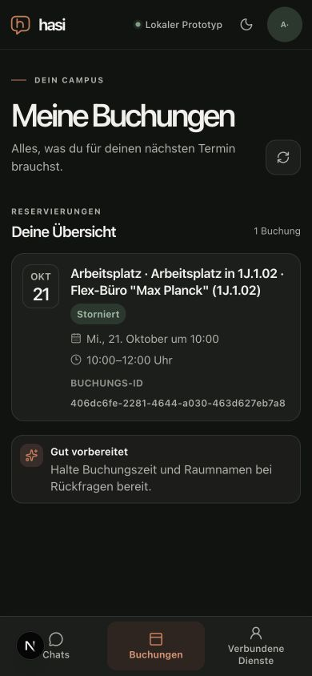

# Native Anny proposal preview preservation

Date: 2026-10-20. [Measured inputs/results](anny-native-proposal-preview-result.json).

The native availability-card preparation path copied only ID, resource, interval,
status and expiry from the authoritative Anny proposal. It lost action and preview.
The pre-confirmation identity check correctly rejected that incomplete UI snapshot;
weakening the check would conceal the defect. Preparation now uses the existing
whitelist/schema/expiry parser, requires a pending booking action, and stores the
complete normalized presentation. API-only fields do not enter strict chat storage.
Cancellation preparation and exact canonical preview comparison remain unchanged.

## Observed counterprobe and positive journey

On the unchanged main baseline, the actual local browser reproduced the supplied
failure: fresh preparation showed a card, explicit confirmation reported a proposal
mismatch and the bookings overview contained zero bookings. An intermediate raw
API-object forwarding attempt failed strict workspace persistence; it was rejected.
The final normalization retains the canonical preview and excludes API-only fields.

In a fresh conversation under the final behavior, the synthetic employee searched
for tomorrow's 10:00-12:00 single-person office in 1J and selected Max Planck 1J.1.02.
Preparation displayed the canonical account, action, consequences and costs.
Reloading before confirmation restored the full pending proposal without a storage
warning. Explicit confirmation succeeded and the overview contained exactly one
booking. Loading own bookings, preparing cancellation and separately confirming it
retained that same single entry with cancelled status. All changes were confined to
the local Anny mock; no external provider or institutional write was made.

At 390x844 the document width remained 390 and no workspace error was visible.
The viewport override was reset, the agent-created tab closed and local services
stopped (launcher exit 0; no listeners on ports 3001/4100-4103).

## Verification and limits

35 focused tests in three files, web TypeScript, affected lint and the production web build pass. The added
regression round-trips the normalized snapshot through strict JSON persistence,
checks preview/action retention and API-field removal, accepts canonical identity
and rejects both the former incomplete projection and changed costs. Existing
expiry, unknown-status, cancellation and confirmation identity guards remain covered.
Independent bounded read-only review found no blocker; it did not repeat the tests.

This qualifies the native UI bug with an offline synthetic persona. Protected OIDC
renewal, disconnect/revocation, managed updates with pending actions, live-provider
quality, physical-device/native-AT and full M7 remain separate gates. Full mandatory
integration, exact-head CI and actual delivery evidence belong to the linked PR;
this bounded report does not accept an entire milestone. The separate ambiguity of
“one workplace”, topic switching and unsupported external-portal advice remain open.
