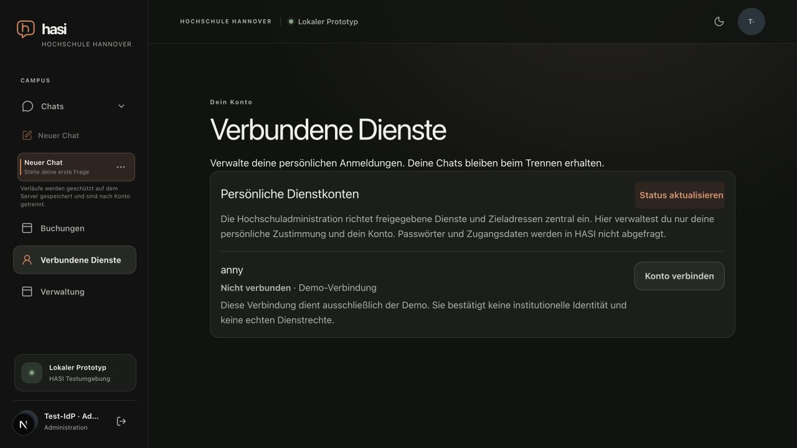

# Caller cancellation and account-panel errors

Date: 2026-10-20. Supporting M2/M7 technical evidence, not milestone acceptance.

The client API wrapper normalized every fetch rejection, including an intentional
AbortError, into an unavailable-service error with status 0. The personal-account
panel already ignores AbortError during effect cleanup. In development StrictMode,
the next setup can make its mounted ref true before the first aborted request's
catch runs, exposing the normalized error to the new view.

The wrapper now preserves an aborted caller's own rejection reason or AbortError
DOMException. An unrelated network rejection that races with abort still receives
the ordinary status-0 diagnostic. HTTP error status, text and structured diagnostics
remain on the existing response path. Five focused mocked-fetch tests cover normal
cancellation, custom reason identity, network failure, the rejection/abort race and
HTTP 403 text/status. Together with proposal-failure tests, 10 cases pass; scoped
web lint and independent bounded source review pass.

## Actual local browser observation

The joined fixture used the actual local TestIdP, two API processes and the Next
application at 1280 by 720. No plugin account consent or model request was made.
On opening Connected services, browser network events showed two account requests:
the first failed with canceled=true/net::ERR_ABORTED, and the second returned HTTP
200. The settled rendered panel showed the Anny account without an unavailable
error. This observes the intended cancellation pattern and settled view, not every
intermediate render or a proof that every previous unavailable message had this
cause.

A controlled local-only browser request block then made Status refresh display the
normal account-service-unavailable message. Clearing that block and refreshing
restored the panel and cleared the error. The temporary blocking rule was removed,
the owned browser tab closed and fixture quit exited 0 with owned processes stopped.
Independent checks found all fixture ports closed and its directory removed. The
owned isolated HOME was removed; the generated Next declaration was restored. The
caller-owned shared test database was retained without reset. Model counters were
zero synthetic calls and zero real-provider calls; source/action counters were zero.

The [bounded sanitized result](api-cancellation-result.json) records the original
base and exact two changed source hashes. The browser used those uncommitted
changes before integration, not a production deployment. Complete mobile,
accessibility, production and M2/M7 acceptance remain separate.

