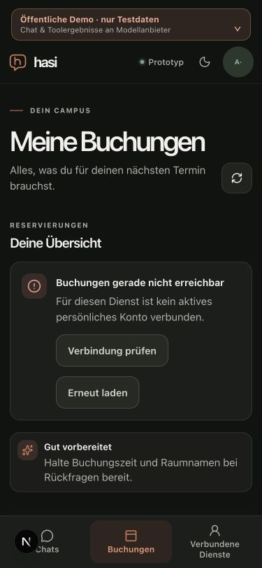
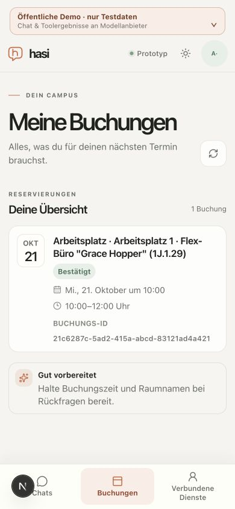

# Booking list errors and connection recovery

Date: 2026-10-20. Related to technical M2 #49 and M7 #54.

An unavailable booking list previously displayed `0 Buchungen` beside its error,
which confused an unknown result with a successfully empty account. A failed
refresh could retain prior cards in state. The page now clears the result on
refresh/failure and exposes its count only after a successful response. The
error offers both retry and the existing account connection flow, with the
allowlisted return path `/bookings`. No API authorization or consent is changed.

## Actual isolated browser journey

The actual Next16.4.2 development app used public-demo rendering, an empty
allowlisted environment, a fresh HOME, synthetic session material and an owned
namespace in disposable loopback PostgreSQL. No model credentials or HsH
session were used. The selected model was explicitly Dialog-Demo.

- Initial unconnected account: unavailable notice, no false zero count; the
  connection action leads to `/account/connections?returnTo=/bookings`.
- Explicit synthetic account consent returns to the booking list. Its successful
  empty response correctly displays `0 Buchungen`.
- An explicit synthetic workplace search, separate proposal and confirmation
  created one mock booking. The list then showed one card and `1 Buchung`.
- Disconnecting that same synthetic account in a second tab did not immediately
  redact the first tab's cached view. On explicit refresh, the actual denied
  request cleared every old booking card and the count, and exposed recovery.
  This is failure-on-refresh proof, not immediate cross-tab redaction.
- Explicit reconnection returned to `/bookings` and restored the same single
  booking, without another write or a duplicate booking.
- Narrow dark and light browser viewports at320/375/390px had no horizontal
  page overflow. The measured connection action was46px high and stayed within
  the narrow viewport. These are browser viewport observations, not native
  iPhone/software-keyboard or assistive-technology acceptance.

The local server and both owned browser tabs were closed, original appearance
and viewport restored, and all31 physical rows in the exact owned namespace
were removed after checking its nonce marker. Non-target namespace fingerprints
were unchanged; the isolated HOME was removed and the caller database retained.
Only the known Next-generated declaration imports were restored. Affected lint,
web types and full CI/delivery are recorded separately in the PR/issue.

The offered preference reply `Ein Büro mit einem Arbeitsplatz.` separately
repeated the office clarification; `Einzelbüro` succeeded and retained the date
and interval. That parser defect and the supplied live-model conversation remain
open. This UI change does not qualify booking dialogue, local200ms performance,
managed-plugin browser rollback or full M2/M6/M7.

## Qualified source identity

`apps/web/src/components/bookings-page.tsx`: SHA-256 `12bbb0bcc303f3e614b84267954aa60c5582f80a65149e0463203a0eee8adaa9`.
