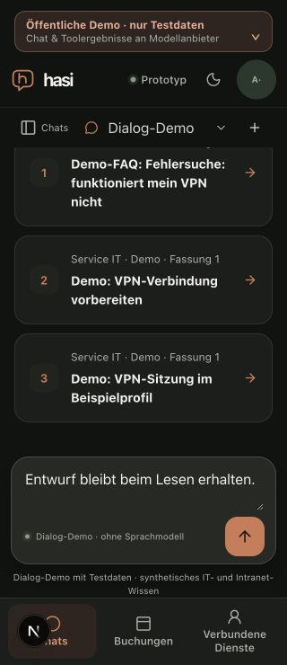
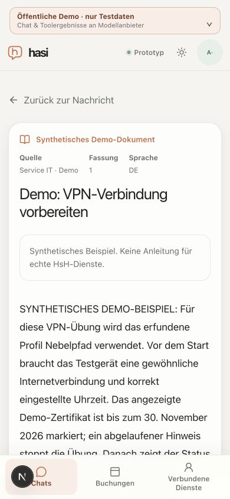

# Compact source discovery and reading on narrow screens

Date: 2026-10-20. Related to M6 #53 and technical M7 #54; follows #151.

A fresh public 320x740 browser check at `75e63ae` showed the long prototype
notice using approximately 240px, leaving very little transcript space. Its
three VPN source cards could not be viewed together. The reader also presented
index/retrieval metadata and nested mobile padding before the document text.

The native default-closed disclosure keeps the demo/test-data and model-transfer
warning visible in portrait. Its complete original warning and GPL link remain
inside a named, focusable, height-limited region. Existing chat rules still hide
the notice while the keyboard is open and on short/landscape viewports; this
change does not promise a warning in those states or change admission policy.

The source reader retains visible title, source, revision, language and synthetic
status. Index/retrieval timestamps, source update date when provided, full
synthetic disclaimer and the technical citation identifier move into source
details. Mobile padding/gaps are reduced. A keyed-reader boolean preserves the
user's disclosure choice across rights checks. A second boolean restores the
summary's keyboard focus only after successful exact-document validation and
only if focus is still on body. Neither contains document text. Previous content
is still removed before every check; an error clears focus-restoration intent.

## Actual local browser qualification

The real Next16.4.2/Node24 development app ran with public-demo rendering, an empty
allowlisted environment, fresh HOME and synthetic 32-byte session material.
It used a unique namespace in the disposable loopback PostgreSQL database,
no provider keys, the explicit Dialog-Demo and no business writes. No HsH
session, institutional document or external content fetch was used.

- At320x740 dark the closed notice is46px and its summary44px. All three VPN
  card titles are visible. Page/viewport widths are both320. The final caption
  explicitly includes chat and tool-result transfer.
- Enter opens/closes the disclosure. Its full text is limited to220px; focusing
  the GPL link with Tab scrolls the region to16px and keeps the link inside it.
- At320px the reader body starts at507.09px, compared with720.69px during the
  initial compact-notice iteration. At390x844 light, body top is also507.09px,
  the complete warning remains visible and page/viewport widths are both390.
- Enter opens the metadata details, exposing the full disclaimer, timestamps
  and identifier. An actual periodic authorization refresh replaced the article:
  details stayed open, reader height1283.78px and scroll505 were unchanged, and
  focus returned to the metadata summary. This is success-path proof only.
- Returning to chat focuses the exact originating source message and preserves
  the visible draft `Entwurf bleibt beim Lesen erhalten.`
- At844x390 landscape the existing notice-hiding rule applies. The input remains
  inside the viewport at331–375px, with no horizontal page overflow.
- Exact revision999999 produces the unavailable notice and zero document bodies.

Original dark mode and viewport were restored; the owned browser tab and local
server were closed. All30 exact owned namespace rows were removed, the namespace
is physically empty and all other local namespaces have unchanged fingerprints.
The isolated HOME was removed and the caller's database retained. Only the known
Next-generated declaration imports were restored. Affected web lint/types and
independent bounded static review passed; the reviewer did not repeat the UI
checks. Full pre-push and hosted CI/delivery are separate records in the PR/issues.

These are technical browser observations, not native iPhone/Safari, software
keyboard, native assistive technology, local200ms performance or full M7
acceptance. Model grounding, generic search relevance and the submitted booking
conversation remain open in #53. No provider/model selection changed.

## Qualified source identities

| File | SHA-256 |
| --- | --- |
| `apps/web/src/components/public-demo-notice.tsx` | `a521846e42da9a276033bff452ca0391ec39cff4391bea351f8a7d3e110775ba` |
| `apps/web/src/components/knowledge-document.tsx` | `cf25b48672bc430e23959bca438d9b2a897c1f7158c8a953a7e926a7cd7c3cd5` |
| `apps/web/src/app/globals.css` | `1c73cfa8a07c47444466925f37f385e37f540b097446ad61e3966965355caf65` |
