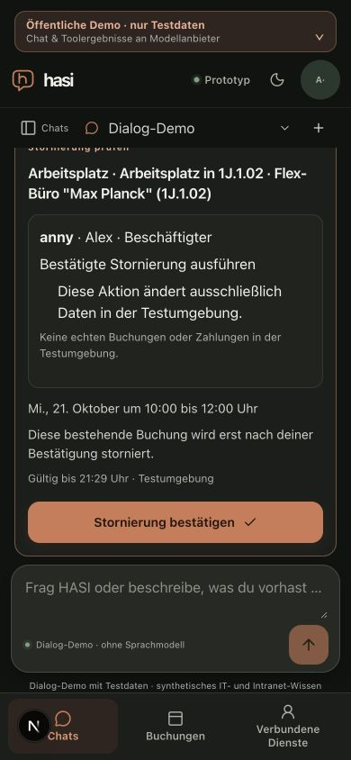
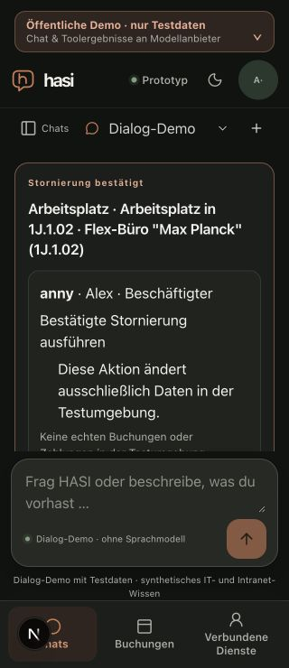

# Current action context and in-chat confirmation recovery

Date: 2026-10-20. Related to the supplied dialogue regression in M6 #53 and technical M2 #49/M7 #54. This is bounded technical evidence, not milestone acceptance.

The supplied dialogue retained an old pending proposal in provider history after a failed confirmation and topic switch. UI confirmation attempts were user utterances in model history, while their host-side outcomes were display-only. The model then invented an external confirmation portal. Native preview identity was repaired previously in #145; this slice repairs the context and recovery boundaries.

## Change

- Generated button-attempt utterances stay visible and timestamped but no longer enter new model wire history. Existing saved histories are preserved.
- The provider-only projection removes paired historical booking/cancellation proposal calls and results. For a turn without native Anny tools it removes all native Anny cycles. It preserves source/dynamic-tool pairs, current-turn proposal cycles, useful discovery, ordinary conversation and original persisted history. Verified user calendar anchors follow the projected positions.
- A request may carry up to eight distinct UUID lookup handles, never client status/preview claims. Fixed authenticated GETs read the actor-authorized current proposal status. Only ID and allowlisted status reach the model; unreadable, foreign, malformed or timed-out results become `unavailable`, which establishes neither success nor failure. A shared three-second deadline includes body reads and best-effort cancellation. Caller abort is terminal before generation.
- The host rechecks those status snapshots immediately before provider attempts and after generation. A changed snapshot discards the response with action-specific guidance. A pre-dispatch denial releases the unused reservation; completed provider usage remains charged when a later status change discards its answer.
- Bounded German/English questions about missing confirmation controls take a host-owned path without a model call or business write. It freshly reads and compares the exact displayed preview and monotonic status. Only an identical still-pending card can regain its confirmation control. Completed, expired, uncertain, changed or unreadable actions cannot be promoted to pending by this help request. Actual confirmation still performs its existing independent preflight and separate execution.

The help path retains focus/scroll priority until the next user action. Tall previews keep the complete 46px confirmation button inside the chat scrollport rather than underneath the composer. A stale completed card remains readable with its status; no external portal is asserted.

## Qualification

Focused offline route/helper/router/projection/control tests cover current status, owner denial, malformed bodies, ID bounds, deadlines, stalled stream cancellation, status changes before/after provider I/O, caller abort, reservation settlement, mixed native/knowledge/dynamic pairs, timestamp positions, changed previews, expiry and terminal/uncertain status regression. Injected provider fetches observe the outgoing context; these are not real model-quality results. The action context is host-owned and request schemas reject client status claims.

The actual Next16.4.2 development app ran with public-demo rendering, an empty allowlisted environment, fresh HOME/session material and an owned loopback PostgreSQL namespace. No dotenv/model key or institutional data was used. Dialog-Demo and synthetic account consent were explicitly selected.

1. Tomorrow in1J,10:00–12:00 produced availability-checked single-office workplaces. The exact Max Planck1J.1.02 workplace from the submitted case produced a pending preview.
2. A VPN question left the action inactive. The German missing-button question freshly restored the unchanged pending card, and a separate explicit click confirmed one booking. The booking list showed one matching card.
3. A separate cancellation proposal for that booking was prepared. After another VPN topic switch, missing-control help restored its exact confirmation. A browser observation exposed focused-but-offscreen controls; the final scroll-priority repair was reloaded before qualification. The final390px observation measured the enabled, focused button at556.75–602.75px inside the164–619px chat scrollport, with page width390. The full button was visible. The English help variant also used the fixed host notice after the fresh reload.
4. Enter explicitly confirmed that cancellation. At320px, subsequent help kept the completed card focused and exposed zero cancellation-confirmation buttons. Page and viewport widths were both320.

All owned browser tabs were closed and viewport restored. The local server stopped, its nonce ownership marker was checked and all43 physical owned rows/HOME were removed. Both the original non-target namespace fingerprint and the cleanup transaction's non-target fingerprint remained unchanged; the test PostgreSQL database was retained. Only known Next-generated declaration imports were restored.

No live Groq dialogue, protected TestIdP/native managed-plugin browser journey, actual iPhone/assistive technology, local200ms or broad semantic/adversarial acceptance is claimed. The browser journey used the pre-#157 revision1 corpus; it proves action recovery, not corrected VPN prose. M6 human review/adjudication and the complete submitted live-model regression remain open.

## Qualified source identities

| File | SHA-256 |
| --- | --- |
| `apps/web/src/components/assistant-page.tsx` | `40ad289fcbb5e4481c0ed4c4452fa55ada27959ac454c62ef5cd8033f1be681e` |
| `apps/web/src/lib/chat-action-guidance.ts` | `e429b15e1b39d8b5390187bd3b48f3ee90284bb1cefec13e57936241ba54f222` |
| `apps/web/src/lib/chat-tool-context.ts` | `79fb113fb6e3963d6cc3b3f800f46e700a0dd3292ee62543852462ef4b75f1b2` |
| `apps/web/src/lib/server/action-context.ts` | `6d53d6a1fb80408d74ea9fd16805fe2287e3efa372e171e0c1a0491d231a3883` |
| `apps/web/src/app/api/chat/route.ts` | `29f84d4b8d444bb1a8b7ed61543d23a4cda62680240ae95eb38694e080eea8d3` |
| `apps/web/src/lib/server/model-router.ts` | `5e78693ff2b67e5bd523b47950e2446f676695ba1cbc4b2ee98c015089be6b89` |
