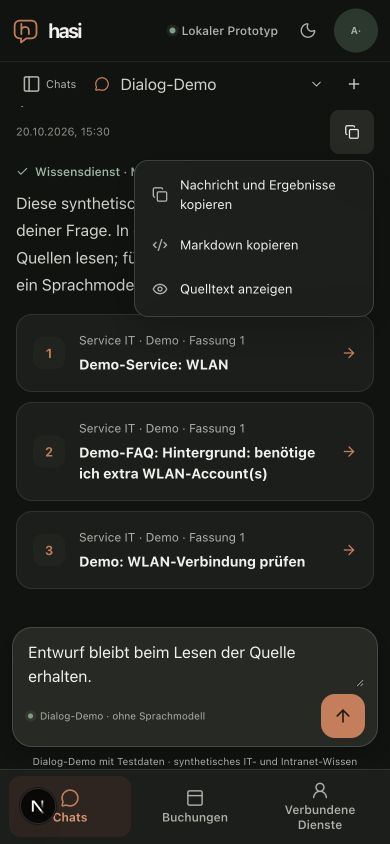

# Readable sources in normal message copy

Date: 2026-10-20. Follow-up to [citation/reader navigation](knowledge-link-ux.md).

Normal message copy now exports an eligible assistant citation as a readable
`[Quelle n](same-origin-reader-URL)` reference. Copied source cards include the
title, source label, revision and canonical reader URL. Opaque citation IDs and
retrieved document bodies are omitted. Unmapped canonical tokens become an inert
unassigned-source label. User-entered text is unchanged. The separate Markdown
copy and source-view options retain the exact original Markdown, including any
literal source markers.

The caller passes only that message's eligible answer/source-card mappings.
Normalization ignores supplied URLs and reconstructs the document/revision route;
no model-provided URL establishes a verified source. Existing API permission and
revision checks still apply when a recipient opens the link.

Twelve focused clipboard serialization tests pass, including a forged supplied
href, unmatched/wrong-revision mapping, hidden-content exclusion and unchanged
explicit Markdown source. Independent bounded source review found no blocker.
Root/web types, affected lint and a production web build passed for this candidate.

In the actual local browser, a stored synthetic Dialog-Demo knowledge result
showed three numbered, titled source cards with no foreground technical IDs. A
source opened its matching reader in the same tab; “Zurück zur Nachricht” returned
to the original chat/message, focused it and retained the unsent draft. The normal
copy control reported success. The browser automation clipboard read returned an
empty string, so an end-to-end clipboard readback is **not** claimed; output
content is verified by the serialization tests. The source-view dialog displayed
the unchanged message. At 390×844 the document width remained 390; the temporary
viewport was reset and the owned tab/services were closed/stopped. No live
provider calls were made. This is not a native-iPhone, assistive-technology,
formal latency or complete M7 acceptance result.

