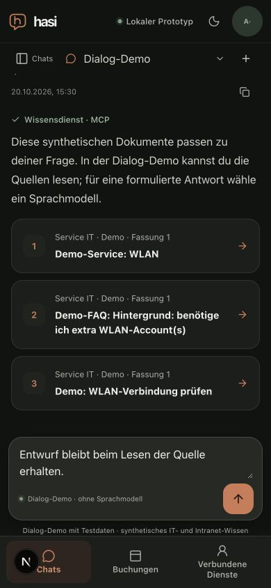
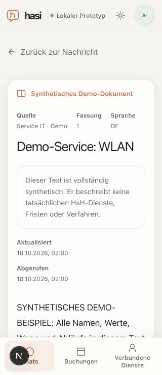

# Knowledge citation and reader navigation UX

Date: 2026-10-20. [Measured inputs and bounded results](knowledge-link-ux-result.json).

The earlier UI exposed opaque source IDs in cards and inert model citation tokens,
opened a separate tab, and linked the reader back to the chat root without a
message position. Exact eligible citation tokens now render as numbered links
matching the source cards. Unknown or mismatched tokens render an inert `[?]`
with an accessible explanation. Code and authored links/references are not rewritten. Raw HTML attributes
cannot inject citation markers, HTML blocks are dropped and remote images are
not rendered. Generated AST markers and canonical
host-built document-ID/revision routes prevent model URLs from establishing a
verified source link. The Markdown source remains unchanged for copying.

Mappings are scoped to one conversation. OIDC answers use only preceding source
contexts named in their server-verified evidence. The unsigned synthetic demo
uses only synthetic sources retrieved in the same user turn. Cards use title,
source and revision; technical IDs are available in collapsed reader details.
The existing authenticated reader still rechecks document permission and exact
revision; UI navigation metadata grants no access.

Source links open in the same tab. UUID-bounded chat/message metadata constructs
a fixed local return route. Both the reader return link and browser Back restore
the conversation and focus the originating message. An unsent draft survived the
actual local browser exercise. Deleted/missing destinations fall back to the
current chat; direct reader visits retain the chat-root fallback.

## Verification

Node 24: 26 focused tests in six files, root/web types, full web lint and the
production web build pass. Positive/counter tests cover exact mapping, unknown
and wrong revision, invalid IDs, supplied URL injection, authored-link marker
impersonation, code/reference preservation, evidence-context selection and
same-turn synthetic restrictions. No real model/provider calls were made. An independent bounded source review
found no blocker; it did not repeat the browser observations.

The actual local multi-process app was exercised through the in-app browser with
an employee fixture and explicit offline Dialog-Demo. At 390x844 in dark mode,
three source cards measured 358 px wide and 78/99/78 px high, with no horizontal
overflow, new-tab targets or foreground technical IDs. At 320x740 in light mode,
the reader had no horizontal overflow and kept source details closed. A valid
source read displayed the document; the same route with revision 999999 displayed
the unavailable message and zero visible document bodies. Return remained usable.
Viewport/theme overrides were reset, the agent tab closed and local services stopped.

This is bounded local browser/component evidence. Inline numbered answer links
are covered by rendered component tests; no live-provider answer journey,
physical iPhone/assistive technology, formal UI latency, full M7 qualification or
institutional authorization is claimed. Those criteria remain in their existing
milestones. The separately reported Anny preparation/confirmation mismatch and
unsupported external-portal advice are not fixed by this change.
