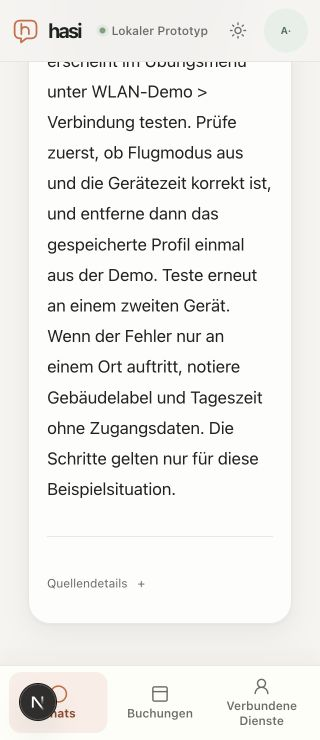

# Scrollable source reader and stable return navigation

Date: 2026-10-20. Related to source UX under M6 #53 and technical M7 #54.

The public 390x844 browser showed a real clipping defect: the knowledge document
used `app-frame--chat`, whose viewport-sized frame hid overflow. The document
body began below the visible viewport, while the page height remained 844 and a
scroll gesture changed no scroll offset. A navigation selection label had been
used to choose the fixed chat layout, so source pages inherited it.

The fixed chat viewport/layout now applies only to the actual root chat route.
Sources retain the selected Chats navigation item but use normal document flow.
Selecting another sidebar session from a source now navigates to the chat route;
previously the selected navigation label prevented that callback.

After this layout correction, the actual local reader exposed another defect:
an automatic rights refresh removed its article, collapsed page geometry and
reset scroll476.5 to0. The reader now reserves only its measured height while
rechecking rights and excludes its replaceable content from browser scroll
anchoring. It still removes the previous article before every check. Only a
successful authenticated response with the exact requested ID/revision restores
the article; unavailable/error states do not retain it. User/document/revision
component identity, request-abort/mount checks and refresh cadence are unchanged.

## Actual browser observations

Node24 / Next16.4.2 local development services were launched with an empty,
explicitly allowlisted environment and isolated HOME. No real provider keys,
model calls, booking/cancellation writes or production database were used.

- At390x844 dark, normal page scrolling made the source body and footer
  reachable. The corrected freshly loaded reader kept scroll476.5 and body
  top148.99px across an automatic refresh and actual article DOM replacement.
  The old reader reset to0. This is bounded browser evidence, not a formal
  network-fault or source-revocation test.
- At320x740 light, document width/scroll width were both320. The complete body
  and footer were reachable; footer top561.16px at scroll848.5. Source details
  stayed collapsed. The image below records that local result.
- A nonexistent exact revision999999 displayed the unavailable alert and zero
  document bodies, with no horizontal overflow. “Zurück zur Nachricht” focused
  the originating assistant message and retained the existing unsent draft.
- At1280x720, selecting another named session from the source opened that
  conversation at the root route, restored `app-frame--chat` and removed the
  source reader. No message was sent.

The original dark theme and normal viewport were restored; the owned tab and
all five local service listeners were closed. Only the known generated
next-env declaration difference was restored; isolated HOME was removed.
Independent bounded source review found no protected-content or lifecycle
blocker; it did not repeat browser/tests. Success-path scroll stability is the
qualified claim: an error/denial can collapse the page to its unavailable notice,
and a viewport change while a request is pending can leave temporary blank space.
Physical iPhone/Safari, native assistive technology, UI latency and complete
M7 acceptance are not established. Existing route/access tests and hosted CI
remain separate; source/model grounding defects remain in #53.

## Qualified source identities

| File | SHA-256 |
| --- | --- |
| `apps/web/src/components/app-shell.tsx` | `5e499ad9591c1416cd73530200fcde2a2fbf90a7b1f39663f76ea0454be42fdf` |
| `apps/web/src/components/knowledge-document.tsx` | `14ed47441257df0f50ceab12981dbb81924486e849bb48e22341fb88a0bca7de` |
