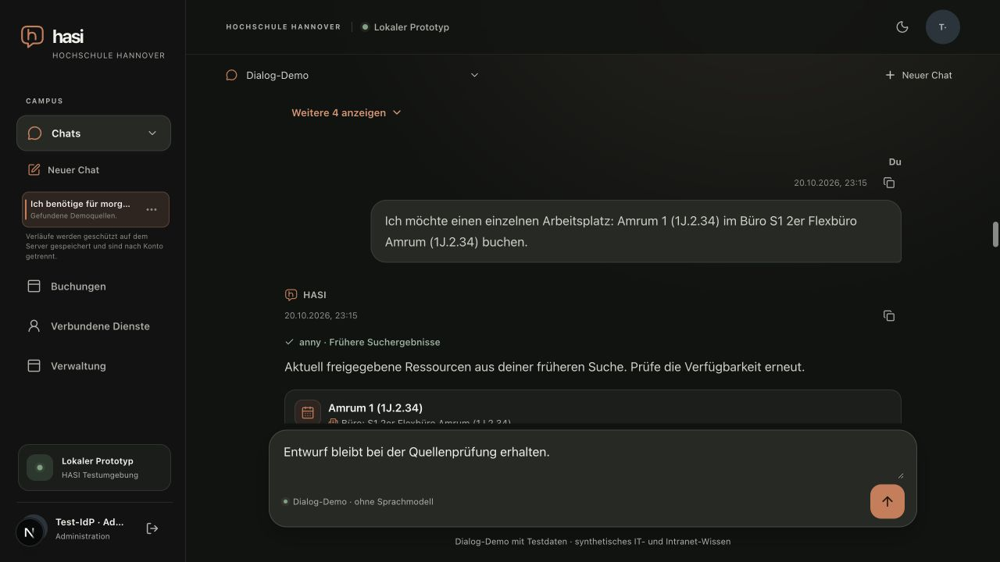

# Local UI feedback measurement

Date: 2026-10-20. The [machine-readable result](local-ui-feedback-result.json) contains the raw final positive and delayed-counter samples.

After a full client reload, the final local browser run recorded 20 interactions for each of navigation, opening the chat actions menu, expanding/collapsing room results, and changing the theme. All four sets passed the 200 ms limit. The maxima below retain the raw `performance.now()` precision.

| Interaction | Samples | Maximum | Gate |
| --- | ---: | ---: | --- |
| Navigation | 20 | 14.399999856948853 ms | Pass |
| Actions menu | 20 | 24.799999952316284 ms | Pass |
| Room results | 20 | 14.5 ms | Pass |
| Theme | 20 | 16.600000143051147 ms | Pass |

The probe starts timing only after a trusted click on a visible, uniquely identified control. It observes the expected state change with a `MutationObserver`, then checks the result after two animation frames and requires the relevant control or content to be visible. Durations are compared to 200 ms without rounding. Eleven focused tests cover the threshold boundary and above-bound rejection, delayed countercase, malformed or missing samples, recorded hidden-page failures, origin restriction, invalid delay, and missing targets.

The delayed counter run used the same path with a deliberate 250 ms main-thread delay on all 20 navigation samples. The navigation maximum was 254 ms, so the gate rejected it as over the limit. Each delayed click still reached visible feedback; the sample status records that observation, while the aggregate gate separately enforces the threshold. The other 60 samples are the unchanged successful zero-delay baseline for the menu, results, and theme.

The run used a local Next.js development server, a local TestIdP, two API replicas, and PostgreSQL synthetic fixtures with the synthetic Anny persona, synthetic knowledge, and the offline Dialog-Demo. The browser was Chrome 155 at 1280×720, DPR 2, in dark mode. Fixture statistics show zero synthetic model calls and zero real-provider calls. One native Anny test booking was exercised for Amrum 1 on 21 October 2026, 10:00–12:00; it was not a real booking.

A preliminary visibility preflight recorded 60 successes across navigation, menu, and theme, one successful results expansion, and one missing results target because the toggle was clipped outside the viewport. This preflight is not part of the final result. Before the collapse fix, a separate results-collapse sample timed out after 2004.5 ms while the focused toggle remained about 600 px above the viewport. After the fix, `useLayoutEffect` scrolls the focused toggle into view with `scrollIntoView({ block: "nearest", behavior: "instant" })`; it was visible at vertical bounds 122–166 px in the chat viewport. The final positive run was captured after a full client reload, so an earlier stale-client HMR observation is not used as final evidence.

Independent bounded source review found no actionable regression in the collapse correction. The visibility check covers CSS visibility, viewport intersection and clipping ancestors; it does not establish actual painted pixels or exclude occlusion by overlapping siblings or top-layer elements. The screenshot supports this tested collapse state, not arbitrary overlays.

The probe is local-only and measures visible client-side UI feedback. It says nothing about server, model, provider, or request latency. This is one local Chrome viewport, not a mobile matrix, and it is bounded prototype evidence rather than full M7 qualification. Cleanup stopped owned processes and closed ports 3001 and 4100–4103, removed the temporary test HOME, restored the generated Next declaration and original dark theme, disposed the probe, and closed the owned browser tab. The caller-owned PostgreSQL instance was retained.
