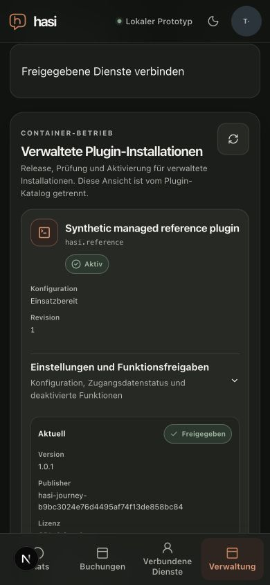
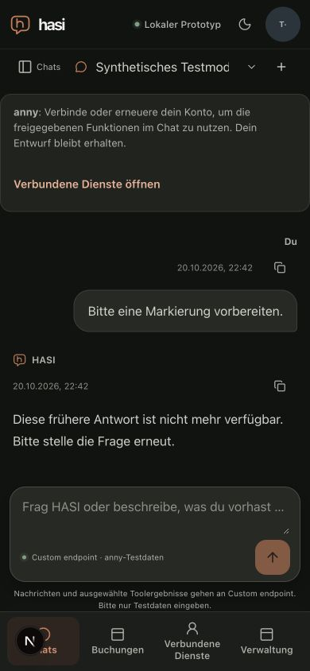
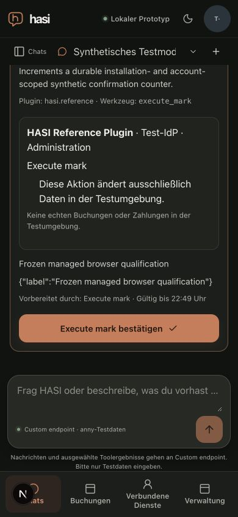
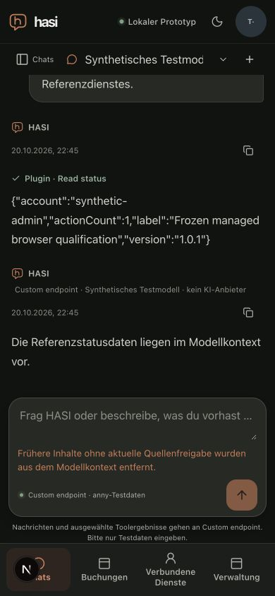

# Held managed-plugin browser runtime

Date: 2026-10-20. Supporting technical evidence for M2/P5/P6 and M7; this is not milestone acceptance.

## Composition

`pnpm journey:serve --managed` opts into the actual separate
`apps/api/src/managed-plugin-worker.ts` process. The existing default invocation
retains the direct reference-process fixture and its IPC failure controls.
Unknown, repeated or combined CLI operations fail before fixture startup.

Managed mode composes the existing local TestIdP and protected Next frontend,
two separate API processes over one PostgreSQL namespace, the signed authority
directory, private admin/contract RPC, settings and deployment bindings, the
actual Docker installer driver and its revision-fenced gateway. The API registry
uses its normal per-registration guarded transports: native fixture origins are
local test registrations; the managed reference registration uses the exact
operator-managed loopback exception. A global transport cannot be substituted
without breaking the native registrations.

Two local Git snapshots, versioned 1.0.0 and 1.0.1, are packaged offline. Both package
metadata and manifest versions change. Their complete packaged trees are verified
before image building. A generated publisher key signs the two pinned release
envelopes and supplies the explicit publisher approval. Docker builds use
`--network=none --pull=false` and require the approved base image already present.
The browser performs configuration draft/save/activation, candidate staging,
explicit review and activation through the existing admin routes. Terminal
commands cannot stage, approve, activate or roll back managed releases.

The worker alone receives Docker socket configuration. API, web, plugin and model
configuration contain no operator or real model-provider credentials. The local
HTTPS model fixture receives a fresh synthetic credential and trusts only its
short-lived local certificate through `NODE_EXTRA_CA_CERTS`; TLS verification is
not disabled. The per-installation gateway transport and plugin SERVICE_TOKEN
slots have different logical names but intentionally resolve to the same generated
credential, because the gateway forwards Authorization unchanged. This is not
independent credential separation.

## Operator prerequisites and controls

Use the opt-in/database and dotenv-presence restrictions from the
[joined fixture](joined-plugin-runtime.md#run). Managed mode additionally needs an
explicit local Unix Docker endpoint and the approved cached base image. A remote
Docker service and a remote/production PostgreSQL database are rejected.

Launch with an isolated HOME, an isolated XDG_CONFIG_HOME and a minimal pnpm
configuration pointing at the already prepared public offline package store and
metadata cache. Preserve stdin in the held terminal; do not feed the launcher's
source code through the same stdin channel. The parent retains an explicit
DOCKER_HOST only for local Docker admission. Its child environment allowlist does
not propagate that socket setting to the web/API/native services.

The ready event reports the evidence file, two API replicas and `managed:true`.
It follows an actual protected TestIdP login/workspace/logout readiness probe.
That readiness probe is not a browser journey.

Managed terminal commands are `stats`, `expire-anny`, `expire-reference`,
`revoke-reference` and `quit`. Statistics contain explicit numeric/identity
metadata, never private worker configuration or credential values. Release
lifecycle actions remain in the admin UI.

On shutdown, the fixture withdraws the exact owned route and stops the worker.
It validates the complete owner-filtered container batch, including full 64-character
IDs, installation/plugin/managed/role labels and absence from the pre-run
inventory, before removing any container. Unrelated new containers are ignored.
Owned networks and image identities are verified before deletion. The caller's
database and namespace are retained; a failed/unproven cleanup retains private
recovery files and fails the process. The final event reports the explicit
managed cleanup counts only after successful verification.

## Verification and limits

Focused configuration, child-process, model, proxy and managed boundary tests
pass 38 cases across 5 files. The boundary suite covers valid admission and
remote/ambiguous/malformed countercases without Docker or database I/O. Actual
no-opt-in and malformed-managed CLI counterprobes both exited 1 at preflight.
Backend build, TypeScript and affected ESLint checks pass. Independent bounded
source review found no actionable blocker; these checks do not establish runtime
cleanup, browser behavior or broad security acceptance by themselves.

The first development run exercised actual admin configuration and v1
stage/review/activation, separate personal consent, a model-planned MCP read,
v2 stage/review/activation, historical-result/proposal redaction after update,
one fresh browser-confirmed synthetic action, a subsequent v2 read reporting
`actionCount:1`, and an admin rollback to v1. The admin page measured 390px
viewport/document width with a 362px managed panel. One initial personal-account
load showed a transient unavailable message; an ordinary status refresh loaded
both accounts and the subsequent consent completed. No cause is inferred.
No stale-action HTTP denial is claimed: the stale button disappeared during
history revalidation before the attempted click was dispatched.

That first run is development evidence only: the helper was edited while it was
running, and its initial shell launch did not preserve stdin for fixture commands.
Its actual terminal shutdown reported owned processes stopped; an independent
inventory found no remaining containers with its exact owner label. The following frozen-input
rerun supplies the bounded final-harness evidence.

## Frozen-input browser run

The [sanitized result](managed-browser-result.json) records base commit
`1c14ed285263485f40b0020544c6c76e9c9115ad`, the four harness/test file digests,
two source commits, both verified package digests, image/release identities,
model counters and cleanup. All four file digests were captured before startup
and rechecked unchanged before shutdown. The operator launch preserved stdin;
`stats`, the expiry command and `quit` were observed through that live terminal.
An unsupported direct-version command was rejected without changing the managed
release. No real provider request occurred; the model fixture counted 4 synthetic
HTTP calls and 1 correlated reference read result.

Actual browser observations:

- Administrator login used the actual local TestIdP. Configuration was saved as a
  draft and activated separately. Both v1 and v2 went through stage, explicit
  review and activation in the admin UI, with the separate personal consent flow
  in between. The API round-robin composition contained two distinct processes.
- A pending v1 proposal was visible before the update and removed from protected
  history after v2 activation, before its natural expiry. No stale confirmation
  button remained. This is UI/history evidence, not a dispatched stale HTTP
  confirmation counterprobe.
- A fresh v2 proposal was confirmed once through its button at 390px. Its button
  was 46px high at 513.07–559.07px, inside the 106–604px chat scrollport. The viewport
  and document were 390px wide; the managed admin panel was 362px wide. The subsequent
  real MCP read reported `version: 1.0.1` and `actionCount: 1`. The protected confirmed
  receipt and read result survived a full reload.
- The expiry control was acknowledged by both API replicas. Reloading then
  removed the reference read result, answer and action card and offered account
  renewal. The normal simulated consent flow returned to the same conversation
  with its unsent draft intact. The old read result and answer remained redacted;
  the durable confirmed receipt could be shown again, with status-check control
  and no pending confirmation button. No extra action or model call was made.
- Admin rollback restored current version 1.0.0 with v2 retained as previous.
  After logout and student TestIdP login, `/admin` displayed the access-denied
  view and direct navigation to `/api/admin/managed-plugins` returned HTTP 403.
  This is a real API denial, observed through the browser network response.
- The first account-panel load could briefly display an unavailable message;
  during renewal it cleared after the ordinary load completed, without a status
  retry. A separate no-network probe confirms that `apiRequest` currently converts
  an aborted fetch into an ordinary status 0 error. Source review identifies a
  StrictMode cancellation race, but the precise browser-event ordering was not
  captured. Repair and lifecycle qualification remain open.

`quit` exited 0. Runtime cleanup withdrew the route, stopped the worker and
removed 4 owned containers, 3 networks and 2 images. Independent local inventory
confirmed no resources with the exact run owner remained and ports 3001/4100–4103
were closed. The fixture retained its caller database as contracted; only the
outer operator then removed its newly owned disposable PostgreSQL container and
isolated HOME. The shared test database and public HASI deployment were not
reset. The generated Next declaration was restored; temporary browser tabs were
closed and viewport overrides cleared.

## Remaining gates

The reference Docker launcher uses in-memory state. This runtime does not prove
state preservation across container replacement or independently published external
artifact distribution. Temporary local Git snapshots are packaged local inputs,
not a public plugin release. The production composition, complete hostile-input,
reauthentication/accessibility/mobile matrix, UI 200ms measurements and current
Coolify rollback evidence remain separate gates. No institutional data, real
provider call, paid model comparison, public deployment or live business write is
part of this runtime.
