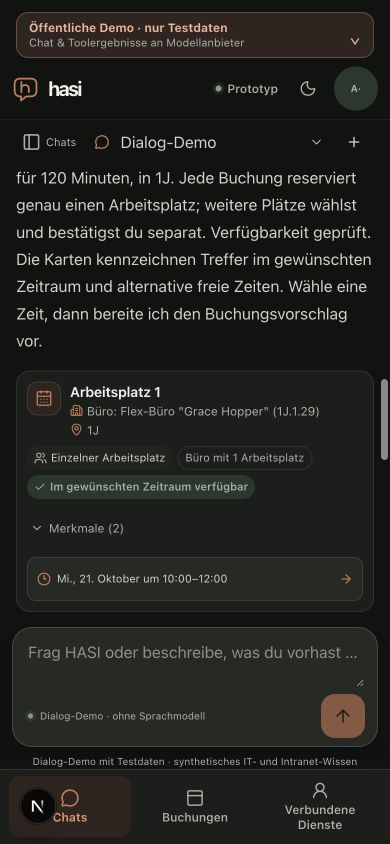

# Offered office preference replies

Date: 2026-10-20. Related to the submitted dialogue regression in M6 #53 and
technical M7 #54. This is a bounded deterministic parsing correction.

The clarification offered “Ein Büro mit einem Arbeitsplatz”, but the parser did
not recognize that reply as a single-occupancy office preference. Its standalone
fast path and the model router also maintained separate phrase lists. The shared,
bounded full-reply parser now recognizes the offered single/shared descriptions,
retains the existing interval and building, and does not create a stray `platz`
resource query. Generic `1 Arbeitsplatz` still expresses quantity, not occupancy.
Only complete preference replies use the direct path. Negation, compound tasks,
new date/time clauses and VPN additions do not trigger that shortcut. No provider,
credential, authorization or confirmation policy changes.

## Qualification

- The new regression checks initially failed in three expected places: the
  single-office type was absent and both offered replies missed the direct path.
- After correction,189 tests across chat-demo, chat-tool-loop, model-router,
  room-dialogue and anny-chat-tools pass. Fake-provider observations check forced
  discovery after historical results and negative/compound countercases. These
  are injected provider fixtures; no live model call was made.
- An independent bounded source review found no blocker in the standalone flow.
  It did not repeat the browser or provider qualification. A pre-existing compound
  shared-office phrase with added date/time may leave `platz` in the generic query;
  that broader parsing behavior remains outside this standalone correction.
- The actual Next16.4.2 development app ran with public-demo rendering, an empty
  allowlisted environment, no dotenv files, no model keys, fresh HOME/session
  material and an owned disposable loopback PostgreSQL namespace. An explicit
  synthetic consent connected anny; Dialog-Demo was explicitly selected.
- Query: tomorrow in1J,10:00–12:00. Exact offered single-office reply yielded
  seven availability-checked single-occupancy workplaces; all seven were expanded
  and visibly labeled `Büro mit 1 Arbeitsplatz`. Date21.10.2026,10:00–12:00 and
  building1J remained. The exact shared-office reply then produced shared-office
  cards retaining that interval. No proposal or booking was executed.
- A second fresh chat repeated the query. `1 Arbeitsplatz` retained clarification
  instead of inferring single occupancy. The exact offered single-office reply
  then produced the filtered results. At390px page and viewport widths matched.

The owned tab/server were closed, viewport restored and all38 physical owned
namespace rows removed after checking its nonce marker. Other namespace
fingerprints were unchanged; the isolated HOME was removed and the caller's
PostgreSQL database retained. Only known Next-generated declaration imports
were restored. Affected lint and web types pass. Full pre-push/hosted delivery
are separate PR/issue records.

This does not qualify the supplied live-model booking/topic-switch conversation,
synthetic VPN instructions, semantic retrieval, native devices, accessibility,
local200ms performance or complete M2/M6/M7.

## Qualified source identities

| File | SHA-256 |
| --- | --- |
| `apps/web/src/lib/chat-demo.ts` | `0bfcf0a4d8e2d8fd8efeedc05801ee72a0223450da9e3ecbc25cd66aa2607a1d` |
| `apps/web/src/lib/chat-tool-loop.ts` | `93c01150c8080c87f4ca347797657b63c5f3b99d934957a157b1dbf1ec5a53de` |
| `apps/web/src/lib/server/model-router.ts` | `e9f5a3b1e3d1461c5aa03988c69a4e4f171f486d0c1e96fbd5fe9590d3c95da6` |
