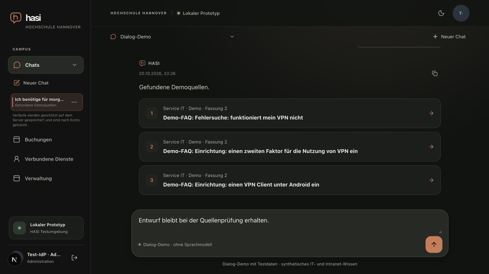
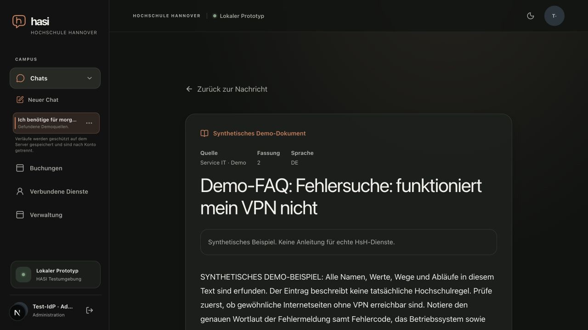

# Offline knowledge context retention

Date: 2026-10-20. Related to M6 issue #53.

Tested revision: `de45f0ff963b5c34dc2036183151677b52fd4dc2` (local candidate,
not `main`). Browser: desktop Chrome 155 at 1280x720.

## Local browser verification

The isolated joined fixture used Next on port 3001, the local TestIdP, two API
replicas and PostgreSQL. The browser used the Dialog-Demo with synthetic Anny
and knowledge services.

Before the fix, a knowledge tool POST returned HTTP 200 with three documents
and a context receipt. The three source cards rendered, then autosave redacted
them because the offline search path had not retained the `sourceContextId`
that links the displayed cards to that receipt.

After the fix, a new VPN search retained all three revision 2 cards through
canonical save and a full reload. Opening source 1 at
`/sources/svc-catalog-6c79c1e68f04?revision=2` showed the matching synthetic VPN
troubleshooting document. Reloading the reader and returning to chat focused
the originating message and preserved the unsent draft
`Entwurf bleibt bei der Quellenprüfung erhalten.` The previously stripped cards
did not reappear.

The return screenshot shows all three cards and the retained draft; the reader
screenshot shows the exact synthetic revision 2 document. This is one desktop
browser viewport, not a mobile-device or broader viewport matrix.

## Authority and limits

`sourceContextId` remains required as the server-side reference to a knowledge
context. Workspace reload resolves it through the current resolver, which
checks current authorization and supplies the current documents. Missing,
mismatched or unresolved receipts fail closed; browser-carried source bodies
do not restore authority.

There were zero model/provider calls and zero real service calls. One native
synthetic Anny booking had been confirmed earlier in the fixture session; this
result does not establish the complete failed Groq dialogue acceptance flow.
That work remains open in #53. The focused 23 tests, ESLint and TypeScript
checks had passed for this candidate before this report was added; code checks
were not rerun for this documentation-only change. This verification makes no
UI latency claim and does not establish production integration.
