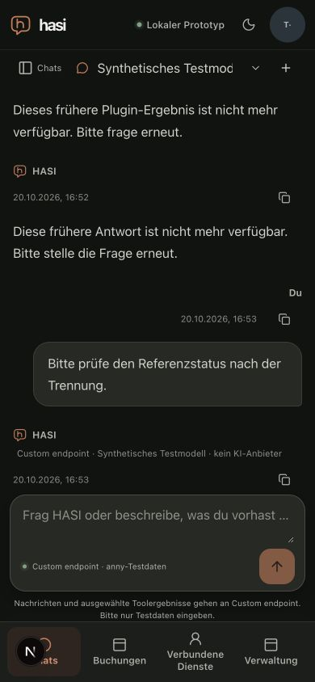

# Personal disconnect: protected display and later model context

Date: 2026-10-20. [Bounded observations and measured identities](protected-disconnect-result.json).

The first joined browser probe reproduced a real UI defect: after a successful
personal disconnect, immediate SPA return still showed two old source results and
the two dependent assistant answers. A later model request already excluded the
revoked context. Server filtering was correct; immediate cached display was not.
That earlier run is retained as a failed UI probe, never a passed journey.

A confirmed disconnect now synchronously redacts the shared protected store before
the POST begins. A local barrier prevents chat controls and workspace recovery while
the account mutation is in flight. Old read successes, failures and queued-save
acknowledgements cannot update a newer authority generation. Only a fresh owner-bound
canonical response after the mutation can restore currently permitted content.
A failed/aborted mutation leaves content redacted until an explicit successful
recheck. Unsent drafts survive. Recovery also preserves the selected chat when it
still exists in the merged workspace; canonical content continues to own that chat.

## Joined local browser observations

The final fixture used the real local web UI, TestIdP, two API OS processes,
protected PostgreSQL history and an independently packaged SQLite-backed reference
plugin. The deterministic HTTPS model received old reference context before the
personal disconnect: after the second read, both prior-result and prior-answer
counters were 2, and two requests contained that earlier context. This positive
probe demonstrates that the observer is not a constant-zero detector.

After explicit disconnect and immediate SPA return, neither the old label/source
cards nor the exact dependent fixture answer remained visible. The unsent draft
remained in its original chat. A third prompt produced the reconnect notice; the
three prior-context counters remained 2/2/2, a zero delta after revocation. Two
source invocations total, five fixture model calls, zero real-provider calls and
zero effects/executions were observed. Reload still hid the old source and answer.
The 390×844 viewport had document width 390. The owned fixture processes stopped
normally, caller-owned test database was retained, viewport override was reset and
the agent tab was closed.

An additional active-chat selection issue was noticed during this exercise: the
canonical read selected the server's other empty chat, although the draft remained
in its original chat. The final navigation-only correction was applied during the
exercise and is covered for normal refresh and recovery by two focused regressions;
the complete disconnect path was not repeated solely for that navigation change.
The screenshot/reload check followed that correction.

The observer counts bounded correlated earlier read results and one exact synthetic
assistant fixture answer. It is not a general semantic detector for paraphrases.
Browser engine version was not available through the supported tool surface. This
is local synthetic evidence, not institutional revocation or live-provider quality,
external-provider-initiated revocation, the full mobile/assistive-technology matrix,
UI-latency qualification, or completion of M2/M7. Those gates remain open.

Focused race tests cover delayed success/error, empty-store invalidation, active
mutation/recovery barriers, saved/busy/pending admission, draft preservation and
canonical content. Independent source review found no security blocker; it did not
repeat the browser exercise.

