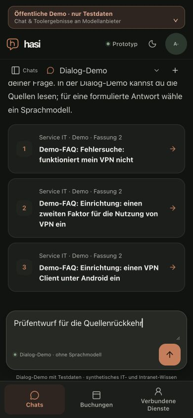
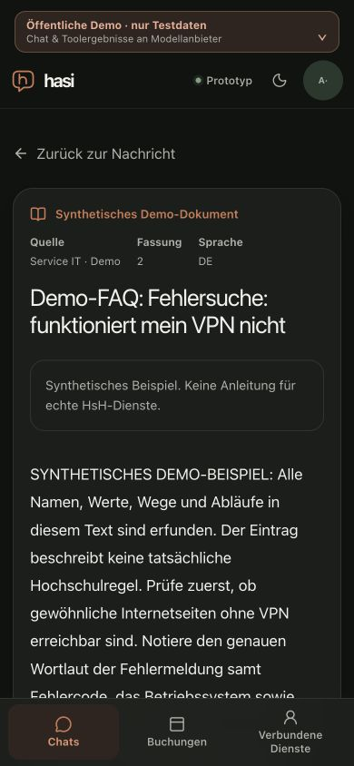
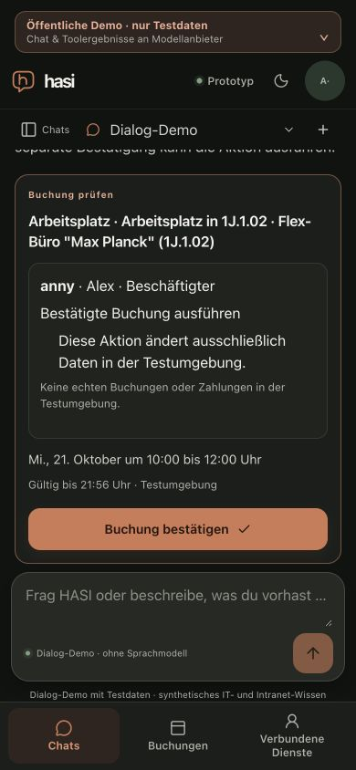

# Public knowledge reader and action-control follow-up

Date: 2026-10-20. Bounded technical evidence for M2 #49, M6 #53 and M7 #54; no milestone or live-model acceptance.

## Delivered revisions and preservation

Synthetic VPN correction #157 merged at `d2038e4a9e6bc7d071eb099445270e7571e7ba92`. Its five exact-head checks (39482635419) and exact-main CI (39483602535) passed. Coolify deployment `ekwmevthsqtyvhh5namtf4hg` completed at 19:35:32 UTC, with one exact-revision health check. Public HTTPS and the healthy running image `sha256:b2a26ca910ee7e56e4a49b94c02580d83967b4e30a70fec655f3c29b2706b71b` matched. All 472 still-active baseline rows, the database and its volume, and the shared budget fingerprint remained unchanged.

The restricted Service-IT replica was rebuilt from exact PR head 2550b53, whose tree matched the merge, and activated as image `sha256:acff9dafd613fe5e8504875580ade327d9619b39d9157eccfd7f0a3327c3f232`. All 10 corrected article bodies/titles matched the fixture over HTTPS from the server. Existing Compose and access-control labels were unchanged; external access still returned403. The previous image was retained for rollback. This did not refresh the separate MediaWiki corpus.

Action context #158 merged at `bf435d68cf12af012dcce07226a0f355b03ae82c`. Its five exact-head checks (39484781921) and exact-main CI (39485831001) passed. Coolify deployment `cymxdcsmz4ty0yp6qfp2scbl` completed at 19:51:42 UTC, with one exact-revision health check. Public HTTPS and the healthy running image `sha256:1ee4814ffa929c6456dfd20d94d2ecd79cf7625aded63165bf95c975bc24aecd` matched. All 475 active baseline rows were present and unchanged, with the same database and volume and no expired baseline rows. The single shared budget row retained fingerprint `c80d1cc1b5f433c0fd1f31414b87829bb61587859058fa4e0a3ac7cbc5cd65b6`.

## Actual public browser observations

The public app was exercised at 390×844 in dark mode with the synthetic Alex account and explicitly selected Dialog-Demo. No provider call or real institutional data was used.

- A fresh VPN question returned titled source cards at revision 2. The matching reader opened in the same tab. Its return link restored the exact originating message, focus and unsent draft. Reading the old revision 1 URL displayed the unavailable message rather than its former document text. This is source-card navigation evidence; it is not a new live-model inline-citation or clipboard-readback result.
- On #158, a fresh tomorrow, in 1J, 10:00–12:00 single-office query returned availability-checked workplaces, including Max Planck 1J.1.02. Preparing that exact workplace produced a pending preview. After a VPN topic switch, “Ich sehe keine Schaltfläche” returned fixed host guidance and freshly restored the same preview. Its enabled, focused 46px confirmation button measured 556.88–602.88px within the 164–619px chat scrollport; document and viewport widths were 390px. No confirmation was clicked and no booking/cancellation was executed. The knowledge cards used the corrected revision 2 corpus.

The public action journey exposed misleading inactive-pending copy: a topic switch disabled a still-pending card with “abgeschlossen oder ersetzt”. The accompanying copy-only change says “Vor Bestätigung erneut prüfen” for inactive pending native and generic-plugin cards. It changes neither status nor confirmation/admission logic. Terminal states already have their own presentation and render no pending confirmation button.

The source probe and action probe each retained their own nonempty synthetic chat as a QA trace; no existing chat was deleted. The action probe renewed an expired existing synthetic Anny connection through the ordinary demo flow. Those intentional probe changes occurred after the corresponding deployment preservation check and are included in the fresh baseline for the next merge. Original selected conversation and signed-out state were restored; temporary tabs closed and viewport overrides reset. The budget fingerprint was unchanged in the subsequent 479-row baseline.

These observations do not establish a complete Groq dialogue regression, formal model quality, a managed-plugin browser journey, actual iPhone/assistive-technology acceptance, local UI 200ms, current protected Coolify rollback or full M7.

