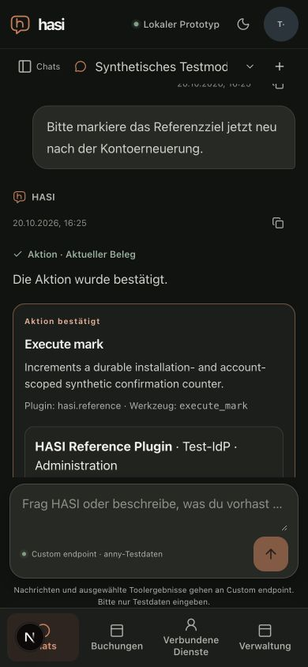

# Fresh confirmation after personal account renewal

Date: 2026-10-20. [Measured inputs/results](renewal-fresh-confirmation-result.json).
The prior [action-history recovery report](action-history-renewal.md) left this
specific follow-up unqualified. This run completes the bounded normal fresh-action
journey; it does not accept entire P3-A3/P4-A3/P6-A2 groups or M2/M7.

## Inputs and actual topology

The qualified application tree is `c0334a049b4155a5d8d1974fe5c452ca4ba7a743`,
identical to merged `b728cfa13236d008022934f6825f27a0386c762b`. Node v24.21.0,
local TestIdP, two API OS processes behind the loopback round-robin proxy, disposable
PostgreSQL, protected server-side chat storage and the separately offline-packaged
1.0.0 reference process are used. Its immutable artifact SHA-256 is
`701c711f2ffd1a5eb22365f1467c8b1780ce1c5db0b6e42e6e727229af7f542c`.
The deterministic HTTPS model fixture makes no real-provider calls. Personal
account consent and configuration use the actual chat/admin/account UI.
The supported browser APIs did not expose an exact engine version; that platform
identity is unverified. The technical viewport observation is 390x844, not a phone.

## Journey and positive/counter observations

1. A fresh synthetic administrator configures and explicitly activates the reference
   target, separately connects its personal account, and prepares a generic action
   in chat. A draft is entered but not sent.
2. `expire-reference` advances the account clock; both API processes acknowledge.
   Reload removes the denied card and confirmation control, retains the draft,
   and indicates that the account needs renewal. Counters remain zero effects and
   zero execution requests.
3. Account renewal is initiated from that conversation and explicitly confirmed.
   Full document navigation returns to the same conversation with its draft.
   The old pending card returns as invalidated and has no confirmation control.
4. A new request in that same conversation prepares a fresh action. Reload retains
   both the invalidated historical card and the fresh pending card. Exactly one
   confirmation control is available; effects/execution requests are still zero.
5. Clicking that new control confirms the action. Counters report one effect,
   one journal row, one source row, two invocation rows and one execution request.
   There have been two local model-fixture calls and no real-provider calls.
6. `restart-reference` restarts the same immutable artifact over its existing SQLite
   state. Counters retain the same values. Reload reconstructs the invalidated old
   receipt and confirmed new receipt with zero confirmation controls. A final
   counter read remains one effect/one execution request, proving no rendering or
   restart replay in this journey.

At 390x844, document width remained 390 and no save-error warning was visible.
An initial startup without a live stdin control channel was stopped cleanly and
excluded; its pending-card setup is not renewal evidence. The successful run used
a held terminal, copied metadata before cleanup, then `quit` exited zero and proved
owned-process shutdown while retaining the caller database. Agent tabs were closed
and the temporary viewport override reset.

## Remaining scope

This closes the previously setup-only fresh-action observation. Disconnect or
external revocation followed by later provider-bound context, managed pending-action
update/disable/rollback, complete mobile/keyboard/200% text and local UI latency,
M6 evaluation and M7 operational exercises remain separate. This does not demonstrate
institutional authorization, live provider quality/cache/billing, managed plugin
installation/rollback, an actual phone or native assistive technology.
