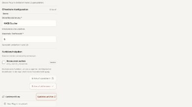

# Remote admin status and keyboard recovery

## Change and observed baseline

The remote connection check had no live region for successful results. Its
failure remedy alone used a status role. Update checks duplicated their result
in two status regions, and a failed subsequent check could retain the previous
available-update result. These are observed UI defects, not inferred from an
automated accessibility score.

The correction mounts one polite, atomic region per operation before a check
starts. Each region receives pending text and the completed result. Connection
remedies share the connection region. Update checks clear their previous result
before the request, and do not repeat the result in the generic notice. HTTP
errors retain their existing alert. Configuration, reachability, service
authentication, user rights and readiness remain separate diagnostics.

## Browser evidence

The [before/after observations](admin-remote-status-result.json) bind the
baseline to `90c9129d59e2dad66c78285ecc7a148e74ca315d` and the corrected panel
to SHA-256
`4a9a3f97125485fcc3f431467f2c066481373dbfca107042f1f4c34fca2d4d7f`.
The result file SHA-256 is
`ee1caf648dac3f40a0bba55d31f3118d3386045e14e01ad2da65f3aec4355b25`.
The baseline panel digest was
`8460b9e3a3490867bddf382125e99e39b0ec5f33ef34ea6e58ebe60454d1372c`.

Actual application components ran in a minified production React 19.3.1 bundle
against an isolated in-memory loopback API. Chrome 155 used a 390 × 844 CSS-pixel
viewport, device scale factor 1 and mobile emulation. Only Tab, Shift+Tab and
Enter operated the controls; focus was not assigned through DOM scripting.

| Completed keyboard case | Observed result after correction |
| --- | --- |
| Connection success | Structured diagnostics in the connection live region |
| Connection contract failure | Diagnostics and remedy in the same region |
| Connection recovery | Successful diagnostics replace the failure |
| Update available | One update-result announcement owner |
| Update HTTP 503 | Alert; previous update result is absent |
| Update current | One current-result announcement owner |
| Connection HTTP 503 | Alert; connection region is empty |
| Connection recovery after HTTP error | Successful diagnostics; error is cleared |

All eight cases restored focus to the invoking button. Each button was 44px
high, its center hit-tested to that button, and there was no horizontal overflow.
Both regions existed empty before the first check; separate observations record
their pending text. The browser accessibility tree exposes both as `status`,
`live: polite`, `atomic: true`. This proves the rendered semantic contract and
its text changes, not an actual screen reader's spoken output.

Targeted axe-core 4.14.0 checks passed all seven selected rules with no violation
or incomplete result: `aria-allowed-attr`, `aria-valid-attr`,
`aria-valid-attr-value`, `aria-roles`, `button-name`, `label` and
`nested-interactive`. This bounded check is not a full accessibility audit.

## Fixture identity and limitations

The machine-readable record retains source, harness and bundle digests and the
complete safe request ledger. The fixture made five connection checks (three
successes, one contract failure and one HTTP error), three update checks (two
successes and one HTTP error), and three configuration reads. All responses used
a controlled 180ms delay. There were no invalid request bodies or unknown routes.
No credentials, installed remote MCP process, database or model were involved.
No configuration was saved or activated.

The compiled global CSS digest is
`8c9813f4472b43c268a7b4741ab9bba06c5f21c53ccbc8a2c9ec32637787bdba`.
It predates the separate welcome-paragraph color correction; the admin styles
are unchanged. This fixture does not claim a fresh build of every current CSS
source or full-application performance. Its owned tab was closed, and the
fixture process was stopped and independently checked absent.

This resolves the named remote-admin keyboard/status cases under M2. Native
screen readers, devices and participant acceptance remain M8. Other M2/M6/M7
gates remain open.
