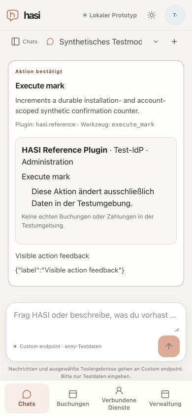

# Visible chat action feedback

Date: 2026-10-21. Implemented candidate: `d92e3e06b0fe82e0e704e34edf397d0a9800bad6`.
Supporting [M2 #49](https://github.com/metaneutrons/HASI/issues/49) and
[M7 #54](https://github.com/metaneutrons/HASI/issues/54); neither is accepted by this slice.
The [machine result](chat-action-visibility-result.json) records the frozen input
hashes, runtime identities, geometry, countercases and cleanup.

## Defect and correction

The preceding actual 390px development journey on `8ffb072` confirmed an action,
but the automatic scroll followed the appended user confirmation message.
The completed proposal card received focus with `preventScroll`, leaving its
success heading above the chat viewport. Status recovery requests lacked the
explicit-help flag that previously allowed revealing the card.

The existing guarded recovery now reveals the card before restoring focus.
The active-conversation, connected/visible-card and newer-focus guards are
unchanged. Explicit UI help retains its existing behavior. No proposal, action,
authorization or execution decision changes.

## Optimized fixture

`pnpm journey:serve --managed --optimized` performs an explicit sanitized web
build, initializes the existing durable budget through the normal operator
initializer against the admitted loopback test database, then uses `next start`.
The build receives no database, identity, Docker or model credentials. Runtime
retains the existing TestIdP/synthetic-only boundaries and separate managed
worker. Only the worker receives Docker configuration. The initializer preserves
prior reservations; no database or budget reset is used. Preparation commands
have bounded cancellation through the existing child cleanup. Unknown and
repeated CLI options fail before startup.

The actual run used two API processes, PostgreSQL, signed private RPC, the actual
Docker installer/gateway and invocation-bound managed state. The browser saved
and separately activated the configuration, staged/reviewed/activated v1, connected
the approved catalog service and completed separate personal synthetic consent.
The four recorded source inputs remained unchanged through shutdown.

## Actual browser observations

At 390×844, one actual model-planned proposal was confirmed with the visible
**Execute mark bestätigen** button. Without subsequent scrolling, the completed
card had focus and its **Aktion bestätigt** label occupied y=136.89–151.89px inside
the chat frame y=106–604px. Document width was 390px. The screenshot is this
optimized run, not a component preview or a real model answer.

A second actual proposal exercised newer user focus. With 250ms tab-scoped
network latency, the user entered a draft in the composer while confirmation
was still pending. After both cards were confirmed, that exact draft and composer
focus remained. A separate status-read countercase used 1000ms tab-scoped latency:
while the old card was being checked, the browser opened a new chat and typed
another draft. The old status read completed with **Die Aktion wurde bestätigt**;
the new chat retained its draft/focus and had no visible old proposal.

The host-state oracle validated two source effects and two confirmed journal
receipts. The status read left the count at two. Fixture statistics recorded two
synthetic model HTTP calls and zero real-provider calls. These are not real-model
quality, provider token, caching, billing or latency measurements.

The public demo was also checked separately without a new model call. Its current
revision-3 VPN result opened the exact reader revision and returned focus to the
originating message. At 390px there was no document overflow; reader body began
at y=507.09px. This confirms the deployed source-navigation behavior from
[PR #169](https://github.com/metaneutrons/HASI/pull/169), not answer grounding.

## Verification, cleanup and limits

57 focused source/navigation/action-history/help/focus tests and 20 fixture
configuration/process tests passed, as did affected lint and TypeScript checks.
Independent bounded reviews found no remaining actionable UI or launcher blocker.
The process suite includes a child that ignores SIGTERM and requires SIGKILL.

An earlier unqualified startup attempt was interrupted before browser testing
when affected lint found three launcher issues; those were corrected before the
frozen candidate. Its exact owned image was removed after label/ID/tag validation;
a final owner-filtered inventory found no remaining labeled Docker resources.
Private recovery material and isolated HOME were removed. Shared build cache and
the caller's database were retained. The final successful run shut down normally
with two owned containers, three networks and two images removed, route withdrawn,
worker stopped and private recovery material removed. Both owned tabs were closed,
accounts signed out, latency reset and viewport restored. No caller-owned service
or production integration was reset.

This bounded run covers generic successful confirmation and two focus countercases.
It does not qualify the native Anny confirmation, unknown/error/expired-card matrix,
all responsive widths, physical devices or native assistive technology. Browser
version was not re-read in this slice. The local ≤200ms gate, full joined technical
matrix, independent distribution, model grounding/adversarial evaluation and M7
remain open. The original supplied Groq booking → VPN → missing-button dialogue
is still an unaccepted M6 case.

