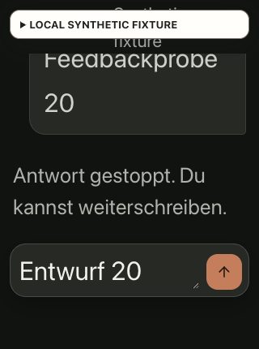

# Generation Stop: transport, budget and browser evidence

Base: `9c757138844ff2015c2f4101c930345ab2e507c0`. The candidate client source
has SHA-256 `6402903175b69b17bd2be4869f7223e171e7709982e9edc66d8150a68541110f`.
The [machine-readable observations](generation-stop-result.json) have SHA-256
`e93af716cf02a5264c8e739328a297b5cbc1278cace95303cc8e222e4db019ab`.
See the [generation lifecycle contract](../../architecture/generation-stop.md).

## Backend qualification

The four focused files (`model-router.test.ts`, `chat-route-policy.test.ts`,
`chat-http.test.ts`, `groq-cache-probe-transport.test.ts`) pass 174 tests. The new cases verify:

- An already-cancelled request contacts no provider and makes no reservation.
- Cancellation after reservation but before dispatch settles zero usage.
- The request signal reaches the actual AI SDK fetch path. Cancellation after
  dispatch preserves unknown usage and triggers neither fallback nor retry.
- Cancellation racing with HTTP 400 `tool_use_failed` or HTTP 500 does not
  regenerate or fall back. Genuine timeout fallback remains covered separately.
- A completed late result can settle trustworthy usage, but is not returned.
- HTTP returns sanitized cancellation metadata, without the private abort reason,
  and does not finalize a late cancelled result. Source-rights rejection remains
  a separate 409; cancellation uses 499.

The first full local gate exposed a probe-contract regression: unknown-usage
settlement passed an explicit `undefined` instead of omitting the argument.
The router now retains the no-argument unknown-usage call; the unchanged probe
and the cancellation tests pass together. Focused lint, web type checking and
whitespace checks pass. These tests use
fake credentials and provider transports, not a live model or business action.
The HTTP 499 is an internal diagnostic convention; a disconnected client may
never receive it. Provider-side cancellation or zero billing is not implied.

## Actual component browser cases

The fixture compiles current `AssistantPage`, real Session/Theme/ChatWorkspace
providers and current global CSS into a minified React 19.3.1 bundle. Its API
is isolated, in-memory loopback data. The one-column wrapper omits application
navigation/header and Next's font setup; `next/link` is an anchor shim. The
result retains exact source, bundle and CSS digests. This qualifies the named
component behavior, not the full deployed application or native devices.

The first keyboard run found a real defect: Stop aborted inference, but React
reused its DOM button as the submit button during the click's default action.
The unsent draft became a second model request. The failing capture is retained
with its source digest `b5efb542956ab1053136e62f0b90fb68298d5aabb9e8a19df011968afc7b1c4e`.
The correction prevents the Stop click's default action and uses distinct React
keys for Stop and Send. The repeated Enter, Space and pointer cases retain the
draft and produce no unintended second request.

| Case | Observed result |
| --- | --- |
| 390×844, Enter on Stop | 44×44 reachable control; draft retained; focus returns to composer; stopped status; no retry alert |
| Pointer Stop, transport deliberately ignores abort | Stop disappears, draft remains, stopping status is visible until the held request completes |
| Release a late tool-call reply after Stop | Reply discarded; zero tool reads, proposals or executions at that checkpoint |
| Send a subsequent message | Ordinary response appears; no stale stopped status |
| Hold an actual synthetic knowledge-read request | Stop is absent during the tool phase; request ledger confirms one held read |
| 320×430 and 32px root text (200%), Space on Stop | Reachable 44×44 control at y313–357; draft retained; focus returns to composer; no horizontal overflow |

The final fixture ledger records 26 model requests, 23 abort notifications,
four delivered synthetic model responses (including one deliberately late
response), one knowledge read, zero proposals/executions and no unknown routes.
All pending responses are cleared. No external provider, database or installed
remote MCP process participates. Business confirmation is excluded from this
fixture; the implementation never exposes Stop from those action handlers.

## Repeated local feedback

Twenty actual Stop activations at 320×430 with 32px root text retain the exact
draft and remove Stop. Local feedback measures 5.7–10.5ms, below 200ms.
The instrument timestamps the trusted click in capture phase, observes the
visible feedback mutation and Stop removal, then records the next animation
frame. This measures DOM/render scheduling, not display photons, full-app/API
latency or provider cancellation time.

The same measurement accepts a normal DOM control at 1.9ms (exit 0), and rejects
a deliberately delayed 250ms DOM control at 252.2ms (exit 1). The app samples
pass the same 200ms predicate (exit 0). The full sequence is retained in the
result; there are no discarded app samples.

## Accessibility and remaining boundaries

The seven targeted axe-core 4.14 rules report no violation. One rule has 29
incomplete popup-reference observations: `aria-valid-attr-value` cannot resolve
the controls of conditionally mounted closed copy menus. These observations
are explicitly **not counted as passed**; existing popup interaction evidence
remains separate. This check is not a whole-app accessibility certification.

The fixture's owned tabs were closed, both server sessions terminated, and the
owned Node process was checked absent. Root-text and measurement controls were
removed. Small-height emulation does not establish a native software keyboard,
VoiceOver/TalkBack, participant or institutional acceptance; those remain M8.
M2/M6/M7 still require their other recorded gates.
