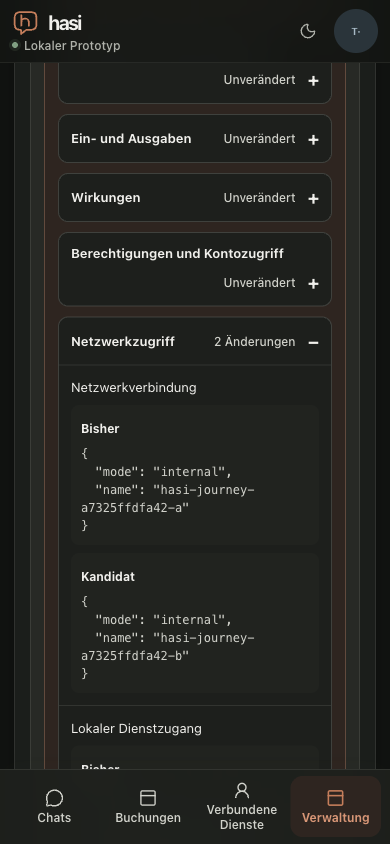

# Joined release review and provider-failure recovery

Date: 2026-10-21. Supporting M2 P1-A3/P3-A1/P5-A3/P6-A2 observations;
**not milestone acceptance**. The ordinary fresh-preparation-after-renewal path
was already proved by [renewal-fresh-confirmation](../2026-10-20/renewal-fresh-confirmation.md).
It must not be repeatedly described as missing. This targeted run adds an
injected provider failure and actual installer-backed release comparison.

## Inputs and scope

The host application inputs are PR #190 head
`af3d2a0c994dd0399020b9cb96b58e8deb5c7493`, whose application tree equals merged
`54dbcb724d064083e13f6a9fc39c56eac2f4e4dd`. The new local qualification scripts
were frozen at capture; their source hashes and the optimized Next build ID are
in [runtime identities](joined-review-recovery-identities.json). Later Git
commit/rebase changed no captured application or fixture source. The composition
uses actual TestIdP, two API processes, private signed installer RPC, separate
worker, gateway, Docker plugin artifacts, host-managed PostgreSQL state and
server-side protected chats. It uses a dedicated disposable database, isolated
HOME and a fixed local synthetic HTTPS model; real-provider calls are zero.
The observation is Chrome155/macOS at390×844 CSS pixels, not a native phone.

The two prebuilt artifacts come from a separate local source repository, with
source commits `59e15b00c36fdef1cb4083c019dd56f0a628942b` and
`40e30f3c1b3900e0505144e11d11326d2c3904f1`. Exact payload/image/release
identities are in the machine record. This is local technical distribution,
not an independently attested public artifact or a marketplace installation.

## Positive and counter observations

1. An actual synthetic administrator fills the required public configuration,
   saves and separately activates it, stages v1 and receives the new installer
   comparison (HTTP200, no-store). Its first-install view lists all three tools,
   schemas/effects/rights, identity, network/ingress and configuration/state.
   Explicit review makes activation available; activation remains separate.
   The operator connects the approved catalogue service, then separately consents
   to its personal synthetic account. Navigation initially preceded catalogue
   propagation; one explicit account-status refresh observes the connected entry.
2. A chat preparation creates one pending card. An unsent draft is entered.
   `expire-reference` is acknowledged by both API replicas. Reload retains the
   draft and removes confirmation while account rights are expired. Personal
   renewal returns to the same conversation and draft; the old card is invalidated.
3. The held terminal alone arms `model-unavailable-once`. The next model completion
   receives the fixture's fixed503, followed by normal behavior. A new draft typed
   while the request is pending survives the displayed generic failure and reload.
   No usable confirmation is produced by the failed generation.
4. An explicit new request prepares a fresh card. Reload retains exactly one
   confirmation control; one explicit confirmation produces the native confirmed
   receipt and no confirmation control. The model fixture reports three calls:
   initial preparation, injected failure, explicit retry; one unavailable response,
   zero real-provider calls. The browser event buffer was empty, so this report
   does not claim a captured client `/api/chat` status. The actual-route regression
   separately proves provider503→sanitized503→explicit200, without automatic retry.
5. The administrator stages v2. The actual current/candidate comparison shows two
   changed network/ingress declarations, with unchanged other sections. After
   separate approval and activation, the current digest is v2; explicit rollback
   returns it to v1 without a host rebuild. Physical host-managed state after each
   transition contains exactly one application effect/source receipt and one
   confirmed journal result. These bounded numeric projections are supporting
   state observations, not a substitute for the earlier full state-contract oracle.

[Browser cases](joined-review-recovery-cases.json), [terminal statistics](joined-review-recovery-stats.json),
[state after update](joined-review-recovery-after-update.json) and
[state after rollback](joined-review-recovery-after-rollback.json) retain these observations.

## Reproduced read-policy behavior and UX limit

Returning to the chat after update/rollback hides all three historical assistant
messages, including the confirmed action receipt, behind the unavailable-answer
placeholder. Confirmation controls remain absent, and the physical action count
stays one. This demonstrates no execution replay, but it **does not establish
successful receipt recovery in the UI**. Read-only investigation traces this to `assertProposalReadAccess` in
`apps/api/src/index.ts`: the original plugin version/binding must match before
current account rights are compared. A managed deployment transition changes
that binding. The signed recovery handle remains server-side, but the current
GET denies redeeming it; the workspace resolver then renders the placeholder.
This matches the existing [action-history policy](../../architecture/action-history-recovery.md#pending-actions-and-lifecycle-changes),
which expressly denies access through retained handles after a plugin/configuration
binding change. Other model-linked turns have a separate intentional global
history-authority fence. Do not relax that fence or describe the database state
as a visible/recoverable receipt. A future immutable terminal-receipt projection
would need a separately reviewed compatibility/current-rights rule; no such
exception or milestone-scope waiver is introduced here.
The cause of the older unrelated503/draft observation is still unknown; the
injected failure here does not establish its historical cause.

## Method exclusions and cleanup

The first startup failed before the application journey because Colima did not
publish a database port on its internal network to macOS. The dedicated owned
network was recreated with loopback-only database ingress; a direct read probe
then passed. That startup is excluded from product qualification. An early draft
query accidentally selected a read-only Markdown-source textarea, not the composer;
those values are excluded. Recorded cases assert a unique editable textarea.
No stale-draft defect is inferred from that rejected observation. A workspace
GET exceeded the browser command observation window; the later explicit protected
GET completed200. Only own synthetic state was inspected; raw signed workspace
responses are private and excluded from the repository.

The [cleanup record](joined-review-recovery-cleanup.json) confirms normal quit,
worker/route shutdown and removal of four managed containers, three networks and
two images. Root then removed only the separately owned disposable database,
volume/network and isolated HOME after checking exact owner identities. Generated
private runtime material was removed. The owned browser tab and viewport override
were closed/reset. Public sessions, budgets and data were untouched by this run.

## Deterministic security and failure checks

`chat-route-policy.test.ts` now keeps hostile tool descriptions in tool metadata,
never system/developer instructions, and rejects invented tool names/direct
execution attempts while provider origin/model/credential remain server-pinned.
The valid read control passes; no business call, external sink or confirmation
bypass occurs. A separate actual-route case proves fixed sanitized provider503
metadata, no raw provider payload/credential in logs or response, no automatic
retry and one successful explicit retry. These are deterministic fake-provider
checks, not real-model prompt-injection resilience or M6 quality acceptance.

The terminal-only fixture control is absent from HTTP/MCP/model authority; unit
countercases prove that unknown CLI/terminal/model-body commands do not arm it,
and rejected unauthorized requests do not consume an armed failure. The next
valid completion fails once, then normal behavior resumes. Production router
configuration and provider credentials are unchanged.
