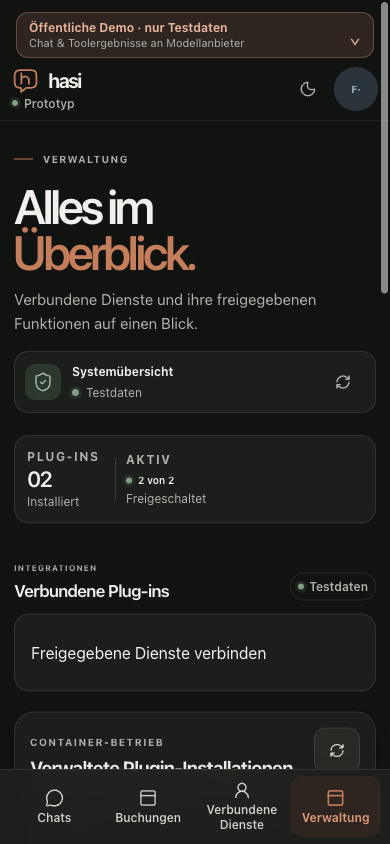
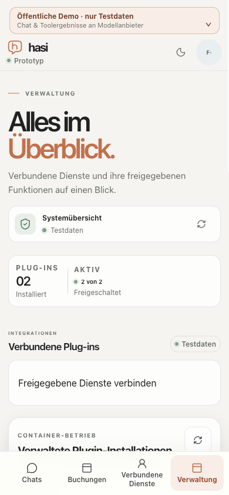

# Mobile navigation text contrast

Date: 2026-10-21. Application baseline: `5aa333028f9eea27004788297fa4cb2a5cf6839b`.
PR #188's documentation-only merge has the same application/CSS sources.
This is supporting M2 P6-A3 / M7 evidence, not milestone acceptance.

## Measured defect

The corrected desktop report does not cover the fixed mobile navigation.
Its translucent, blurred background can contain darker underlying administration
content. Using the same calibrated screenshot path with `captureBeyondViewport=false`,
48 actual navigation labels were measured: four links on chat and administration,
320/375/390×844 CSS pixels, both themes, DPR1, Chrome155 on macOS.
Each record checks geometry and ancestor scrolling immediately after every PNG,
then restores masks, scroll and inline styles. Normal text uses threshold4.5.

The [baseline result](mobile-nav-contrast-before.json) has 48 valid captures,
48 leaves and68 PNG regions; four light administration groups fail. The lowest
quantization-aware lower bound is **4.281219**, not a passing value. The other
44 groups pass. These are genuine rendered-background failures, unlike the
rejected moving-capture exploratory batch in the earlier report.

## Correction and bounded preview

The only application change sets the inactive `.mobile-nav .nav-link` color to
`--ink-soft` within the existing mobile media query. The existing active rule
continues to use `--accent-deep`; desktop, dimensions and layout are unchanged.
The complete global stylesheet differs from baseline only by this declaration.

A separate browser tab applies that color rule as a temporary local stylesheet;
its explicit active-rule repetition preserves the existing cascade. Theme changes
wait for finite CSS transitions before acquisition. An initial unsettled capture
was rejected by the restoration check and is excluded; all final48 records were
recaptured. The [preview result](mobile-nav-contrast-preview.json) has48 valid
groups/48 leaves/68 PNG regions and zero failures, minimum **5.827605**.
This is a local overlay on the deployed baseline, **not post-deployment proof**
of a rebuilt application. The optimized frontend build with the tracked rule
passes; CI/delivery and an actual rebuilt-style readback remain separate.

Both actual tabs independently reproduce all13 color patches and four coordinate
quadrants at scroll0/200 CSS pixels, checking26,000 pixels in each PNG. Raw
backgrounds use the empirically calibrated Display-P3 interpretation and CSS
foregrounds use sRGB, as in [the desktop method](rendered-contrast.md).
The verifier rejects a coherent black-foreground countercase, false font threshold
and per-image geometry drift. Actual CLI replay exits1 for the failing original
and0 for the corrected preview; no failing capture is removed from either matrix.
The preview's minimum is the unchanged active accent label, not the stronger
inactive text. Same-browser calibration does not claim a universal ICC profile.

All source masks, preview/calibration elements and viewport overrides were removed,
original dark mode restored, test accounts signed out and both owned tabs closed.
The existing chat/draft were only read. No message, confirmation, business effect,
model request, credential retrieval or budget reset was initiated.
Native-device and assistive-technology acceptance remains M8.

## Reproduction

The [input packet](mobile-nav-contrast-inputs.tar.gz) includes raw records, PNGs,
the measurement/factory helpers, calibration records and standard-library verifier.
Extract into a fresh directory. From that directory the original application
measurement is expected to fail and the preview is expected to pass:

```sh
python3 baseline/verify-mobile-nav.py
```

```sh
python3 preview/verify-mobile-nav.py
```

The verifier reuses the reviewed desktop record/math checks, changing only the
explicit tab/viewport/theme-filename constraints for this48-record matrix and
its strict route/identity checks. Input association is operator-recorded, not
cryptographic runtime attestation. These scripts are internal verification tools.

- Packet SHA-256: `0bd0c7ce9a1432878838624449cdf94fb92a2a34d0d2564f7fdcb51885e4f06b`.
- Baseline result SHA-256: `0165e5925cd3089e170ea76d7c0065e483e7493c3b1d8db16aa361aab9a6d377`.
- Preview result SHA-256: `0d3867a32dadf578f021ac3f650dddf391bc0556971517bce6041df9888314df`.
- Updated global CSS SHA-256: `5f70d95bf60a9d3927928e25de3ea463ba7f2077bf3ffea53e6b86a9abf227a9`.



## Rebuilt application readback

PR #189 is merged at `981519d9339f86b74a7041346e3be27541bfb5b6`.
Exact-main CI39655662097 passed; the earlier run39655066077 was cancelled
by GitHub's same-branch concurrency priority, not restarted as a qualification
shortcut. The automatic controller completed at `2026-10-21T18:56:47.126Z`.
Public readiness and the sole healthy application reported that exact merge.
The552 active baseline records, database/volumes and budget fingerprint remained
unchanged (zero missing, changed or expired baseline rows).

A fresh owned tab28 then measured the **actual served styles without an overlay**.
The [result](mobile-nav-contrast-actual.json) contains all48 valid groups,
48 leaves and68 PNGs, zero contrast failures, minimum lower bound **5.827605**.
Its independent13-patch/four-quadrant calibration at scroll0/200 and the black
foreground, false-font-threshold and geometry counterprobes pass. Normal text
uses4.5. This corroborates the preview on the rebuilt application; it remains
bounded Chrome155/macOS emulation rather than native-device acceptance.
The public admin page has no managed candidate, so this navigation observation
does not establish the new release-review component's full-stack qualification.

The [actual input packet](mobile-nav-contrast-actual-inputs.tar.gz) contains
raw records/PNGs, served CSS identities, calibration, helpers and the verifier.
Its only verifier identity adjustment from baseline is explicit tab28.
SHA-256: `1b62b3d808c18ce17b66f23d58e87247d0fe20a76fbbc8177ad2c5e44626dc47`.
After extraction, run from the extracted directory:

```sh
python3 actual/verify-mobile-nav.py
```

The original dark theme was restored, the synthetic administrator signed out,
all recorder elements removed, viewport override reset and the owned tab closed.
No chat message, booking, provider request or budget mutation was initiated.


