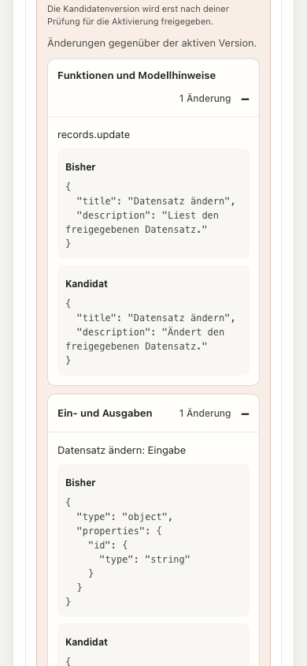

# Managed plugin release-change review

Date: 2026-10-21. Scope: M2 P5-A3 supporting implementation and bounded
qualification. This does not accept M2 or the complete plugin lifecycle.

## Review contract and authority

The administrator previously saw version, publisher and migration information
before approving a staged candidate, without the actual old/new tool and access
contracts. The dedicated no-store GET `/api/admin/managed-plugins/:id/review`
now projects an exact current/candidate pair from the trusted installer. Signed
private RPC binds method, installation, subject and response. Installation ID,
full state token and both artifact digests bind the browser response. Installer
reads recheck catalogue/configuration/state and administrator authority before
return; stale or unavailable reads fail closed. Approval still uses the existing
server-enforced expected-state fence. Loading a comparison does not activate it.

The bounded browser-safe DTO contains tool titles/descriptions, schemas, effects,
permissions, visibility, native result semantics, approved presentation/CSP
metadata, identity claim names, logical credential requirements, validated network
and loopback ingress, configuration schema and managed-state declarations.
Runtime configuration values, credential references/values, image strings and
operator filesystem paths are omitted. Plugin strings are escaped text; reviewing
UI resources neither loads a frame nor fetches their resource or CSP destinations.

The UI opens changed sections, displays before/after values, blocks approval
until a matching comparison is loaded, and clears verification during retry.
A failed or stale read explains the blocked approval. Ready/error/loading status
is announced; retry focus returns only if the user has not moved elsewhere.
Scrollable schema text has a keyboard focus target and visible focus outline.
Publisher/signature approval is distinguished from license/inventory completeness
and from the operator's activation review.

## Deterministic qualification

The SDK/API and focused installer/RPC/admin-route tests exercise initial install,
metadata-only changes, schemas/effects/permissions, projected identity/secrets,
network/UI/configuration/state data, secret-value exclusion, revoked or missing
catalogue entries, mid-read state/configuration/admin changes, response size and
signed RPC binding. Web projection tests reject different installations, state
tokens and current/candidate digests; equivalent key/set ordering has no changes.
The normal pre-push and exact-head CI remain separate integration gates.

## Actual component observations

The [browser record](plugin-release-review-browser.json) identifies source and
minified bundle hashes. It runs the actual React19.3.1 managed panel and review
components with a loopback **synthetic in-memory HTTP fixture**. It has no actual
installer, worker, database or model provider. Source hashes, rather than the
fixture's older base HEAD, identify the uncommitted application inputs at capture.
The production integration must qualify separately; this is not a public-demo
managed-candidate journey.

All20 combinations of320/375/390/768/1280 CSS widths, light/dark and16/32px
browser standard font pass the scoped layout observations: no page overflow,
changed sections open, targets at least44px and no externally loaded UI resources.
The font-size emulation is not native zoom, Dynamic Type or actual-device proof.
Settled light/dark axe4.14.0 WCAG A/AA checks each report zero violations or
incomplete rules. An initial inaccessible scrolling schema was found and fixed;
a transient theme-transition colour result was excluded and both settled themes
were rerun. Automated checks do not establish assistive-technology acceptance.

The recorded error, stale-token and pending cases block approval; successful retry
enables it, restores retry focus, and does not steal a newer focus on discard.
The [mock approval record](plugin-release-review-mock-approval.json) then contains
exactly one synthetic approve command and `candidate-ready`, with activation
still a separate button. No activation or real business effect was initiated.
A premature DOM read during that refresh was retried without repeating approval.
The owned tab/viewport override were closed/reset. Native devices, actual IdP and
institutional review remain M8; no new milestone acceptance is inferred here.

