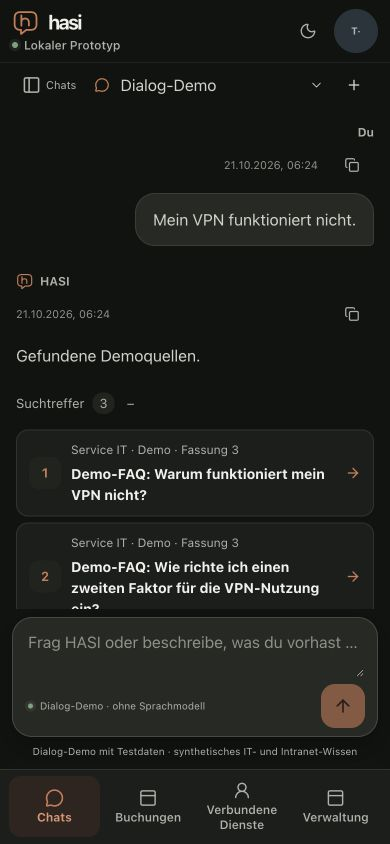
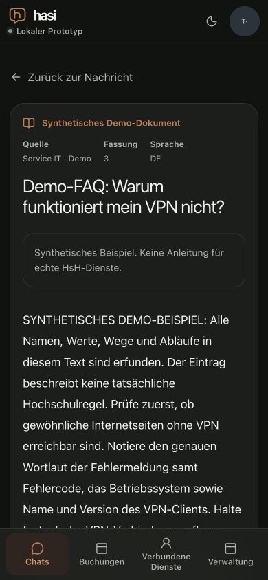

# Larger default fonts and source navigation

Date: 2026-10-21. Implemented candidate: `63fa7b1f63a2afedae27d16526aa435667a528a0`.
Supporting [M7 #54](https://github.com/metaneutrons/HASI/issues/54), still open.
The [machine result](relative-interface-type-result.json) pins the input hashes,
final observations and remaining findings.

## Measured defects and correction

On the preceding optimized build, changing Chromium's default standard font
from 16px to 32px changed the root size but left body and message text at 16px.
The correction converts 349 pixel values in 338 font-size declarations to rem,
using 16px as the baseline. An independent byte comparison verified that exact
transformation before the subsequent, separately measured layout corrections.
Existing relative and fluid typography is preserved; fluid headings need not
double at a fixed viewport width.

Larger text exposed a clipped mobile account control, a caption extending beyond
the desktop sidebar, a 27px-high transcript at 320×568 and an administration
status label extending the 768px document to 796px. Header grid placement,
caption wrapping, a relative compact-height breakpoint and wrapping admin rows
correct these cases. At the final 320×568/32px setting, the transcript is 178px
high; at 390×460 it remains scrollable at 70px. This short view is constrained,
not equivalent to a full-height mobile experience.

The fixed mobile navigation now reserves its measured outer height and can wrap
into two rows. A padding-only counterprobe exposed an important distinction:
observing the content box missed a changed safe-area inset. Border-box
observation fixes that case. With a simulated 34px bottom inset and 32px default
font, both navigation and reserved height are 203px. The composer ends at 635px,
above the navigation's 641px top. Clearing the override restores ordinary sizing.

## Final bounded browser observations

The final optimized local fixture used two API replicas, PostgreSQL, synthetic
TestIdP administration and no model calls. Thirty joined scans cover expanded
VPN search results, the exact-revision document reader and an expanded managed
configuration with its actual required-field error, each at 320×844, 375×844,
390×844, 768×1024 and 1280×720 in both themes with a 32px default font.
Seven further observations cover normal 390px text, three short viewports,
the changed bottom inset, the copy menu and the Markdown source dialog.
All 37 observations have no horizontal document overflow.

The source card opens revision 3 in the HASI reader. Returning preserves the
unsent draft and focuses the originating message; the application consumes the
return fragment after restoring focus. Escape from the Markdown source dialog
returns focus to its copy trigger. These observations exercise current source
navigation; they do not establish that generated answers are supported by it.

The browser measurement helper retained earlier exploratory observations across
restarts. This report explicitly selects only the final 37 observations after
the frozen optimized restart. Preview-only styles and earlier candidate scans
are excluded. Independent static reviews found no remaining blocker in this
bounded layout correction.

## Remaining gates and cleanup

Axe 4.14.0 still detects the best-practice `page-has-heading-one` finding in the
four populated desktop/tablet chat scans. Closed popup references and contrast
on gradients/overlaps retain incomplete results. These are recorded, not passed
or suppressed. This slice does not qualify all action, recovery or error states.

The `Page.setFontSizes` test changes the browser's default-font preference with
visual viewport scale 1. It is not native browser page zoom, an iPhone Dynamic
Type test or a software-keyboard test. Actual page zoom remains unqualified;
native computer control was unavailable while the Mac was locked. The simulated
bottom inset is not a physical-device notch/home-indicator acceptance result.
Those distinctions remain visible in M7/M8 tracking. The full supplied Groq
office → failed confirmation → VPN → missing-button dialogue remains unaccepted
in M6; a source link does not prove claim support.

Normal shutdown stopped owned processes, removed three networks and two images,
and retained the caller's database/namespace. The test identity was signed out,
temporary font/safe-area/viewport settings reset, owned tab closed and isolated
HOME removed. No real provider, production booking, source permission, budget
or deployment configuration was changed by the browser run.

