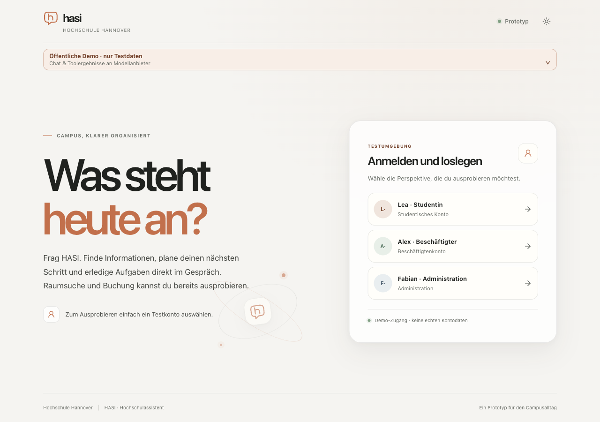

# Current rendered-text contrast qualification

Date: 2026-10-21. This replaces only the withdrawn numerical contrast claims in
[the provisional report](ui-contrast-pairs.md). It qualifies the named desktop
text groups below, not a blanket WCAG, mobile-device or whole-product certificate.
M2/M7 acceptance still requires their other mapped evidence; M6 is separate.

## Inputs, runtime and scope

The actual public application was observed with Chrome 155.0.0.0 on macOS,
1280×900 CSS pixels, DPR 1, normal 16px root text, using synthetic existing data.
There are 36 matching light/dark groups: 12 chat groups, 13 administration groups
and 11 unauthenticated welcome groups in each theme. They include existing user
and assistant text, a room heading, an expired proposal's details, administration
headings/summary/plugin descriptions/settings, the clipped profile name, and
welcome/login/account-choice text. Invisible accessibility-only text and disabled
confirmation controls are not asserted as visible contrast targets.

The page began on serving revision `c0255d0e446976a61b0850cc747dd87c288f2704`.
During acquisition the documentation-only PR #187 deployed
`5aa333028f9eea27004788297fa4cb2a5cf6839b`. The original two loaded stylesheets
retain their exact SHA-256 values; navigation loads one additional admin stylesheet.
The packet records both serving revisions and all three CSS identities. Source
comparison verifies identical `globals.css`, `assistant-page.tsx`, `admin-page.tsx`,
`app-shell.tsx` and the root page across those revisions. The complete commit
identities differ; no claim is made that the original client was rebuilt or
reloaded at the second revision. No product/style change is justified by the
rejected preliminary capture data.

Only the operator's test login/theme and scrolling were used. No message was sent,
confirmation activated, source rights changed or model/budget call initiated.
The existing draft remained unchanged. The test account was signed out, temporary
controls/masks removed, viewport override reset and owned tabs closed. The local
calibration listener was terminated. Native devices/keyboard/AT and participant
acceptance remain M8; 200% text and other viewport evidence are linked separately
from the [criterion map](../2026-10-19/m2-evidence-reconciliation.md#m2-criterion-evidence).

## Capture correction and controls

`Page.captureScreenshot` with `captureBeyondViewport=true` changed the actual
nested chat scroller from 2225.5 to 1950.5, moving the target by 275px. That path
captured unrelated text and cannot establish target contrast. The entire earlier
exploratory batch remains unaccepted; its failures are not product defects.

The replacement uses `captureBeyondViewport=false`, explicit document-coordinate
CSS-pixel clips and scale 1. The recorder checks target, text ranges, clipping,
all ancestor geometry and scroll immediately after every image, before any
scrolling helper. Post-mask observation never calls `scrollIntoView` again.
Each target must be unique. The recorded pre-capture root/ancestor scroll and
inline styles are restored and checked. Text-only masking retains layout;
nontrivial foreground opacity/filter/blend/clip/mask composition is rejected.
Text ranges are intersected with viewport/overflow clipping and enclosed with
outward pixel rounding; nine points per region check obstruction. These checks
are bounded observations, not proof against arbitrary transient or pseudo-element
occlusion. The clipped profile's visible rectangles are used; the earlier
unclipped Range is not reused.

All 13 known sRGB color patches and four two-dimensional quadrants match the
CSS Color 4 sRGB→XYZ→Display-P3 conversion rounded to 8-bit channels. Every one of
26,000 pixels per image is checked at root scroll offsets 0 and 200 CSS pixels;
the two images are byte-identical. Untagged files are interpreted using this
empirical capture-path calibration, not an assumed or universal ICC profile.
The original CSS foreground is evaluated in sRGB and the backing pixels in the
calibrated P3 space, including an 8-bit quantization interval.

The actual sensitive red/blue controls yield lower bounds 4.661409 (pass) and
4.307887 (fail) at 4.5. Incorrect sRGB interpretation of the same PNG values flips
both outcomes, so neutral black/white controls alone are not being used as color
proof. The [CSS Color 4 conversion reference](https://www.w3.org/TR/css-color-4/#color-conversion-code)
and [WCAG contrast criterion](https://www.w3.org/WAI/WCAG22/Understanding/contrast-minimum.html)
define the color and text-size distinctions.

## Results and rejection proof

| Scope | Result |
| --- | --- |
| Application groups | 72 valid, zero invalid; 36 complete light/dark pairs |
| Text and backing regions | 152 leaves, 166 PNG regions; zero failing pairs/leaves |
| Normal text | 138 leaves; lowest lower bound **4.540789**, threshold 4.5 |
| Large text | 14 leaves; lowest lower bound **3.203537**, threshold 3.0 |
| Additional diagnostic | Four proposal-time leaves/regions valid; lowest 10.989846 |

The lowest normal-text result is the 11px/400 light chat footnote; its margin is
small and should be revisited if its styling changes. The lowest large-text
result is the 69.12px/570 light admin heading. Thresholds are recomputed from the
recorded font size/weight; stored thresholds are not trusted alone.

Independent bounded review/calculation found no outstanding acquisition defect in
this corrected batch. The original analyzer's final predicate omitted application
contrast failures despite reporting them; root review corrected it. The corrected
CLI exits **0** on the real packet. A coherent isolated copy changes one dark
proposal-time leaf to a black foreground while retaining its original background:
all 72 captures remain structurally valid, exactly one group/leaf fails contrast,
and the same CLI exits **1**. Separate malformed font-threshold, per-image scroll
and one-byte PNG/CRC counterprobes are also rejected. Originals are preserved.

Per-record metadata binds the measurement-source hash and tab/API/clip parameters.
The supplied capture-factory hash is retained separately; its association with
this acquisition is operator-recorded, not a cryptographic runtime attestation.
This limit is distinct from the measured PNG identity/geometry/control checks.

## Durable reproduction

The [input packet](rendered-contrast-inputs.tar.gz) includes all raw records/PNGs,
source helpers, CLI counterproof, source/runtime identities and the standard-library
Python verifier. It is internal verification tooling, not an application runtime
dependency. Extract to a new temporary directory and, from the extracted root, run:

```sh
python3 viewport-false/analyze-verified.py
```

The unmodified packet exits 0. Its result file is regenerated; ephemeral temporary
paths in corruption diagnostics may differ. The input identities, contrast values,
counts and rejection outcomes are reproducible. The [published result](rendered-contrast-result.json)
retains the original checked result.

- Packet SHA-256: `00cde3ee305b3fb65027807ed89df33c6ed0282867ab2746ea9ac472ba5cb89a`.
- Published result SHA-256: `5e673c6974a02041b28ef571561e9e9015f927cb27aa296abebf2cf99e91820c`.
- Corrected verifier SHA-256: `36942c87b9d8855ed95afebb68de3a9114075b1c8f2a32dc7aaccb6cb9d7addd`.
- Measurement source: `c310b3415940aae32ced5f10ddf5e4f69d8045a63a21e0172d2c9674acadf91b`.
- Capture factory: `e5396946820df4984183a5b7eeb9cd417493f8e64b26c521d6ac3350b1905518`.


