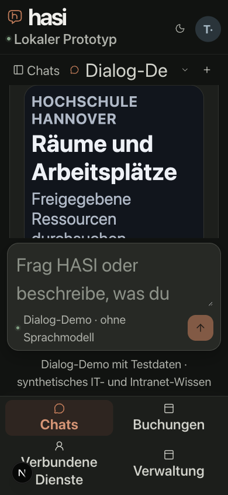
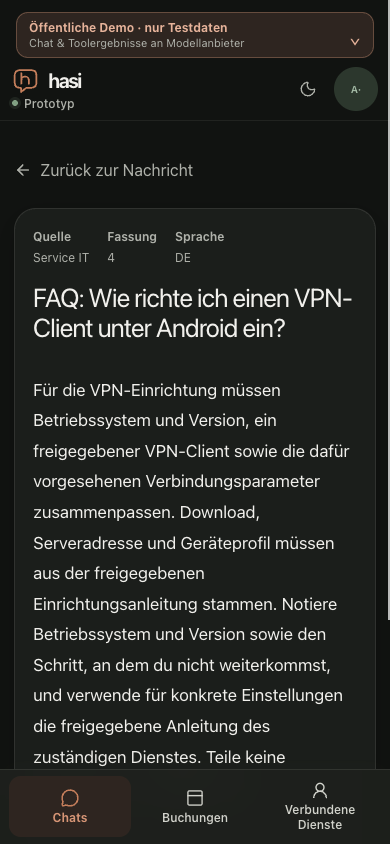

# Reviewed Anny view: compact layout and native fallback

Date: 2026-10-21. Bounded M2 P2-A3/P3-A4/P6-A3 technical observations.
Base: `a7653f736ea91f816a0657654f84f16d1501ae7a` plus the recorded local CSS correction.
Public MCP Apps remain off. This does not admit unreviewed third-party views or
accept a milestone. Real devices, native keyboards and assistive technology stay M8.

## Reproduced failure and correction

The actual local Next/TestIdP/API/isolated PostgreSQL application loaded the
operator-reviewed Anny resource. At 320px host width and 32px root text in both
host and iframe, the iframe was 236 px wide but its document scrolled 243 px. The
Refresh button and an unwrapped flex header squeezed the title into single
characters. Nine other original dark cases passed; the failing case is retained
as a measurement counterprobe in [original observations](reviewed-app-before.json).

The header and pager now wrap. The title container has a flexible 16rem basis;
buttons have a bounded width, wrapping text and vertical padding. The generated
resource/digest is rebuilt from the pinned MCP Apps SDK 2.0.3. No bridge method,
CSP, permission, model or action policy changes. [Source identities](reviewed-app-identities.json)
bind the template, generated bytes/metadata and actual host components.

[Twenty corrected cases](reviewed-app-matrix.json) cover 320/375/390/768/1280px,
light/dark and 16/32px roots. Every host and embedded document fits its width,
no measured descendant crosses the embedded horizontal boundary, and every
visible button/input/select is at least 44 px high. This includes the visible
pager for 43 catalogue entries. Theme changes reach the view; all cases retain
22 October 10:00–16:00 Europe/Berlin. These are local Chromium 155/macOS CSS-layout
measurements, not native page zoom or Dynamic Type. Independent source review
found no actionable regression, and the generated SHA matches its metadata.

## Keyboard, view loss and native history

The actual iframe [keyboard record](reviewed-app-keyboard.json) observes Enter
opening, Tab entering Refresh with the browser's visible auto outline, Enter
refreshing, Tab reaching Search and Kind, typing Amrum, then Shift-Tab returning
to the host summary. The view performs typed app-only reads; no model generation
or business execution occurs. [Network projection](reviewed-app-network.json)
has no truncation. It includes the explicitly requested native availability
reads and ordinary workspace saves; those are not model or business writes.

A precisely scoped local Fetch fault returns [404](reviewed-app-404.json) for the
view resource. The transcript and four native result headings remain; reload
retains them and makes no confirmation. A separate [403 fault](reviewed-app-403.json)
removes the iframe and its old view-only Amrum results, exposes the fixed safe
error/retry/native guidance, and retains the currently authorized native cards.
These are response-fault UI cases; actual current-rights denial is established
by the separately mapped API/native-history tests, not by intercepting a response.
The [cleanup record](reviewed-app-cleanup.json) verifies owned tabs, supervisors,
database container/volume and isolated HOME removal. Only two fixture rows were
removed with that owned database; public state was untouched by the local run.

The existing availability-lease transition can replace a fresh native message
and unmount its optional view. Reopening makes a fresh authorized view read;
continuous filter state across that replacement is not claimed here.

## Actual published native mode and source links

The separate public run used the delivered base above, with Apps off and the
explicit Dialog-Demo. It created only its own named test conversation. An initial
request was denied because the personal Anny test connection had expired; after
ordinary renewal, an explicit retry returned native workplace results.
[The uniquely selected active chat](reviewed-app-public-native.json) has four
visible native headings, no optional view/iframe, retained user text and three
current VPN source references. [Reload network evidence](reviewed-app-public-reload.json)
contains only GET requests after the unique Document navigation: zero model,
tool, availability or action POSTs caused by rendering history.

The Android-VPN link opens the current [revision 4 source](reviewed-app-public-source.json)
after access/revision checks; its article contains no Demo/synthetic wording.
The central HASI header retains the public-demo disclosure. Returning to the
originating message works. The ten previous conversations were not deleted;
the new conversation remains clearly named “Technische Prüfung · Quellen und
native Ergebnisse”. [The test account was logged out and tab closed](reviewed-app-public-cleanup.json).
No real provider call or business execution occurred. This public demo uses
synthetic authorization and browser-local transcripts, not institutional identity.

## Excluded observations and remaining scope

- An initial public DOM query included inactive retained chat sections. Its
  result failed the expected user-text/count check and is excluded. The saved
  accepted projection asserts exactly one non-hidden active chat.
- Unclipped in-app/retina screenshots did not match CSS viewport geometry and
  are excluded. The two images here use an explicit CSS clip, with viewport
  capture and no beyond-viewport scroll.
- Raw touch dispatch was unsupported in the in-app browser; coordinate safety
  and mouse-to-touch attempts did not establish a touch activation. Do not
  infer one from coarse-pointer layout or 44px controls. The attempted native
  iPhone Simulator could not open while the Mac was locked. That bounded
  technical observation was subsequently completed by the separate
  [trusted Chromium/WebKit touch proof](reviewed-app-touch.md); that does not
  extend these original observations or establish M8 hardware/AT acceptance.
- A longer neutral office-preference reply exposed an independent fixed-dialog
  parser issue. Its narrow repair and 55 focused parser/dialogue/fast-path tests
  are separate from these frozen view observations; no joined parser browser
  success is claimed in this record.

The optimized web build passes after the CSS/parser changes. Full CI and
publication are separate claims recorded in the delivery PR.
