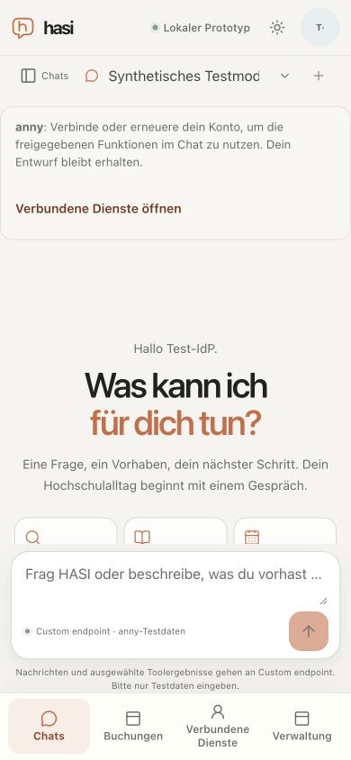

# Shell labels, landmarks and text contrast

Date: 2026-10-21. Supporting [M7 #54](https://github.com/metaneutrons/HASI/issues/54), still open. The [machine result](shell-accessibility-result.json) pins the reviewed input files and browser engine.

An optimized local build with two API replicas, PostgreSQL and a synthetic TestIdP was checked using axe-core 4.14.0. The official npm archive integrity and bundle hash were verified before browser injection; no dependency was added. Login, empty authenticated chat and loaded administration were scanned at 320×844, 375×844, 390×844, 768×1024 and 1280×720 in light and dark modes: 30 scans, zero detected violations and no horizontal document overflow. This is a bounded automated observation, not whole-application accessibility acceptance.

The scan found visible labels overridden by different accessible names, a missing authenticated main landmark, an invalid label on a generic effect span, and insufficient small-text contrast. The correction derives names from visible text or retains that text in the name, adds semantic landmarks, supplies effect context as hidden text, and darkens light-mode faint text and the login kicker. Account initials remain in the control name for voice matching. An independent static review found no actionable blocker.

At 390px, opening the session drawer and its action menu produced zero detected violations. Escape returned focus first to the menu trigger, then to the visible Chats trigger and closed the dialog. Expanded anny settings also had zero detected violations; no configuration was saved or activated. Composer bounds remained inside all five viewports. These observations do not measure an on-screen keyboard or native assistive technology.

Closed popup references remain scanner review items; their open states were checked separately. Gradient and overlapping surfaces prevent automatic qualification of some text contrasts, especially on desktop; the result retains their incomplete counts. These are not passes. The corrected light faint token has approximately 5.20:1 contrast on #fdfdfc and 4.65:1 on #faeee6; the corrected light login kicker has approximately 8.64:1 on #fdfdfc. Other incomplete pairs still need review.

A deliberate DOM-only restoration of the old brand override and nonsemantic login header in the earlier diagnostic build reproduced both label and region failures, then restored the original DOM. An invalid first counterprobe using role=generic and a parenthesized avatar-name prototype were rejected; only the final frozen build is reported in the matrix.

The fixture recorded zero synthetic model and zero real-provider calls. Normal shutdown stopped owned processes and removed three networks and two images. The caller-owned database and namespace were retained. The test account was signed out, the owned tab closed and the temporary viewport reset. No business, provider, budget, source-access or configuration policy changed.

Still open: populated answer/action/source/error states across the joined matrix, 200% text, software keyboard and safe-area qualification, remaining contrast review, and the rest of M2/M6/M7. Actual devices, institutional authorization and acceptance remain M8. The supplied Groq office → VPN → missing-button dialogue is not accepted by this shell-only slice; the separate model comparison reproduced unsupported VPN instructions.

