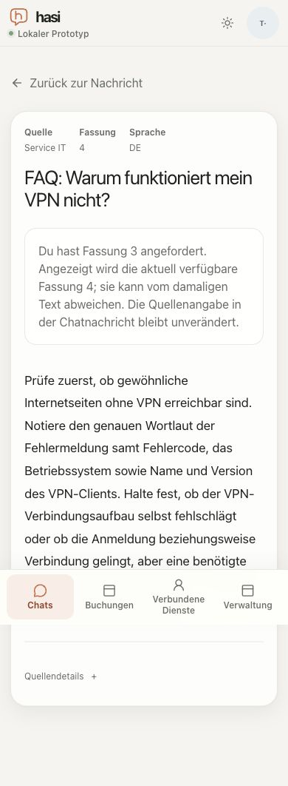

# Explicit recovery from an unavailable source revision

Date: 2026-10-21. Qualified application source: `d4bdc8c58a80eb905bb9b8e6ea9a1c152c0d2045`,
rebased onto main `d11882e7c6458f8cbb5c429eacc5be04ccb52bf5`.
Supports [M7 #54](https://github.com/metaneutrons/HASI/issues/54), still open.
The later evidence-only commit does not change the qualified application inputs.

## Behavior and boundary

An unavailable explicitly cited revision previously ended with a generic error.
The reader now offers **Aktuelle Fassung prüfen** after that error. This is an
explicit user navigation to the same document's current version, not an
automatic replacement of the cited text. The current version is fetched through
the existing authenticated document API and normal actor/source authorization.
Neither navigation metadata nor a source citation grants access.

The recovery URL accepts only a validated document identifier and positive safe
integer revision. Duplicate, ambiguous and malformed revision queries return
not-found. Return metadata accepts only the existing pair of UUID identifiers;
invalid metadata is omitted. A successful read displays the requested and
returned revisions and explains that the original chat citation is unchanged.
A denied current version retains the generic error without another recovery
link or a protected title/body. Error views expose a primary heading.

The branch also carries the populated-conversation heading correction; its
[earlier 26-observation record](populated-chat-heading.md) identifies its own
inputs. During the current qualification, source-card accessible names were
found to override visible content in a different order. The cards now derive
their names from the visible number, source, revision and title. The decorative
arrow remains hidden; destinations and authorization are unchanged.

## Exact current browser qualification

The optimized fixture used PostgreSQL, two API replicas, a synthetic TestIdP and
a separate reference process. Backend packages were built **before** launching
`pnpm journey:serve --optimized`. The launcher starts API children before its
later web build; without that prerequisite a child can retain older fixture data.
The first stale runtime (`YlRDY6`, serving revision 3 despite revision 4 on disk)
was rejected and stopped. It is not evidence for the final build. The qualified
runtime was `hasi-plugin-journey-49tezZ` and served neutral revision 4.

[45 complete observations](source-revision-recovery-result.json) record actual
geometry, headings, revision notices, recovery links and full Axe violation /
incomplete results. Forty observations cover four states at 320/375/390/768/1280px,
in both themes, with standard font 32 and measured root font 32px: unavailable
revision 3, current revision 4 after explicit recovery, and the old/current reads
of an administrator-only document as a student. All fit the viewport; none has
a confirmed Axe violation. The additional controls cover ordinary default
geometry, authorized administrator access, populated-chat source cards, the
complete recovery flow and the same-revision notice.

The original source cards on source commit `4b2134b3247471763651085b348f8392f253873f`
produced `label-content-name-mismatch` on all three cards. Diagnostic DOM edits
were excluded from final qualification. The actual rebuilt correction passes
that scan; the native accessibility tree includes number, source, revision and
title. An independent bounded static review found no remaining blocker.

The functional observations establish:

- An actual source-card link opens the authorized source. A deliberately modified
  route requesting revision 3 produces the error and explicit recovery link.
- Recovery displays revision 4 and the requested/current notice; same-revision
  recovery explicitly reports that revision 4 remains current.
- Reloading the reader and returning restores the exact unsent draft and focuses
  the originating message article. The saved chat citation still requests 4.
- The administrator can read `int-013`; the student cannot read either its old or
  current version. The denied current view has no recovery link or protected
  title/body. The student can still read the generally authorized VPN source.
- Duplicate revision parameters, mixed revision modes and an unsafe integer
  produce 404. Invalid chat/message metadata is omitted from the return link.

The old-revision probe changes a current persisted revision-4 citation route;
it does **not** demonstrate migration of a historical persisted revision-3 chat.
The first final-result collector was accidentally detached when its array binding
was reassigned and saved zero checks. That empty result was withdrawn. The matrix
was repeated into a stable record object and its saved 45 records read back.

## Validation and remaining boundaries

All 23 focused tests pass across the five actual navigation, citation, evidence,
knowledge and chat-citation test files. Required integration checks are recorded
on the PR for its exact head. Normal fixture shutdown confirmed all owned
processes stopped and the caller's test database retained. Synthetic model calls,
real provider calls and reference business writes were all zero. Browser font,
media and viewport overrides were restored; only the owned temporary tabs closed.

Axe 4.14.0 is pinned by digest in the result. Incomplete checks include ARIA
relationships and contrast and remain unresolved observations, not passes.
The in-app browser reports a Chrome/155 user agent; viewport/default-font
emulation does not establish native iPhone, Safari, keyboard, page-zoom or
assistive-technology acceptance. Whole-product M7 remains open.

One direct hard navigation immediately after editing, bypassing the normal
source-card link, lost the draft. Regular source-link navigation and reader reload
preserved it in repeated checks. This timing concern remains separate recovery
work; the present reader fix does not claim to solve it. Production deployment
and state retention require their own post-merge evidence.
