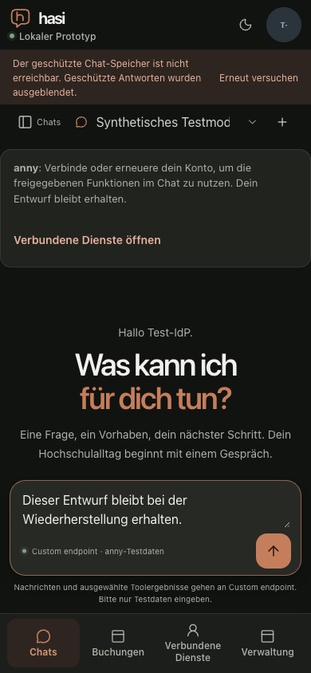

# Protected chat recovery notice inside the application viewport

## Defect and change

On a narrow mobile viewport the protected-workspace provider rendered its
recovery notice before the fixed application frame. The account menu covered
the retry control: a pointer activation opened the account rather than retrying.
The provider now exposes recovery presentation through context; the shell mounts
one notice immediately below its header. The original store, authority checks,
retry guard and refresh effects retain their single owner. Local chat mode has
no protected-storage notice; the initial load/error screen remains standalone.
The retry control has a minimum height of 44 CSS pixels.

The first corrected build exposed a second countercase: at 320 CSS pixels,
32px root text and a scripted 430px VisualViewport, the long warning displaced
the send control below the visible area (bottom 494px). The final build limits
only the warning text's height while the keyboard is open, keeps that text
scrollable and keeps the retry button alongside it. It does not hide the
warning or place the notice over the conversation.

## Measured browser evidence

The [machine-readable observations](storage-notice-layout-result.json) bind the
four changed source files to main base `4167f51057f4c2464b6ae1523b3856f7e25fd18c`.
The app was built with `--optimized`; two API replicas and disposable PostgreSQL
were used. No real model request or institutional business write occurred.

An actual workspace PUT was intercepted at the browser's request boundary and
failed with `ConnectionReset`. This induced the real persistence-error UI.
The interception was then removed before the actual pointer retry. The retry
completed, the notice disappeared, the account menu stayed closed, and a page
reload restored the exact unsent draft from server storage.

At 390×844 with the default 16px root, the final warning starts at the 63px
header boundary. The retry control is 44px high; its center hit-tests to the
button, not the account menu. There is no horizontal page overflow.

At 320×844, 32px root text and a scripted 430px visual viewport, the final
warning is 100px high. Both retry and send centers hit their intended controls.
The send control ends at 403px, inside the 430px visible area; the composer ends
at 420px. The draft is unchanged and page scroll width remains 320px. The
warning's text has its own scrollable 86px region, with the full text retained.
Removing the fixture restores normal viewport handling.

## Scope and validation

The VisualViewport fixture overrides geometry and dispatches resize events to
the real `useChatViewport` hook; an explicitly labelled overlay represents the
occluded area. It is a geometry simulation, not a native keyboard, physical
phone, participant or assistive-technology acceptance result. Those remain M8.
An attempted first-build reload retained the old page and unsaved draft. A
fresh test tab was used for the final build; no browser root cause is assigned
to that retained page.

The focused workspace-refresh/store/viewport suite passed 27 tests. The web
TypeScript and targeted lint checks passed before the final CSS-only correction;
the mandatory integration gate is recorded separately on the implementation PR.
The release-state group also receives its missing semantic `group` role; its
named-group targeted axe check had already passed in the earlier optimized
managed-reference browser run. This report does not close the full P6 matrix,
M6 human review or M7.
