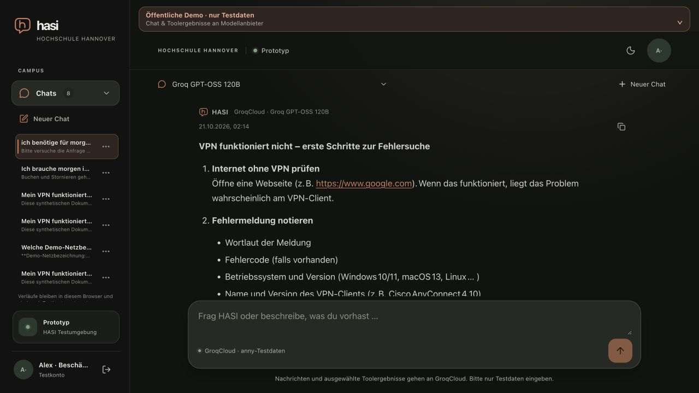

# Supplied dialogue and FAQ title follow-up

Date: 2026-10-21. Base: `b5d608d4f6a4c6def7afae66ea602ba6b0704d87`.
Related to [M6 #53](https://github.com/metaneutrons/HASI/issues/53).
This is a bounded regression observation and correction, not M6/M7 acceptance.

## Actual deployed Groq observation

The public application was exercised in a new synthetic Alex chat, with the
existing Groq GPT-OSS 120B profile selected, on the base above. No original chat
was edited or deleted. The query retained the supplied wording but used the
current relative date: tomorrow was 22 October, 10:00–12:00 Europe/Berlin.

- `1 arbeitsplatz` now narrowed the catalogue to single-workplace offices.
  Max Planck 1J.1.02 was selected, its availability checked, and the displayed
  proposal was separately confirmed through the actual browser button. The
  server-backed card showed **Buchung bestätigt**, without the original mismatch.
  This created one synthetic booking, retained as an intentional QA trace.
- The VPN turn returned three collapsed source results. Its rendered answer
  linked reference 1 to revision 2 of `svc-catalog-6c79c1e68f04`, and listed that
  actual cited reference below the answer. Opening the appended reference
  displayed the synthetic document in the authorized reader. Its return link
  returned to the original answer. The restricted replica was not opened here.
- `ich sehe keine schaltfläche` used host-owned in-chat guidance, without the
  earlier invented external portal. Since this booking was already confirmed,
  no new confirmation was offered. This was not a failed-confirmation recreation.
- The exact frustrated follow-up `was soll das denn, ich will direkt von hier
  buchen` still fell through to generation and returned generic retry guidance.
  The correction below targets that observed missed UI-help path.

The VPN answer still failed the grounding boundary. It described the synthetic
FAQ as HsH guidance and added unsupported client/version examples and operational
suggestions. The corrected source did not contain the earlier invented device
profile, but source cleanup and functioning citations do not prove reliable
answers. The complete supplied dialogue remains unaccepted in #53. No score,
cache saving, exact HTTP-attempt/token count or invoice-cost claim is made from
this browser observation. Generation used the existing server-side budget and
provider policy; no secret, tariff or limit was changed. The test account was
signed out and the owned tab closed; original tabs/theme were retained.

## Corrections

85 exact malformed synthetic FAQ labels now use complete grammatical questions
or a neutral topic title. The curation is keyed by stable document ID and checks
the expected old title/revision; it does not guess how an unknown inventory
should be rewritten. The generator calculates bodies from their existing cues,
then applies this reviewed title-only curation. Unexpected input changes for a
known curated record require review. Reapplying an already corrected record is
idempotent. Windows S stays distinct from Windows; CampusCard wording retains
both the method and location question.

77 revision-1 FAQ records advance to revision 2; eight previously corrected VPN
records advance from 2 to 3. The other 156 records are unchanged. All 241 IDs,
bodies, audience labels, tags, publication/source fields and order are preserved.
Citation revision suffixes advance with the title. This changes neither rights
nor historical links: a reader still requests its exact revision; an unavailable
old revision must remain explicitly unavailable, never silently receive new text.
The restricted HTML replica must be updated to the same fixture before delivery
is reported, retaining its current network allowlist.

The closed action-controls helper now permits the brief `was soll das denn`
prefix before an otherwise already recognized UI-help request. The existing
fresh actor-authorized status read and preview comparison still decide whether
an unchanged pending card can regain its control. The prefix alone, a new booking
request or a mixed VPN/booking request does not match. No model call or write is
introduced by this route, and completed/uncertain actions cannot become pending.

## Local verification and delivery

The exact submitted follow-up and a punctuation variant failed the old helper
and pass with the correction. Mixed-task and ordinary booking countercases stay
outside this closed help route. Focused title/VPN/help tests pass, including exact
revision/citation alignment, idempotence, unexpected-input rejection and baseline
hashes for preserved content/access fields and untouched labels.

The complete generator was rerun using the existing private metadata inputs; it
initially exposed a pre-existing mismatch: five VPN setup records regenerated as
generic troubleshooting because classification inspected the raw question instead
of its setup cue. Both generator classification sites now use the same cue as the
existing reviewed VPN content. Regeneration then reproduced all 241 records and
the preservation checks passed. No source
article bodies were imported.

Full required CI, independent review, exact-main deployment and restricted-replica
conformance are not yet claimed in this record. New title rendering has not yet
been observed in the deployed app. Physical devices, formal semantic/adversarial
qualification and the complete failed-confirmation journey remain open.

