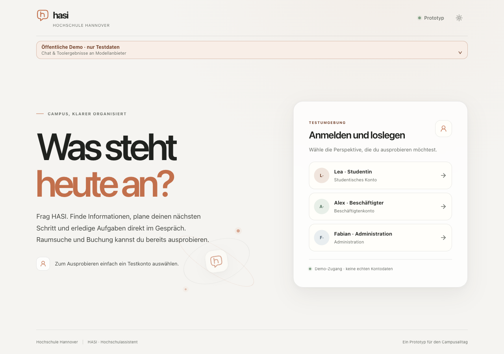
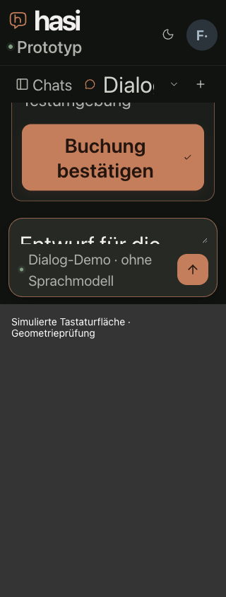

# Rendered contrast pairs and confirmation keyboard geometry

## Contrast correction

The welcome paragraph uses the stronger existing `--ink-soft` text color.
The previous `--muted` color had a conservative minimum contrast of 3.970:1
against the rendered light-theme decoration. The rectangle includes whitespace,
so this is a rejected conservative check, not a claim that a particular glyph
pixel definitively failed. The stronger color provides margin across the whole
rectangle: 6.968:1 in light mode and 9.661:1 in dark mode, above the 4.5:1 target.

The [measured results](ui-contrast-pairs-result.json) bind observations to deployed
base `f55d20ed809ef4e6015abf5ccda3774af34c71b8`. The candidate welcome rule was
temporarily overlaid in the browser and then removed. These candidate readings
are not proof that the new source rule has been deployed. All 15 retained
welcome text targets passed in both candidate themes at 1280×900.

The same measurement passed 56 actual mobile navigation text pairs: Chats,
Bookings, Connections and Administration, at 320/375/390×844, light/dark, with
the chat or administration route active; the administration route also has a
390px/32px-root sample in each theme. Minimum observed ratios are 5.058:1 in
light and 6.144:1 in dark. These readings qualify those specific navigation
pairs; they do not silently accept all earlier incomplete admin/chat targets.

## Method and countercases

Chrome 155.0.0.0, DPR 1. Axe 4.14.0 identified retained targets but could not
decide their gradient/overlap contrast. For each text-node Range rectangle,
the instrument records the actual computed opaque foreground and checks
foreground opacity, blend, filter, masks, text shadow and center hit targets.
It temporarily makes only the selected text fill transparent, captures all
underlying pixels as lossless PNG at explicit CSS-pixel scale, then restores
the original styles. Layout, text geometry and original foreground must match
after restoration. Other elements, gradients, decoration and blur remain.

The analyzer computes WCAG luminance contrast against every backing pixel;
the minimum must meet the text-size-specific threshold. Bounding rectangles
include whitespace, so rejection can be conservative. A heading child whose
rectangle included neighboring heading glyphs was measured with its parent
heading's fill masked, using the identical child rectangle and foreground.
The initial conservative rejection is not counted as a product defect.

An actual white-PNG positive/negative pair passed through the same decoder and
analyzer: black-on-white gives 21:1 and exit 0; white-on-white gives 1:1 and
exit 1. The result records the analyzer digest and each result-file digest.
This is rendered backing-pixel evidence, not a token-only color comparison or
a claim about contrast of antialiased edge pixels.

## Confirmation with simulated software keyboard

The deployed base's actual public demo was used with an explicitly selected
**Dialog-Demo** profile (`offline`), not a language model. The documented
synthetic account connection was completed. A search for a workplace in 1J,
tomorrow 10:00–16:00, was narrowed to an office with one workplace; an actual
mock booking proposal was prepared. The confirmation button was never clicked.
No model call or booking execution occurred.

The [confirmation observations](confirmation-keyboard-result.json) record an
explicit 430px VisualViewport override and labelled keyboard occlusion overlay
against the real viewport hook. The composer retained focus and its exact
unsent draft. The confirmation was scrolled into the available message region,
without activating it; its center hit-tested to the actual button.

| Viewport and text | Confirmation bounds | Send bounds | Horizontal overflow |
| --- | --- | --- | --- |
| 390×844, 16px root | y225.03–271.03, height46 | y367–411 | None |
| 320×844, 32px root | y175.55–269.55, height94 | y359–403 | None |

Both controls are inside the simulated 430px visible area. Hidden clipboard
textareas were excluded: draft and focus checks use the actual composer.
The fixture and root-text override were removed afterward. These measurements
qualify reachability through scrolling; they do not claim that every long
proposal fits without scrolling.

This is software-keyboard geometry simulation, not native iPhone keyboard,
assistive-technology or participant acceptance. Those remain M8. P4's admin
keyboard requirement concerns keyboard operation/focus; the technical basis
does not require every admin action to run beneath a simulated software
keyboard. Named admin connection-test/update/error/reconnect focus evidence,
remaining contrast targets and final P1–P6 reconciliation are still separate.
