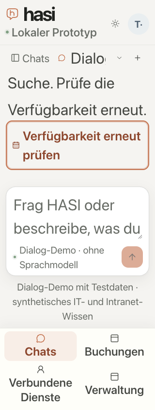

# Restored availability recheck: keyboard and narrow layout

Supporting M7 #54; M6 and M7 remain open. Application revision `66a25f0656863d9f409d20b04e4b1f5c45cd9ece`; baseline `9bec43ae67c48088f4996fab68736de8c357c1c6`.

## Observed defect and correction

After protected-history reload, the actual native `Verfügbarkeit erneut prüfen` button was reachable with Tab and matched `:focus-visible`, but its computed outline style was `none`. It is rendered outside the result group, so group-scoped focus and disabled selectors did not apply. The correction explicitly includes the standalone toggle and suppresses disabled hover styling. The baseline is a real counter-observation, not a synthetic bad input.

## Bounded optimized browser evidence

The corrected optimized Next app ran with a TestIdP, two API replicas, native mock contracts and an owned disposable PostgreSQL database. A 1J workplace search for 23 October 2026, 10:00–16:00, was saved and reloaded. Historical candidates produced one recheck button and no vacancy cards.

Twelve observations cover widths 320, 390 and 1280, root font sizes 16px and 32px, and the actual light/dark theme controls. Tab from the preceding copy control focused the recheck button in every observation. All showed a solid 2px outline with 2px offset, a target at least 44px high and no horizontal document overflow. At 320px with 32px root text, the button wrapped within the viewport (288×94px). These font overrides are layout stress conditions, not native Dynamic Type.

axe-core 4.14.0 used the verified official bundle SHA-256 `20c09fe157a8a34a30e241aaa1fcdade657734f08ab379ecfbeb7d45cc46e878`, with `wcag2a`, `wcag2aa`, `wcag21aa` and `best-practice` tags. No violations were detected in these twelve states. Existing closed-popup `aria-controls` and desktop gradient/contrast checks remain incomplete scanner items, preserved in the result; they are not counted as passes or newly adjudicated here.

Keyboard Enter started the native recheck. With browser network latency temporarily set to 1200ms, the actual button was disabled, with `not-allowed` cursor and opacity 0.58, while no cards were shown. After removing the delay, the first completed observation showed four exact 10:00–16:00 vacancy cards and four additional results behind pagination, without unchecked text. A later protected-history refresh cleared those slots again; the separate later observation is retained rather than presented as an enduring availability lease. No duplicate-invocation network count was captured.

The screenshot uses the actual CSS visual viewport clip and was inspected; it is accepted as this browser's narrow-layout image. It is not an iPhone/native-device or assistive-technology acceptance result. Both test accounts were signed out, owned tabs closed, and both fixtures stopped with their own database/private home removed and generated Next declarations restored. There were zero model calls, real business writes or confirmed mock bookings.

[Machine observations](availability-recheck-focus-result.json).

