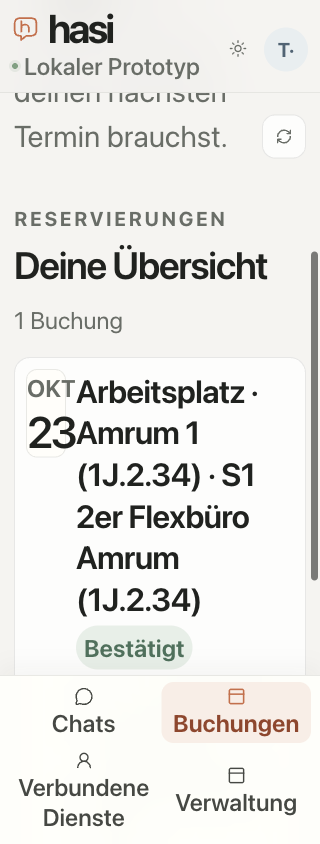

# Populated chat and bookings accessibility

Date: 2026-10-22. Supporting [M7 #54](https://github.com/metaneutrons/HASI/issues/54), still open. The [machine result](joined-ui-result.json) preserves source and compiled-asset identities, individual observation digests, geometry, scanner review counts and the original counter-observations.

## Observed defects and correction

The original optimized `a9bc2d389135b63e5012b1413fcb6cebc2c51951` app produced axe `heading-order` and `landmark-unique` violations in a populated conversation: room-card `h3` headings lacked a preceding result heading, and repeated search sections created indistinguishable region landmarks. Result sets now use a labelled group and a visually hidden `h2`. Existing visible cards and actions are unchanged.

The first corrected build, `20458cd96fcb6a6a499fee25b9b0be03aedfa905`, exposed two further issues. Four live time-slot containers had names on generic `div` elements, reported as `aria-prohibited-attr` review items; they now have `role="group"`. With 320px width and 32px root text, the bookings toolbar's count extended document width to 351px. A rule scoped to `.bookings-toolbar` now permits wrapping. The final observed count starts below the heading, inside the 320px document.

These are actual earlier application observations, not invented counter values. The same scanner and document-width measurement distinguish them from the corrected app. Independent read-only review found no actionable semantic or selector regression; it was not browser acceptance.

## Frozen final build and scope

The optimized local build at `af974beb60050f7338fc430df7398760f69aa1c9` had BUILD_ID `xOOXBfOXFoXEVj9L4mtmB`. All 135 tracked web-source files matched that revision before testing; all 25 compiled static assets are hashed in the result. Subsequent report-only changes do not alter those application inputs.

The actual application ran with TestIdP, two API replicas, native synthetic Anny and knowledge contracts, and an owned disposable PostgreSQL database. This was not the managed Docker installation path. No model provider was called. A separate explicit confirmation created one booking in this final fixture; an earlier diagnostic fixture also created one. These were contract-mock writes only, with no production data, account, budget or business effects.

axe-core 4.14.0 used the previously verified official bundle SHA-256 `20c09fe157a8a34a30e241aaa1fcdade657734f08ab379ecfbeb7d45cc46e878`. Checks used `wcag2a`, `wcag2aa`, `wcag21aa` and `best-practice` tags. Each family below covers 320×844, 375×844, 390×844, 768×1024 and 1280×720; actual light/dark controls; and 16px/32px root-font settings:

| Actual rendered state | Observations |
| --- | ---: |
| Chat with two retained result groups and a proposal | 20 |
| Chat after a further native availability search | 20 |
| Authorized VPN source, revision 4 | 20 |
| Bookings overview with a confirmed mock booking | 20 |
| Loaded administration with Anny settings expanded | 20 |

All 100 observations detected zero axe violations and zero horizontal document overflow. Only two observations retained the four freshly checked slot groups; subsequent observations had no slots after the existing background authorization refresh. The result records that distinction. Both live observations name all four slot groups correctly without the earlier generic-label review item. No availability lease or refresh policy was changed for the test.

The source reader returned focus to the exact originating answer and retained the literal unsent draft `Ungesendeter Entwurf: **Markdown** bleibt erhalten.` The measurement selects the editable composer specifically: hidden read-only Markdown-source textareas are not the composer. An earlier broad textarea query was rejected as a measurement mistake, not a draft-loss defect.

## Limitations and remaining work

Zero detected violations is not accessibility acceptance. Closed-popup `aria-controls` and gradient-related contrast observations remain incomplete review items, with counts retained per scan. This check does not assess native assistive technology, an iPhone keyboard, native text-only zoom or Dynamic Type; 32px root text is a CSS stress condition. It does not establish all overlay, safe-area, network, model-switch or dialogue cases.

A rapid new-chat → preference → slot sequence interrupted in the final fixture: earlier replies became unavailable and the slot-selection event initially lacked a timestamp. An explicit search retry followed by separately observed selection and confirmation succeeded. That recovery does not qualify the rapid path. The original diagnostic is retained for investigation under M6/M7. A separate observed Dialog-Demo parser defect turned “Ein geteiltes Büro ist okay” into a residual room-name query `ist okay`; that remains separate work. Neither defect is hidden by this layout result.

The final fixture recorded zero synthetic-model and zero real-provider calls. Normal shutdown stopped its owned processes and removed its PostgreSQL data and private HOME. The generated Next declaration was restored, the test account signed out and the owned tab closed. One earlier supervisor needed its normal interrupt shutdown because stdin was closed; its owned resources were also removed. Initial dependency-metadata preparation and port preflight failures are not passing runs. Blank screenshots with a document clip outside the scrolled viewport were excluded; the image below uses the actual scroll offset.

M6 human grading, critical independent review/adjudication and threshold approval remain pending. M7 remains open. Groq cache proof remains M8-A10.

