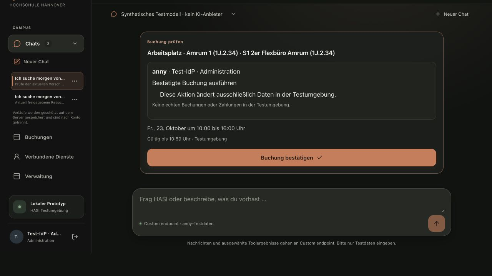

# Native chat history and overlapping protected saves

Date: 2026-10-22. Supporting M6/#53 and M7/#54; neither milestone is accepted by this report. [Machine result](native-chat-save-result.json), [sanitized three-stage browser evidence](native-chat-save-artifacts.zip).

## Reproduced defects

The actual optimized app at `3837d1e93425a63fb133fd85992296a230a22abb` reproduces the interruption through its own preference-search branch. A direct native search fabricated unsigned assistant/tool messages in model history. The protected workspace response correctly removes those messages, while retaining the native room card and the same host-receipt authority/resource metadata. Holding that response, selecting Amrum 1 and holding its timestamp response, then releasing the older save causes redaction/remount and leaves the new user message without its timestamp. This controlled reproduction establishes a real cause in this path; it does not prove the ordering of the earlier uncontrolled observation.

The first correction, `d8c67f60f94fa91dc3f4b59a6e2973676674706f`, eliminates that unsigned history difference. The first held response now preserves the newer selection. A later held response, followed immediately by the next preparation request, nevertheless exhausts the three immediate requalification attempts and triggers the same interruption despite unchanged baseline authority. This intermediate build is explicitly not a successful full-flow qualification.

## Correction

Host-initiated native actions now retain the user's intent/generated selection and separately revalidated native cards without fabricating model exchanges. Actual signed model replies and tool-call IDs remain. Native and other non-context-backed tool results use the existing server omission payload from their creation; a shared serializer keeps the producer and protected-history projection identical. Verified knowledge and context-backed plugin results retain their existing evidence paths. An unsigned technical-error history row is also removed; visible error handling remains.

Each serial save still makes at most three immediate requalification attempts. When every submitted protected baseline remains compatible but newer edits overlap all three responses, the operation yields to the existing 180 ms debounce. Persistence stays pending and the unload guard stays active until an acknowledgement covers the latest state. An incompatible or revoked baseline still redacts immediately. Signatures, source/grant checks, availability leases, confirmation requirements and the server projection are unchanged. No stale acknowledgement is claimed to authorize a newer result.

## Corrected actual browser observation

At `a881fe4f9ad263c1da596281f9e891f6b480890c`, the same actual Next/TestIdP/two-API/native Anny stack with an owned disposable PostgreSQL database completes the controlled fast sequence:

1. Ask for tomorrow's workplace in 1J, 10:00–16:00, using Dialog-Demo; select the synthetic profile before answering the office-preference question.
2. Submit `Ein geteiltes Büro ist okay.` and hold its real workspace PUT response.
3. Select the first Amrum 1 card, hold the real timestamp response, then release the older workspace response. The generated user selection remains.
4. Keep the next workspace response held while releasing the timestamp and obtaining availability. Release that workspace response and immediately request the displayed time's proposal.
5. Let the latest workspace settle and reload the page. One pending proposal remains for resource `180116`, 23 October 2026, 08:00–14:00Z (10:00–16:00 Berlin). All visible/model-history messages have timestamps; no mismatch, interruption or unknown timestamp appears. The separate confirmation button remains unpressed.

The captured interval contains eight workspace PUTs, four resource reads, two availability POSTs and one proposal POST. There are zero `/api/chat` or confirmation requests; fixture statistics independently report zero synthetic/real model calls and zero reference effects. The records describe frontend/native requests, not every internal source RPC. This is one controlled fast sequence, not a throughput claim.

An earlier attempt on the corrected build waited until the ordinary availability lease expired before the next interaction. Its unavailable-time state is retained as a rejected fast-flow observation, not counted as a pass. A fresh second chat repeats the sequence without that delay. Interception only delays local synthetic responses; patterns are cleared before completion. No browser content or application state is injected. Each build's recorded identity includes its source revision and compiled assets; all 136 tracked corrected web sources matched before observation. The two corrected builds each contain 25 static assets.

## Tests, controls and limits

Six focused history/workspace suites pass 68 tests, including signed legacy-call round trips, raw result substitution, forged/changed-authority rejection, preservation of a later generated user turn, and immediate revocation handling. A three-overlap regression checks the finite first batch, pending persistence/unload guard and eventual fourth save after quiescence. Its counter removes native access between batches and checks the real server projection removes the room and remounts. The old implementation fails the selected positive regression with `unsaved` instead of `saving`; an earlier incorrectly matched test selector ran no selected test and is not evidence. These are real store/server projections with a process-local test store, not another full browser rights-revocation qualification.

Independent source review found no actionable regression in the producer or debounce correction. Web types/lint and the normal commit guards pass. All three owned fixtures stopped normally, removed their disposable PostgreSQL/private HOME trees and restored generated Next declarations; owned browser accounts were signed out and tabs closed. No real credentials/provider/business service, production state or shared budget was used.

This resolves the observed native room-selection/save paths. It does not establish every booking-list presentation race, actual provider interpretation, all mobile/native-device journeys, complete M6 semantic/security approval or final M7 acceptance. Existing bounded controls remain separate evidence. M8 institutional identity/rights and the specified deferred review/cache/device/continuity/API targets remain unchanged.

