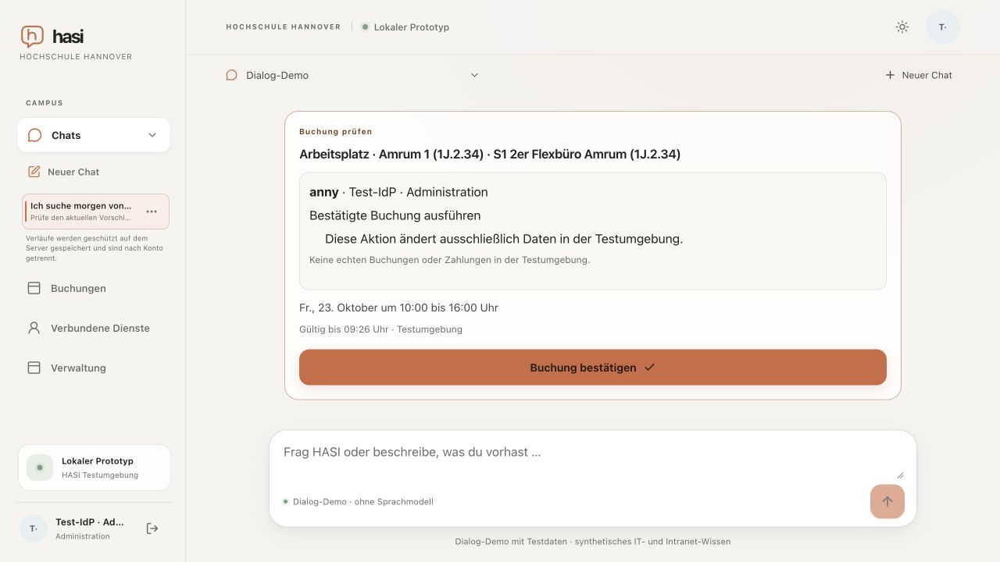

# Office preference acceptance in room searches

Date: 2026-10-22. Supporting M6/M7, not milestone acceptance. [Machine result](office-preference-query-result.json).

The actual optimized earlier application turned “Ein geteiltes Büro ist okay” into residual name query `ist okay`, yielding no matches. The [earlier populated UI report](joined-ui.md#limitations-and-remaining-work) preserves that finding. The parser now removes bounded positive office-preference acceptance phrases from the name query, outside quoted spans. A complete standalone preference also retains the earlier building, date, duration and named-resource query. Negated phrases remain outside the deterministic shortcut; quoted names retain their words. Compound requests with new times, VPN questions, immediate booking or an instruction prefix still require ordinary interpretation.

At code revision `fe0cdce7109f0ea5e32623eb12db90cfbe07a2aa`, the actual optimized Next application ran with TestIdP, two API replicas, native mock Anny and an owned disposable PostgreSQL database. All135 web source files matched that commit before observation; the result records relevant source hashes, BUILD_ID and all25 compiled static asset hashes. This is not a managed-container installation or actual provider interpretation.

The complete reported sentence, requesting a workplace in1J tomorrow10:00–16:00 and accepting a shared office, showed Amrum/Föhr workplaces and a pending proposal for Amrum1 on23October2026,10:00–16:00. Protected persistence settled before the final observation. Its complete measured network interval records eight availability POSTs and one proposal POST, zero confirmation and model calls. A separate new chat naming the quoted “Flex-Büro Grace Hopper” showed its one workplace and no Amrum result. No confirmation or real business write occurred.

The two focused regression files pass54 tests, including14 matching shared workplaces in the imported HsH test catalog, quoted target190449, previous-name retention and refusal/compound countercases. Web types and affected source lint pass. An independent bounded review found a negation regression in the first private draft; the final guarded cleanup and test correct it. Existing quoted office-type interpretation and broader English-language negation are not qualified by this correction.

The separate earlier intermittent rapid booking interruption remains open: four subsequent optimized observations reached visible proposals, but do not establish absence of a timing defect. The earlier diagnostic includes a fail-closed projection mismatch. No authorization, availability lifetime or confirmation boundary was weakened. Other M6/M7 criteria and M8 institutional/device qualification remain separate.

Fixture statistics record zero fake-model and zero real-provider calls. Normal shutdown stopped owned processes and removed PostgreSQL/private HOME; the generated Next declaration was restored, account signed out and owned tab closed. An initial AX diff was insufficient to assert the date/proposal; the full final tree and visible confirmation control establish those observations.

