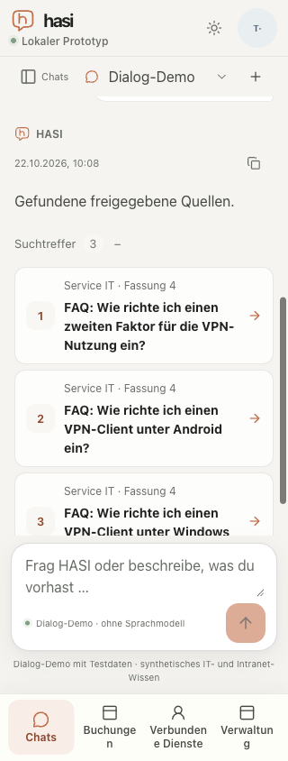

# Normal-text contrast and closed-popup follow-up

Date:2026-10-22. Supporting M6/#53 and M7/#54, both still open. [Machine result](text-contrast-result.json), [paired-image measurement artifact](text-contrast-artifacts.zip). This follows the gradient/popup review items in [the populated UI report](joined-ui.md).

## Observed defects and correction

The actual optimized app at `19c8b612fbfad4d34456749e2b107fe787f422a2` displayed normal-size accent text below4.5:1 in light mode. The empty-bookings kicker measured3.445:1, a Markdown link3.598:1 at both1280×720 and320×844, and a source-card number3.356:1 at320×844. Conservative upper bounds remained below4.5 in each observation. These are three defects/four failing observations, not four separate UI defects.

Four existing normal-text selectors now use the theme's `--accent-deep`: Markdown anchors, source-card numbers, the empty-bookings kicker and the composer's input notice. The input notice shared the same normal-text accent rule; its corrected rendered state is also measured. Large decorative headings, logo/icons, button backgrounds and layout remain unchanged. No permissions, data, provider, action-confirmation or availability policy changes.

The corrected optimized app at `98e3cc2136495a99b4245dc9315eb117cdd4aa06` produced20 passing target observations: the four changed text families at320×844 and1280×720 in both light/dark, plus source-title/revision controls at320px in both themes. Every accepted corrected target has a conservative lower bound above4.5; the lowest is5.942. One earlier corrected empty-bookings capture intersected an entry animation with ancestor opacity and was **unsupported**, not passed. Its stable retry is retained separately. The matrix does not render every inline-citation variant; those inherit the same Markdown anchor rule.

## Method and controls

Both actual optimized builds used TestIdP, two API replicas, the native synthetic contracts and separate owned disposable PostgreSQL databases. All135 tracked web-source files matched their recorded revision; BUILD_ID and25 compiled-asset hashes per build are preserved. The browser stayed at DPR1. This is browser width emulation, not an iPhone/native AT qualification.

The analyzer compares a normal viewport PNG with a paired crop captured after temporarily hiding only the selected text foreground. The target's background, box and layout remain. CSS foreground RGBA is composed over the actual captured background; WCAG sRGB luminance uses that foreground rather than antialias pixel darkness. Text-range rectangles and a minimum8-channel difference select rendered glyph pixels. Background quantization is conservatively bounded by one channel step. Normal text requires4.5; large text requires3. Unsupported opacity/filter/blend/text effects and missing glyph matches do not pass. Root reviewed the sampled DOM/source for flat text and foreground composition; the session-row's narrow left marker is outside its sampled text. This is bounded sampled contrast, not a general occlusion/overlay verifier.

Actual browser controls distinguish black-on-white (pass21:1), gray-on-white (fail3.545:1) and half-alpha black (fail3.977:1). Eight analyzer tests also pass, including missing glyphs, unsupported features and dimension rejection. The archive includes the PNGs/manifests and internal verification helper/tests for independent readback; it is not application runtime code or a new CI gate. A measurement command's successful exit means it ran, not that every item passed.

There are66 passing non-calibration target observations overall, four original failures and the one explicitly unsupported corrected capture. This is not a new all100-state layout or accessibility acceptance claim. Earlier passing snapshots remain bounded evidence for unchanged selectors; the16 applicable changed-family combinations are directly rechecked.

## Popup review

Closed session-action and message-copy controls reference uniquely present `role=menu` targets with `popover=auto`; targets remain in the DOM when closed. Removing `aria-controls` would discard valid relationships. Actual opening moved focus to the first menu item; Escape closed it and returned focus to the originating trigger in the observed desktop flows. At320px, the session menu occupiedx82–290/y206–313; the copy menux64–304/y378.734–535.734, both inside the viewport. Escape from the session menu retained its containing chat-list dialog; a second Escape closed the dialog and returned focus to the Chats trigger.

An initial copy-menu capture was rejected after a normal protected-history/availability refresh remounted that menu; the stable reopening is the accepted capture. That interruption is retained as a limit, not misreported as a successful open menu. These observations resolve the named closed-target ambiguity for the sampled controls, not every keyboard/overlay or authority-transition case.

## Cleanup and remaining scope

Both test accounts were signed out and owned tabs48/49 closed. Both owned database/private-HOME trees were removed and generated Next declarations restored. The corrected launcher required its normal interrupt shutdown because stdin was closed; its terminal exit was0 and all owned app/API listeners were closed. No real model/provider or business system was used. The baseline fixture's model statistics were zero; the corrected browser selected Dialog-Demo within a credential-free synthetic fixture.

The separately observed rapid protected-workspace mismatch remains open. Real-device/AT/participant acceptance remains M8-A7. Other non-deferred M6 semantic/security cases and M7 journeys remain required; this report grants no model-quality or milestone acceptance.

